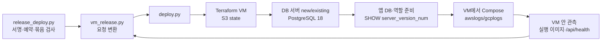

# 운영 배포기 (동규님 방식 이식)

Jenkins `delta-release` 작업이 사람 승인(Ed25519 서명)·nonce 예약을 끝낸 뒤 이 배포기를 실행한다. 동규님 `platform/deploy/workloads`의 운영 배포 방식을 그대로 가져왔고, Codex `compose_host.py`(기존 VM을 EIC/IAP로 갱신)는 삭제했다.



## 파일

| 파일 | 역할 |
|---|---|
| `deploy.py` | 진입점. `DELTA_DEPLOYMENT`(base64 JSON)·`DELTA_RUN_ID`·`DELTA_DEPLOY_CONFIG`를 받아 `result.json`을 쓴다 |
| `vm_runtime.py` | 새 VM에서 root로 실행. 이미지 pull·Compose 기동·헬스·관측 JSON 출력 |
| `database.py`, `database_server.py` | 앱 DB·역할 준비(PG18 관측), 환경 전용 DB 서버 Terraform |
| `aws_vm.py`, `gcp_vm.py` | AWS 위임 세션·SSM 명령·SSM 포트 포워딩 / GCP IAP SSH·포워딩 |
| `state_backend.py` | 작업 디렉터리와 S3 원격 state 연결 |
| `targets.py`, `registry_copy.py` | `delta_platform` 패키지 대신 둔 최소 카탈로그·레지스트리 복사 |
| `remove.py` | 환경 VM 정리(같은 state 키). `{"operation":"remove"}` 요청으로만 실행. Jenkins 작업에는 아직 연결하지 않았다 |
| `terraform/vm-aws`, `vm-gcp`, `db-aws`, `db-gcp` | 이식한 모듈 + `backend "s3" {}` + 고정 잠금 파일 |

## 동작

- 대상 하나에 환경 하나. `environment_id`는 인벤토리 값이 있으면 그 값을 쓰고, 없으면 `target_id`에서 고정 파생한다. 같은 대상 재배포는 같은 VM·DB를 재사용한다(plan은 `create`/`no-op`만 허용). 새 VM이 필요하면 인벤토리 `environment_id`를 바꿔 새로 승인받는다.
- 이미지: 묶음 `registry_images[cloud]`(GCP는 AR, AWS는 ECR)를 그대로 쓴다. 이미 대상 레지스트리에 있으므로 복사하지 않는다. GCP 대상에 ECR만 있을 때만 같은 digest로 AR에 복사한다.
- DB: `server_mode=create`는 환경 전용 RDS(`engine_version=18`) 또는 Cloud SQL(`POSTGRES_18`)을 만들고, `prepared`는 등록된 서버를 쓴다. `mode=new`는 전용 DB·역할을 만들고, `existing`은 등록된 앱 자격 증명을 확인한다. 앱 역할 연결에서 `SHOW server_version_num`을 읽어 18이 아니면 VM 실행 전에 실패한다.
- DB 접속 경로: GCP는 새 VM을 거친 IAP 포워딩, AWS는 새 VM을 거친 SSM 포트 포워딩. 컨트롤러 VPC에서 대상 DB로 직접 경로가 필요 없다.
- 앱 DB 자격 증명 기록: AWS는 대상 계정 Secrets Manager `delta-platform/customer-db/<environment_id>`, GCP는 대상 프로젝트 Secret Manager `delta-platform-customer-db-<hex>`. VM에는 비밀 참조만 보낸다.
- Compose: `cap_drop: ALL`, `pids_limit: 128`, `no-new-privileges`, `pull_policy: never`, FE `8088→3000`, BE `127.0.0.1:8089→8080`. 로그는 AWS `awslogs`(그룹 `/delta/workload/<environment_id>`, `awslogs-create-group=true`, `mode=non-blocking`), GCP `gcplogs`(`gcp-project`, `mode=non-blocking`). 런타임 환경 `APP_ENV=production`, `APP_VERSION`, `CLOUD_PROVIDER`, `IMAGE_DIGEST`, `PORT`.
- 관측: VM 안에서 `docker compose ps`→`container inspect`(`Config.Image`, `.Image`)→`image inspect`(`Id`, `RepoDigests`)로 두 서비스가 요청한 digest로 실행 중인지 확인하고, `/api/health`의 `status/storage/version/environment/cloudProvider/databaseVersionNum`을 요청·DB 관측값과 대조한다.
- 실패: `result.json`에 `{"state":"failed","stage":...,"code":...}`만 남긴다. 명령 출력·공급자 응답·비밀은 버린다. 코드는 도구·하위 명령 이름(`terraform_apply_failed`) 또는 고정 원인(`plan_not_create_only`, `postgres_version`, `image_mismatch`, `health_mismatch`, `ssm_unavailable`, `iap_tunnel_failed` 등)이다.

## 결과 계약 (`delta-release` result.json)

성공: `state="verified"`, `target_id`, `environment="production"`, `commit`, `schema=2`, `platform`, `images{frontend,backend}`, `image_digests`, `bundle_sha256`, `image_ref`, `image_digest`, `database_version_num`(int, 18xxxx), `deployment_id`, `config_sha256`, 참고용 `environment_id`·`instance`·`service_url`(사설). 이미지·digest·해시는 **VM이 관측한 실행 이미지**로 다시 계산한다(`bundle_from_images`). 실패: `state`(`rejected`/`failed`/`unknown`), `stage`, `code`, `error`.

## 인벤토리 (`/run/delta/release-targets.json`)

`target_id`를 키로 하는 dict. 항목 전체의 canonical SHA256이 승인 `config_sha256`이다. 파이프라인 `release_config`와 **바이트 단위로 같아야** 한다. 예: `targets.example.json`.

| 키 | 값 |
|---|---|
| `target_id` | 키와 같은 식별자 |
| `environment` | `production` |
| `cloud` | `gcp` 또는 `aws` (온프렘 경로는 배포기에 이식돼 있으나 컨트롤러에 kubectl·kubeconfig가 없어 거부한다) |
| `region`, `profile_id` | GCP `asia-northeast3`·`e2-small`, AWS `ap-northeast-2`·`t3.small` |
| `database` | `{"profile_id": <config.databases 키>, "mode": "new"\|"existing"}` |
| `environment_id` | 선택. 소문자 UUID |

## 배포 설정 (`/run/delta/release-config.json`)

`DELTA_RELEASE_CONFIG` → `DELTA_DEPLOY_CONFIG` → 기본 경로 순으로 찾는다. 비밀 값은 넣지 않는다(DB 관리자 비밀은 비밀 저장소 참조만). 예: `config.example.json`.

| 키 | 역할 |
|---|---|
| `state_bucket`, `state_region` | 플랫폼 계정 S3 state 버킷·리전. 키 `delta-cp/release/<environment_id>/{vm,database}.tfstate`, `use_lockfile=true`, `encrypt=true` |
| `work_root` | 모듈 사본·plan·provider 캐시·GCP DB 관리자 비밀번호 파일(0600, write-only 최초 적용용). 기본 `/var/jenkins_home/delta-release/work` |
| `allowed_image_prefixes` | 허용 이미지 저장소 `repo@` 목록 |
| `connections.aws` | `identity{revision,account_id}`, `region`, `assume_role_arn`(대상 `delta-prod-deploy`), `external_id`, `management_transport="ssm"`, `terraform{account_id,ami_id,subnet_id,security_group_ids,instance_profile}` |
| `connections.gcp` | `identity{revision,gcp_project}`, `credentials_file`(WIF, 기본 `GOOGLE_APPLICATION_CREDENTIALS` 또는 `/run/delta/gcp-release-credentials.json`), `management_transport="iap"`, `ssh_service_account`, `artifact_repository`(ECR→AR 복사 때만), `terraform{project_id,zone,subnetwork,service_account,image,network_tag,preinstalled_runtime}` |
| `databases.<id>` | `revision`, `modes`, `clouds`, `server_mode`(`create`/`prepared`), `ca_pem`, `terraform{...}`(create), `secret_provider`·`admin_secret_id`·`app_secret_id`·`iap_endpoint`·`connection`(prepared) |

## 인프라 전제

**컨트롤러(플랫폼 계정 `delta-cp-jenkins` 역할)**: `sts:AssumeRole`(대상 `delta-prod-deploy`, ExternalId), state 버킷 `s3:ListBucket`(prefix `delta-cp/release/`)·`s3:GetObject/PutObject/DeleteObject`(`delta-cp/release/*`, 잠금 파일 포함), 버킷 CMK가 있으면 해당 `kms:Encrypt/Decrypt/GenerateDataKey`. GCP는 WIF 풀 `delta-platform`에서 `prod-deploy` SA 가장.

**AWS `delta-prod-deploy`(대상 계정)**: `ec2:RunInstances/CreateTags/Describe*`(Instances·Images·InstanceTypes·Volumes·NetworkInterfaces·Tags·InstanceAttribute·InstanceCreditSpecifications), `ec2:TerminateInstances`(태그 `ManagedBy=delta-platform` 조건, 정리용), `iam:PassRole`(앱 VM 역할, `ec2.amazonaws.com`), `ssm:DescribeInstanceInformation/SendCommand(AWS-RunShellScript)/GetCommandInvocation/StartSession(AWS-StartPortForwardingSessionToRemoteHost)/TerminateSession`, `rds:CreateDBInstance/CreateDBSubnetGroup/CreateDBParameterGroup/ModifyDBParameterGroup/Describe*/AddTagsToResource/ListTagsForResource`, `iam:CreateServiceLinkedRole`(RDS 최초 1회), `secretsmanager:CreateSecret/DescribeSecret/GetSecretValue/TagResource`(`delta-platform/customer-db/*`, RDS 관리 비밀 `rds!db-*` 읽기·생성). 현재 onboarding의 `prod` 정책은 EIC 권한뿐이라 교체가 필요하다.

**AWS 앱 VM 인스턴스 프로파일**: `AmazonSSMManagedInstanceCore`, 묶음 ECR 저장소 pull(`ecr:GetAuthorizationToken`, `BatchGetImage`, `GetDownloadUrlForLayer`; 교차 계정이면 저장소 정책도), `secretsmanager:GetSecretValue`(`delta-platform/customer-db/*`), `logs:CreateLogGroup/CreateLogStream/PutLogEvents`(`/delta/workload/*`).

**GCP `prod-deploy` SA(대상 프로젝트)**: `roles/compute.instanceAdmin.v1`, 앱 VM SA에 `roles/iam.serviceAccountUser`, `roles/compute.osAdminLogin`, `roles/iap.tunnelResourceAccessor`, `roles/cloudsql.admin`, 주소·전달 규칙(`compute.addresses.*`, `compute.forwardingRules.*`; 예: `roles/compute.networkAdmin`), `roles/dns.admin`, `roles/secretmanager.admin`(비밀 생성·IAM·버전). API: compute, sqladmin, dns, secretmanager, iap, oslogin.

**GCP 앱 VM SA**: 빌드 AR 저장소 `roles/artifactregistry.reader`(빌드 프로젝트가 다르면 교차 프로젝트 부여), `roles/logging.logWriter`. DB 비밀 접근은 배포기가 비밀별로 부여한다.

**네트워크·이미지**: AWS 사설 subnet(`subnet_id`), 앱 VM SG(인바운드 불필요, 아웃바운드 443·DB 5432), DB SG(앱 VM SG에서 5432), DB subnet 2개 이상(AZ 분리), AL2023 x86_64 고정 AMI(SSM Agent·AWS CLI 포함), NAT 또는 VPC Endpoint(SSM·ECR·S3·Logs·Secrets Manager) + GitHub(Compose 플러그인 다운로드; `preinstalled_runtime` 이미지면 불필요). GCP 서울 subnet·zone, Debian 12 x86_64 고정 이미지, 네트워크 태그에 IAP 범위 `35.235.240.0/20` tcp:22 허용, Cloud NAT·Private Google Access, 같은 VPC의 PSC(Cloud SQL), `ca_pem`(RDS 글로벌 번들·Cloud SQL CAS 루트).

**컨트롤러 이미지**: `deploy/platform/jenkins/controller/Dockerfile`이 Terraform 1.16.4, gcloud, session-manager-plugin, `/opt/delta/venv`(이 디렉터리 `requirements.txt`)와 `/opt/delta/release`를 넣는다. 이 디렉터리는 jenkins 빌드 컨텍스트 밖이라 이미지 빌드에 `--build-context release=deploy/platform/release`가 필요하다.

## 시험

```sh
(cd deploy/platform/jenkins && uv run --quiet --with pytest --with pyyaml --with cryptography --with boto3 --with google-auth --with "psycopg[binary]" python -m pytest -q tests ../release/tests -p no:cacheprovider)
```

Terraform은 `terraform fmt -check -recursive terraform`, 각 모듈 `init -backend=false` 후 `validate`, `vm-*`는 `terraform test`(mock provider)로 확인한다. 실제 plan/apply·클라우드 실행은 이 시험 범위가 아니다.

## 플랫폼 설정 관리(11/6)

- 인프라(배포 계정·권한·앱 VM 방화벽·인터넷 경로·NAT)는 Terraform `terraform/release-runtime-gcp`와 `terraform/onboarding-gcp`가 관리한다.
- 운영 대상 인벤토리 `targets.json`과 배포 설정 `config.json`(비밀값 없음, 공개 CA 포함)은 이 저장소 파일이 원본이다. `deploy/platform/deploy.sh`가 SSM(`/delta-cp/jenkins/release_targets`, `release_config`)으로 올린다. 손으로 SSM 값을 바꾸지 않는다.
- GCP 배포 계정 WIF 설정은 onboarding-gcp 출력(`release-deployer`)에서, 운영 승인 서명 키는 없을 때만 deploy.sh 가 만든다(개인키는 state·출력에 남기지 않는다).
