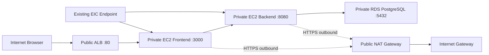

# Sample App의 EC2와 RDS PostgreSQL 배포

기준일: 2026-11-05 (Asia/Seoul).

## 승인과 진행 상태

- 사용자 요청: `terraform/workload/`에서 `2026-sbh-delta/delta-sample-app`을 Frontend EC2, Backend EC2, RDS PostgreSQL로 배포한다.
- 접속 범위: 사용자가 `인터넷에서 접속하도록 공개`를 선택했다.
- Ideation: 공개 ALB, 사설 FE/BE EC2 각 1대, 사설 RDS 1개와 앱의 PostgreSQL 연동을 제안했고 사용자 `ㄱㄱ`으로 승인받았다.
- Inception 및 U1~U4 Design/Implementation Plan: 2026-11-05 사용자 `승인`으로 구현과 테스트를 승인받았다.
- 추가 지시: 인스턴스는 x86 아키텍처를 사용한다. EC2는 `t3.small`/AL2023 x86_64, RDS는 `db.t3.micro`로 변경한다. PostgreSQL 18.3/gp3 20 GiB의 해당 RDS 조합 제공을 API로 확인했다.
- 완료: U1~U3 구현/Test/Review와 U4 실제 Apply, DB 초기화, FE/BE 개별 배포, 외부 HTTP/메모 보존, 실제 DB TLS/IAM/로그 및 최종 Plan 검증을 수행했다. 실제 배포 산출물은 e29af544를 기준으로 한 source_dirty=true 스냅샷이다.
- 실제 Terraform Apply: 종료0, 59개 추가/기존 변경과 삭제0. 최종 Plan은 No changes/종료0이다. 새 FE/BE와 RDS의 실제 동작을 검증했다. Git 게시 및 원격 CI 상태는 Git 이력을 따른다.

## 실제 배포 결과

공개 주소: [Delta Notes](http://delta-lab-notes-alb-1242820262.ap-northeast-2.elb.amazonaws.com). 현재 데모용 HTTP이며 커스텀 도메인/HTTPS는 구성하지 않았다.

| 대상 | 실제 배치 |
| --- | --- |
| Frontend EC2 | `i-0637ad326681c7480`, `10.10.1.211`, x86_64 `t3.small`, 공인 IP 없음 |
| Backend EC2 | `i-05bc064b10ac062a0`, `10.10.1.232`, x86_64 `t3.small`, 공인 IP 없음 |
| RDS | `delta-lab-notes`, PostgreSQL `18.3`, x86 계열 `db.t3.micro`, 암호화 gp3 20 GiB, 사설/Single-AZ |
| DB 연결 | 앱 계정 `delta_notes_app`, 실제 TLS 1.3, 평문 연결 거부 SQLSTATE28000 |
| 공개 진입점 | 두 AZ의 ALB, FE target healthy, HTTP80만 공개 ingress |
| 인터넷 송신 | 단일 NAT, 선택 AZ의 기존 workload RT에만 기본 경로 추가 |
| 기존 기반 | VPC/네 서브넷/TGW/EIC ID 유지, GCP 목적지 TGW route 두 개 active |
| 상태/로그 | 외부 FE 경유 CRUD와 BE 재시작 후 메모 보존, FE9건/BE7건 동일 검증 request ID 로그 수신 |

검증 메모는 직접 만든 한 건만 삭제했다. DB에는 운영자 소유 스키마와 앱 최소 DML 권한을 사용한다. FE는 앱 secret, BE는 RDS 마스터 secret 접근이 실제 IAM에서 거부되는 것을 확인했다.

## Ideation

- 문제 정의: 현재 workload root는 네트워크만 관리하고, 샘플 앱의 메모는 BE 프로세스 종료 시 사라진다. 인터넷 접속과 FE/BE 분리 실행, DB 영속 저장을 함께 준비해야 한다.
- 사용자: Delta 팀의 앱/인프라 운영자와 공개 데모 접속자.
- 성공 기준: 공개 URL에서 메모 생성/조회/삭제가 되고 BE 재시작 후에도 같은 메모가 남는다. FE/BE와 DB의 사설 배치를 API로 확인한다.
- Scope: 기존 workload root의 선택적 앱 구성, 공개 ALB/서브넷/인터넷 연결, 사설 EC2 두 대와 DB 전용 서브넷/RDS, 앱의 PostgreSQL 저장 어댑터, 개별 빌드/배포 및 롤백, 운영 문서.
- Non-goals: 로그인, 앱 자동 확장, EC2/DB의 고가용성, CloudFront, OTel 추가, 플랫폼/Jenkins 연동, 기존 데이터 이전, 중앙/GCP 네트워크 재설계와 검사 재활성화.

## 구현 전 확인한 기준

### 현재 저장소와 AWS

- `terraform/workload`는 VPC `delta-board-vpc`, CIDR `10.10.0.0/16`과 기존 네 서브넷, TGW/EIC를 관리한다. 현재 코드에 앱 EC2/RDS/ALB는 없다.
- 실제 조회 계정은 `616723161368`, 리전은 `ap-northeast-2`다.
- VPC ID `vpc-056871f49eecfeef4`와 backend key `delta/lab/workload-client/terraform.tfstate`를 유지한다. 이번 설계를 이유로 state를 이전하지 않는다.
- 실제 네 서브넷은 `10.10.0.0/24`, `10.10.1.0/24`, `10.10.2.0/24`, `10.10.3.0/24`다. 두 workload RT에서 `10.32.1.0/24 -> tgw-0dafbd07013d574ed`가 active이며 조회한 RT에 인터넷 기본 경로는 없다.
- 기존 네트워크 보호 계약은 [통합 기록](aws-workload-consolidation.md)을 따른다. 새 공개 진입점과 NAT 송신은 이번 앱 설계의 추가 범위다.

### 현재 Sample App

- 원격 `main` 확인 시점의 커밋: `e29af5449dbccc7e6c9bff11e4cb2f0ce5812ee8`. 인접 로컬 체크아웃의 HEAD는 이전 `df9e26b38ad47040176432b6f411de801c2ea9be`다. 작업 트리가 clean이어도 원격과 같다고 판단하지 않는다. 구현 시작 전 fetch와 이력/차이를 확인하고 최신 원격 기준으로 작업한다.
- 현재 BE의 `backend/server.mjs`는 `new Map()`을 사용하며 `/api/health`에 `storage: memory`를 반환한다. PostgreSQL 연결은 없다.
- FE는 `3000`, BE는 `8080`을 기본 포트로 사용한다. 브라우저는 같은 Origin의 `/api`를 호출하고 FE가 BE에 프록시한다.
- 각 서비스는 자체 소스/빌드/Docker 컨텍스트를 가진다. 기존 BE 빌드는 서버와 `lib`만 `dist/`에 복사하므로 DB 의존성을 추가할 때 패키징도 변경해야 한다.
- 이전 DB 보류와 DB/OTel 제거 이력을 일괄 되돌리지 않는다. 이번 승인 범위의 PostgreSQL 저장만 별도 변경으로 추가한다.

## Inception

### Functional Requirements

1. 기존 `terraform/workload` root에서 앱 배포를 명시적으로 활성화한다. 기본값은 비활성화이며, 기존 네트워크 전용 사용과 테스트를 유지한다.
2. 인터넷 요청은 공개 ALB만 받는다. ALB는 FE의 `3000` 포트로 전달하고 FE는 BE의 `8080`으로 프록시한다. BE는 RDS의 `5432`로 연결한다.
3. FE/BE EC2 각 1대에 Node.js 24와 systemd 서비스를 준비한다. EC2에 공인 IP를 부여하지 않고 관리 SSH는 기존 EIC Endpoint를 사용한다.
4. RDS PostgreSQL은 DB 전용 사설 서브넷 그룹에 만들고 public access를 끈다. BE용 별도 DB 계정으로 기존 메모 API의 생성/조회/삭제를 제공한다.
5. 메모리 저장 모드는 기존 실행의 기본값으로 유지한다. 배포 환경은 PostgreSQL 모드를 명시하고 설정/연결 오류 시 메모리로 자동 전환하지 않는다.
6. FE/BE는 각 폴더만으로 빌드 및 Docker build가 가능해야 한다. BE 배포 산출물에는 자체 package manifest와 lockfile을 포함해 production 의존성을 설치할 수 있게 한다.
7. 커밋과 SHA-256으로 식별한 FE/BE 개별 산출물을 전용 비공개 S3 경로에 게시하고 EC2에 설치한다. 비밀값과 로컬 `.env`는 산출물에서 제외한다.
8. 기존 API의 경로, 응답 필드, 입력 제한, 메모 1,000개 제한과 오류 처리를 유지한다. DB health 확인과 BE 재시작 후 영속 저장을 검증한다.
9. EC2 서비스와 CloudWatch 로그, ALB target health, RDS 상태를 확인하는 운영 절차와 FE/BE 개별 이전 버전 복귀를 제공한다.

### Non-Functional Requirements

- 기존 VPC/네 서브넷/TGW Attachment/EIC의 ID와 resource address, backend key, `aws_client` handoff를 유지한다. 새 앱을 위해 기존 기반을 교체하거나 삭제하지 않는다.
- GCP 목적지의 더 구체적인 TGW 경로를 유지한다. 인터넷 송신 기본 경로를 `remote_cidrs`에 섞지 않고 앱 활성화 조건의 별도 NAT route로 관리한다.
- FE/BE/RDS의 서비스 포트는 SG 참조로 제한한다. SSH는 기존 management SG에서만 허용하고 EC2에는 IMDSv2와 암호화 EBS를 사용한다.
- DB 저장소를 암호화하고 TLS 연결에서 RDS CA와 endpoint 이름을 검증한다. 검증 해제나 평문 DB 연결을 사용하지 않는다.
- DB 마스터 비밀번호는 RDS 관리 Secrets Manager 기능으로 생성한다. 앱 비밀번호는 별도 초기화 절차에서 생성/저장하고 Terraform의 secret version, tfvars, Plan, user data와 로그에 넣지 않는다.
- BE EC2 역할은 앱 secret 하나만 읽는다. 마스터 secret 조회와 스키마/권한 초기화는 운영자 인증으로 수행한다. FE EC2에는 DB secret 읽기 권한을 주지 않는다.
- 앱 SQL은 매개변수 쿼리를 사용한다. 동시 생성에도 메모 수 제한을 유지하고 DB 오류 응답/로그에 연결 문자열이나 비밀번호를 노출하지 않는다.
- 이번 기본 공개 주소는 ALB DNS의 데모용 HTTP다. 도메인과 ACM 인증서가 제공되면 HTTPS listener와 HTTP redirect로 확장할 수 있으며, 현재 HTTPS를 구성했다고 표시하지 않는다.
- 두 AZ의 ALB/DB subnet group과 EC2/DB 고가용성을 구분한다. FE 1대, BE 1대, Single-AZ DB 1대, NAT 1개이며 자동 장애 전환을 제공하지 않는다.
- 모든 변경 모듈 README의 입력/출력 및 복합 속성 표를 실제 정의와 함께 갱신한다. 구현/테스트/Plan/Apply/배포/게시 상태를 구분해 기록한다.

### Architecture

앱은 기존 VPC의 local route로 통신한다. 중앙 ANF를 통과한다고 설명하지 않는다. TGW/GCP의 기존 연결과 disabled 검사 모드는 이번에 변경하지 않는다.

#### 서브넷과 경로 제안

| 용도 | AZ | CIDR | 경로와 배치 |
| --- | --- | --- | --- |
| 기존 TGW | apne2-az1 | `10.10.0.0/24` | 기존 유지 |
| 기존 workload | apne2-az1 | `10.10.1.0/24` | FE/BE와 EIC. 기존 GCP route 유지, 앱 활성화 시에만 NAT default route 추가 |
| 기존 TGW | apne2-az2 | `10.10.2.0/24` | 기존 유지 |
| 기존 workload | apne2-az2 | `10.10.3.0/24` | 기존 유지. 초기 EC2와 NAT default route를 추가하지 않음 |
| 신규 public | apne2-az1 | `10.10.10.0/24` | ALB와 NAT. `0.0.0.0/0 -> IGW` |
| 신규 public | apne2-az2 | `10.10.11.0/24` | ALB. `0.0.0.0/0 -> IGW` |
| 신규 DB | apne2-az1 | `10.10.20.0/24` | RDS primary 후보. local만 사용 |
| 신규 DB | apne2-az2 | `10.10.21.0/24` | DB subnet group용. local만 사용 |

위 신규 CIDR은 조회한 기존 서브넷과 겹치지 않는 제안이다. 구현과 Apply 직전 전체 실제 서브넷/예약 대역을 다시 확인한다. 초기 FE/BE/DB와 NAT는 `apne2-az1`을 사용해 구성을 단순하게 유지한다. 다른 AZ 배치는 후속 설계에서 경로와 가용성을 함께 검토한다.

#### 적용한 기본 사양

| 대상 | 기본 사양 | 상태 |
| --- | --- | --- |
| FE EC2 | AL2023 x86_64, `t3.small`, 암호화 gp3 20 GiB | 해당 AZ 제공과 실제 x86_64 실행 확인. AMI와 Node.js 24.19.0 Linux x64 해시 고정 |
| BE EC2 | AL2023 x86_64, `t3.small`, 암호화 gp3 20 GiB | FE와 별도 인스턴스/서비스/역할 |
| RDS | PostgreSQL `18.3`, `db.t3.micro`, gp3 20 GiB, Single-AZ | 실제 available/18.3/db.t3.micro/gp3 20 GiB 확인 |
| DB 보호 | 암호화, TLS 강제, 백업 7일, 삭제 보호와 최종 snapshot | 실제 암호화/백업7일/삭제 보호 및 TLS/평문 거부 확인 |
| 인터넷 송신 | public NAT Gateway 1개와 EIP 1개 | EC2 설치/산출물/Secrets Manager/로그 HTTPS 송신용 |
| 공개 진입점 | internet-facing ALB 1개, 두 AZ, HTTP 80 | 커스텀 도메인/인증서 미지정 |
| 앱 산출물 | 전용 비공개 S3 버킷, 암호화/버전 관리/공개 차단 | FE/BE 서비스별 SHA-256 산출물 게시 완료 |

#### 코드와 state의 경계

- workload root는 기존 기반을 직접 관리하고, 새 `modules/sample-app`에 선택적 앱 기반을 모은다. root의 `application_enabled=false`가 기본값이며 현재는 ignored 입력으로 true를 명시한다.
- child module은 기존 VPC/앱 서브넷과 해당 route table/EIC SG ID를 입력받는다. 기존 VPC/서브넷을 복사하거나 다시 관리하지 않는다.
- child module이 새 ALB/IGW/NAT/public 및 DB subnet/SG/EC2/RDS/앱 secret metadata/S3/IAM/로그와 앱용 default route를 관리한다.
- SG rule은 독립 리소스로 추가해 기존 management SG/EIC를 교체하지 않는다. FE/BE에는 역할별 새 SG를 붙이고 기존 시험 client SG의 넓은 목적을 앱에 이어 붙이지 않는다.
- root 입력은 활성화 여부, 두 AZ별 public/DB CIDR, EC2 사양/AMI, DB/Node.js 사양과 선택적 인증서/hostname이다. 앱 버전과 산출물은 개별 release manifest/CLI로 관리해 앱 릴리스에 EC2 교체가 필요하지 않게 했다. 출력은 공개 URL, EC2 ID/사설 IP, DB endpoint/port, secret ARN, 산출물 버킷, 로그 그룹이며 비밀번호는 출력하지 않는다.
- 앱 변경은 `delta-sample-app`에서 수행한다. 인프라 저장소에 앱 소스를 복사하지 않는다. FE/BE를 AWS SDK에 종속시키지 않고 AWS secret 조회는 EC2의 배포 wrapper가 담당한다.
- 현재 Inception 문서는 이 저장소에서 통합 관리한다. 앱 저장소의 과거 DB 보류 문서는 현재 구현에 대한 기록으로 유지하며, 앱 구현 시작 시 최신 체크아웃에서 후속 AI-DLC와 인덱스를 함께 갱신한다.

### Unit of Work, Design, Implementation Plan

모든 Unit의 Design/Implementation Plan은 2026-11-05 사용자 승인으로 구현에 들어갔다. 각 Unit의 구현, 실제 Test, Review 결과를 아래에 이어 기록한다.

#### U1. 선택적 앱 기반과 네트워크

- Design: 기존 root/state를 보존하고 선택적 child module로 공개 ALB, 단일 NAT, 신규 public/DB 서브넷과 역할별 SG를 준비한다. 앱 비활성화 시 기존 네트워크 전용 계약을 유지한다.
- Implementation Plan: child module 및 root 입력/출력/예제 추가, CIDR 비중복과 AZ 검증, 기존 네트워크 참조 및 경로 추가, EIC 관리 SG rule 추가, README/Runbook과 validation script의 child module 복사 지원 갱신.
- Test 계획: 실제 `fmt`, 격리 `init -backend=false`, `validate`, 기존 mock/Python 보호 검사와 신규 mock Plan 실행. 앱 비활성화, ALB만 공개, DB route 격리, TGW 보존, CIDR 충돌 거부, EIC 관리 경로를 확인한다.
- Review 기준: 기존 네트워크 리소스의 주소와 입력 호환성을 보존하고 공개 포트가 ALB listener로 한정된다. 실제 Plan은 U4에서 별도로 확인한다.

#### U2. Sample App의 PostgreSQL 저장

- Design: BE에 memory/postgres 저장 인터페이스를 도입하고 `STORAGE_BACKEND=postgres`일 때 독립 `pg` 의존성과 `PG*` 환경변수로 연결한다. FE의 API/화면과 같은 Origin 프록시는 유지한다.
- Implementation Plan: 저장 어댑터와 버전 고정 lockfile, 명시적 스키마 초기화, DB TLS와 연결 pool, 비밀값을 숨긴 DB 오류/health, 독립 dist/Docker 패키징, 환경변수/CI/앱 AI-DLC 문서 갱신.
- Test 계획: 기존 memory HTTP 테스트, 실제 PostgreSQL의 생성/조회/삭제와 BE 재시작 후 유지, 동시 생성 제한, 잘못된 입력/ID/DB 장애, PG 모드의 설정 누락 거부, 의존성 설치 후 독립 산출물 실행을 확인한다. Docker/CI는 실제 실행한 범위만 기록한다.
- Review 기준: 앱 DB 계정은 전용 스키마의 필요한 권한만 가지며 운영 중 DDL이나 마스터 secret 조회가 필요하지 않다. 제거된 OTel이나 다른 기능을 되살리지 않는다.

#### U3. EC2 실행과 비밀값/릴리스 배포

- Design: EC2 user data는 런타임/운영 준비만 수행한다. DB 암호와 GitHub 자격증명을 넣지 않는다. FE/BE는 개별 커밋/해시 산출물을 받아 systemd의 전용 사용자로 실행한다.
- Implementation Plan: IAM/로그/S3, Node.js 버전과 공식 다운로드 해시 검증, systemd와 secret 조회 wrapper, 개별 빌드/게시/설치 도구를 준비한다. 운영자 인증으로 EIC의 BE SSH 터널을 열어 RDS 마스터 secret으로 스키마/앱 계정을 초기화하고 앱 비밀번호를 앱 secret에 저장하는 별도 초기화 절차를 제공한다.
- Secret 경계: 앱 secret은 Terraform으로 metadata만 관리하고 값은 초기화 도구가 SDK 또는 CLI의 표준 입력으로 저장한다. BE 실행 시 메모리에서 secret을 읽어 `PGPASSWORD`를 주입한다. 앱 EC2 역할에 마스터 secret 권한을 추가하지 않는다. 터널을 통한 초기화도 RDS endpoint 이름과 CA 검증을 유지한다.
- Test 계획: 산출물 해시/서비스 구분, 비밀값의 tfvars/user data/로그/산출물 미포함, 초기화 재실행 시 기존 데이터 보존, 서비스 자동 시작과 FE/BE 개별 이전 버전 복귀를 실제 가능한 환경에서 확인한다.
- Review 기준: release manifest가 소스 커밋, FE/BE 해시와 배포 버전을 추적하며, 배포 실패 시 기존 release를 유지한다. DB 변경은 추가형 스키마에 한정하고 앱 rollback이 DB를 삭제하지 않는다.

#### U4. 실제 Plan 검토와 배포 검증

- Design: 구현 및 로컬 검증을 마친 후 최신 실제 입력/state에서 Plan을 만들고 생성/수정/교체/삭제를 구분한다. 실제 적용은 Plan을 구체적으로 검토한 뒤 해당 범위의 배포 승인에 따라 수행한다.
- Implementation Plan: 계정/작업 트리/동시 작업과 기존 ID/원격 state 재확인, 앱 활성화 Plan과 보안 검토, 필요한 승인 범위 확인, 저장한 최신 Plan 적용, DB 초기화, BE/FE 개별 릴리스, 외부 HTTP와 장애/복구 검증, 최종 Plan 및 문서 갱신.
- Test 계획: 공개 화면 및 FE 경유 CRUD, BE 재시작 후 데이터 보존, DB TLS, public IP/public DB 부재, ALB와 각 SG/IAM/경로 API 대조, GCP 목적지 route 보존, 로그 수신과 rollback, 최종 Terraform Plan을 실제 확인한다.
- Review 기준: 교체/삭제 계획에 기존 VPC/네 서브넷/TGW/EIC가 포함되지 않는다. 과거 통합 작업의 mock/No changes/HTTP 기록을 새 배포 결과로 재사용하지 않는다.

### Acceptance Criteria

1. 앱 비활성화 입력으로 기존 네트워크 전용 테스트가 통과하고 기존 backend/리소스 주소를 유지한다.
2. 실제 Plan에서 기존 VPC/네 서브넷/TGW/EIC의 교체/삭제가 0개다. 새 자원과 기존 SG/route의 변경을 검토 기록에 명시한다.
3. 인터넷의 ALB DNS에서 화면과 `/api/health`가 응답하고, FE/BE 각각 1대 및 RDS 1개가 실제 생성된다.
4. FE/BE의 공인 IP가 없고 RDS `PubliclyAccessible=false`다. ALB->FE:3000, FE->BE:8080, BE->DB:5432와 EIC->EC2:22만 각 서비스/관리 ingress로 허용한다.
5. 외부 FE 경유 메모 생성/조회/삭제가 성공하고 BE를 실제 재시작해도 생성한 메모가 유지된다. 기존 memory 모드와 API 입력/오류 계약을 유지한다.
6. DB 연결에서 TLS와 CA/호스트 검증을 사용하며 앱 계정이 마스터 권한이나 운영 중 DDL을 요구하지 않는다. FE 역할은 DB secret을 읽지 못한다.
7. FE/BE 각각의 독립 빌드와 production 의존성을 포함한 독립 실행, 배포 커밋/산출물 해시와 이전 버전 복귀를 확인한다.
8. 기존 GCP 목적지의 TGW 경로가 유지되고 ANF/NGFW 모드를 변경하지 않는다. 새 앱의 VPC local 통신을 중앙 검사 통과로 기록하지 않는다.
9. 새 배포의 테스트/Plan/Apply/HTTP/DB 보존/로그 검증과 최종 Plan 결과를 실제 명령 및 날짜와 함께 기록한다.

## Operation

- Deployment: 검토한 저장 Plan으로 실제 기반 적용, DB 초기화와 BE/FE 개별 설치를 완료했다. 외부 HTTP와 BE 재시작 후 보존을 검증했고 최종 Plan은 No changes다.
- Observability: FE/BE 전용 CloudWatch 로그 그룹, systemd 상태, ALB target health/HTTP 오류, RDS 연결/스토리지/CPU와 DB-aware health를 확인한다. 역할별 로그 보관은 14일이며 실제 양쪽 수신을 확인했다. DB 인증정보는 수집하지 않는다.
- Rollback: S3의 이전 커밋/해시 산출물로 FE/BE의 current 경로를 각각 바꾸고 재시작한다. 앱 롤백은 DB/네트워크를 제거하지 않는다. 스키마 파괴/DB 삭제는 이 절차에 포함하지 않고 백업/별도 복구 검토를 따른다.
- Runbook: `terraform/workload/RUNBOOK.md`와 `deploy/workload/README.md`에 초기화, secret 갱신 후 재시작, 개별 배포/health/로그/rollback과 DB 복원 검토 절차를 기록했다.
- 게시: 코드와 운영 문서를 두 로컬 저장소에 반영했다. 앱 산출물의 비공개 S3 게시는 완료했으며 Git 게시 및 원격 CI 상태는 Git 이력을 따른다.

## 검증 기록

아래는 설계의 사전 확인이다. 구현 테스트나 Terraform Plan/Apply 성공을 뜻하지 않는다.

| 날짜 | 실행한 명령 또는 조회 | 결과 |
| --- | --- | --- |
| 2026-11-05 | `git status --short --branch`, `git -C ../delta-sample-app status --short --branch` | 두 작업 트리가 시작 시 `main...origin/main`이고 로컬 변경 없음. 원격 동기화 완료를 뜻하지 않음 |
| 2026-11-05 | 인접 앱 체크아웃의 `git rev-parse HEAD`와 원격 커밋 비교 | 로컬 `df9e26b...`와 원격 `e29af544...`가 다름을 확인. 문서 편집의 기준 커밋 검사에서 중단했으며 앱 저장소 파일은 수정하지 않음 |
| 2026-11-05 | workload 변수/출력/provider/README/Runbook/tests/검증 스크립트 읽기 | 네트워크 전용 구성, 기존 state key/ID 유지 계약, 사설 경로 보호와 child module 복사 필요성 확인 |
| 2026-11-05 | GitHub GET `commits/main`, 고정 커밋의 tree/docs, BE/FE 소스와 BE 빌드 스크립트 조회 | 현재 원격 커밋 `e29af544...`, 메모리 BE와 독립 FE 프록시 및 DB/OTel 부재 확인. GitHub 원격에 쓰기/게시하지 않음 |
| 2026-11-05 | 샌드박스의 AWS STS/EC2/RDS 읽기 명령 | AWS endpoint 연결 실패/종료255. 리소스나 인증 오류로 단정하지 않고 허용된 네트워크 환경에서 같은 조회 재실행 |
| 2026-11-05 | `aws sts get-caller-identity --profile sbh-delta-workload --region ap-northeast-2` | 종료0, 업무 계정 `616723161368` 확인. 인증정보를 기록하지 않음 |
| 2026-11-05 | `aws ec2 describe-subnets --profile sbh-delta-workload --region ap-northeast-2 --filters Name=vpc-id,Values=vpc-056871f49eecfeef4` | 종료0, 기존 네 /24와 물리 AZ 두 개 확인. 모두 공인 IP 자동 할당 false |
| 2026-11-05 | `aws ec2 describe-route-tables --profile sbh-delta-workload --region ap-northeast-2 --filters Name=vpc-id,Values=vpc-056871f49eecfeef4` | 종료0, workload RT 두 개의 GCP `/24` TGW route active. 조회한 RT의 인터넷 default route 없음 |
| 2026-11-05 | `aws rds describe-db-engine-versions --profile sbh-delta-workload --region ap-northeast-2 --engine postgres --default-only` | 종료0, 기본 버전 `18.3`/`PostgreSQL 18.3-R2` 확인 |
| 2026-11-05 | `aws rds describe-orderable-db-instance-options --profile sbh-delta-workload --region ap-northeast-2 --engine postgres --engine-version 18.3 --db-instance-class db.t4g.micro` | 종료0, 해당 엔진/클래스의 gp3 및 암호화/VPC 조합 제공 확인 |
| 2026-11-05 | `aws ec2 describe-instance-type-offerings --profile sbh-delta-workload --region ap-northeast-2 --location-type availability-zone-id --filters Name=instance-type,Values=t4g.small Name=location,Values=apne2-az1` | 종료0, 해당 AZ의 `t4g.small` 제공 확인 |
| 2026-11-05 | `git diff --check`와 Python 문서 구조/로컬 링크/추가 문자/변경 범위 검사, 두 저장소 `git status --short --branch` | 종료0, 문서 검사 성공. 이 저장소의 설계 문서와 docs 인덱스만 변경, 앱 저장소는 clean 유지. 구현/런타임 테스트는 미실행 |

## 공식 근거

- [ALB의 AZ와 서브넷 요건](https://docs.aws.amazon.com/elasticloadbalancing/latest/application/application-load-balancers.html)
- [RDS VPC와 DB subnet group 요건](https://docs.aws.amazon.com/AmazonRDS/latest/UserGuide/USER_VPC.WorkingWithRDSInstanceinaVPC.html)
- [사설 EC2의 public NAT 송신](https://docs.aws.amazon.com/vpc/latest/userguide/vpc-nat-gateway.html)
- [RDS 마스터 암호의 Secrets Manager 관리](https://docs.aws.amazon.com/AmazonRDS/latest/UserGuide/rds-secrets-manager.html)
- [RDS PostgreSQL TLS와 인증서 검증](https://docs.aws.amazon.com/AmazonRDS/latest/UserGuide/PostgreSQL.Concepts.General.SSL.html)

## 승인 후 구현과 검증

- 2026-11-05 사용자 `승인`은 Inception 및 U1~U4의 Design/Implementation Plan에 대한 승인이다. 추가 x86 지시를 반영해 EC2 t3.small/AL2023 x86_64와 RDS db.t3.micro로 구현했다.
- U1~U3 구현과 로컬 검증을 마쳤다. 앱 저장소는 최신 원격 e29af544 기준으로 맞추고 검증 복제본의 변경 19개 파일을 실제 작업 폴더에 바이트 대조해 반영했다. 해당 배포 검증 시점에는 커밋/푸시하지 않았다.
- U4 실제 Plan은 59개 추가/0개 변경/0개 삭제, 기존 관리 24개가 모두 no-op이다. 새 자원은 앱 전용이며 기존 VPC/네 서브넷/TGW/EIC의 교체와 삭제가 없다. 승인된 U1~U4 배포 범위에서 이 Plan을 검토 후 적용한다.
- FE/BE 산출물은 커밋 기준과 해시를 기록한 로컬 미커밋 스냅샷이다. 배포 당시 manifest의 source_dirty=true를 보존하며 이후 게시 후보와 산출물의 내용 대조는 아래 기록을 따른다.
- 같은 checkout에 별도 GCP 작업 변경이 생겼고 main은 관찰 시 origin/main보다 9개 뒤였다. 해당 GCP 파일과 문서를 보존하며 이번 AWS Plan에는 포함하지 않았다.

| 날짜 | 명령/검증 | 결과 |
| --- | --- | --- |
| 2026-11-05 | `git fetch origin main`, clean 앱 체크아웃 `git merge --ff-only FETCH_HEAD` | df9e26b에서 e29af544로 fast-forward. 원격 쓰기 없음 |
| 2026-11-05 | 공식 Node.js 24.19.0 SHASUMS256, AL2023 x86_64 SSM 및 t3.small AZ 제공 조회, RDS db.t3.micro orderable 조회 | Linux x64 해시와 AMI ami-05becc39a92b78fa5 고정. PostgreSQL 18.3/gp3 20 GiB 및 선택 AZ의 EC2 유형 지원 확인 |
| 2026-11-05 | `bash terraform/workload/scripts/validate.sh` | 격리 init/validate와 root mock 28개, child mock 5개, bootstrap 보호 Python 3개 통과. 실제 Apply 아님 |
| 2026-11-05 | `python3 -m unittest discover -s deploy/workload/tests -v` | manifest/압축 안전성 및 실패 복귀/첫 설치 실패/개별 rollback 6개 통과. 실제 systemd/AWS 검증과 구분 |
| 2026-11-05 | 전용 임시 PostgreSQL 18.6과 `PG_INTEGRATION=1 ... PGTLS_TEST_CERT=<test-ca> npm test` | 27개 통과, 실패/skip 0. CRUD, 전체 BE 프로세스 재시작 후 보존, DDL 거부, 동시 1000개 제한, DB 장애 503, 독립 production 산출물의 DB 실행, 실제 TLS와 잘못된 호스트 거부 |
| 2026-11-05 | 렌더한 두 bootstrap의 `bash -n`, gzip 크기 검사 | 두 역할 구문 정상, 압축 user data 각 약 5.7 KiB로 16 KiB 미만 |
| 2026-11-05 | 새 모듈/기존 root README 입력/출력 및 로컬 문서 링크 검사 | root 입력 17개와 child 입력 11개, 전체 출력 및 복합 설정 표 확인 |
| 2026-11-05 | `AWS_PROFILE=sbh-delta-workload terraform -chdir=terraform/workload init -input=false -lockfile=readonly` | 기존 S3 backend/key 유지, 새 child module 초기화 종료0 |
| 2026-11-05 | 실제 `terraform plan -input=false -detailed-exitcode -lock-timeout=15s -out=<ignored plan>`, `terraform show -json` | 종료2, 관리항목 59개 create와 기존 24개 no-op. 변경/삭제/교체0. EC2 공인 주소 비활성화, RDS 사설/암호화/관리 암호, 유일한 공개 ingress는 ALB HTTP80 |
| 2026-11-05 | `release.py build --sample-root ../delta-sample-app --service all --allow-dirty` | FE/BE 독립 빌드와 SHA-256 산출물 생성. 외부 게시/배포 아님 |

최종 Plan/JSON/review와 입력은 ignored `terraform/workload/.validation/sample-app-20261105/` 및 application.auto.tfvars.json에 제한된 권한으로 보관한다. 로컬 산출물은 `.validation/sample-releases/`다.

독립 산출물 검사에서 심볼릭 링크를 거친 CLI 경로를 시작 파일로 인식하지 못하는 기존 진입점 판별을 발견했다. FE/BE의 realpath 판별만 고쳐 current 링크 배포를 지원하고 전체 앱 테스트 27개를 다시 실행했다. FE 화면/프록시 계약은 유지했다.

## 실제 적용과 운영 검증 기록

| 날짜 | 실행한 명령 또는 검증 | 결과 |
| --- | --- | --- |
| 2026-11-05 | `terraform -chdir=terraform/workload apply -input=false <검토한 저장 Plan>` | 종료0, 59개 added/0 changed/0 destroyed. 기존 기반 보존 |
| 2026-11-05 | `release.py ... publish --manifest <frontend/backend.json>` | 전용 비공개 S3의 서비스별 경로에 두 해시 산출물 게시. 대상 계정 STS 대조 |
| 2026-11-05 | `release.py ... init-db --sample-root ../delta-sample-app` | 운영자 인증/EIC BE SSH 터널/RDS CA 및 endpoint 검증으로 스키마와 앱 역할 초기화, 앱 secret 값 저장. 비밀번호 출력 없음 |
| 2026-11-05 | `release.py ... install --manifest <backend.json> --allow-dirty`, 이어서 frontend | 두 역할 설치와 systemd health/버전 확인 종료0. FE의 API_HOST는 실제 BE 사설 IP |
| 2026-11-05 | 공개 ALB의 `/`, `/runtime-config.json`, `/api/health`, 메모 POST/GET/DELETE | 화면/상태200, storage=postgres, 공개 설정은 허용한 4개 필드. 메모 생성201/조회 성공/정리204 |
| 2026-11-05 | `release.py ... restart --service backend` 후 공개 메모 재조회 | 실제 BE 재시작 관찰(uptime86초에서12초), 같은 메모 보존. 검증 메모 한 건만 삭제 |
| 2026-11-05 | 실제 EC2/RDS/서브넷/RT/ALB/IAM API readback | EC2 둘 running/x86_64/공인 IP 없음/IMDSv2 required. RDS available/18.3/암호화/사설/백업7일/삭제 보호, DB RT 인터넷 경로0, GCP TGW route2개 active, ALB FE target healthy |
| 2026-11-05 | 각 EC2에서 `get-secret-value --query ARN`의 금지 대상 요청 | FE의 앱 secret 및 BE의 마스터 secret 모두 AccessDenied. 비밀번호 출력 없음 |
| 2026-11-05 | 앱 전용 계정의 실제 RDS `pg_stat_ssl`, pg_roles와 privilege 조회 | TLS1.3/ssl=true, superuser/createdb/createrole/스키마 CREATE 권한 false, 필요한 SELECT/INSERT/DELETE true |
| 2026-11-05 | 앱 연결 설정을 바꾸지 않은 별도 비TLS RDS 테스트 연결 | 실제 RDS가 `no encryption`/SQLSTATE28000으로 거부. SSL 강제 확인 |
| 2026-11-05 | `aws logs filter-log-events`의 검증 request ID 필터 | FE9건과 BE7건 수신. 임의 사용자 메모/비밀번호를 조회하거나 출력하지 않음 |
| 2026-11-05 | 파라미터 표현 정합성 보완 후 `bash terraform/workload/scripts/validate.sh` | root28개/child5개 mock와 Python3개 재실행 통과 |
| 2026-11-05 | 최종 실제 `terraform plan -input=false -detailed-exitcode -lock-timeout=15s` | No changes/종료0. 추가 Apply나 DB 재부팅 없음 |
| 2026-11-05 | 전용 임시 `pg_ctl ... stop` | 로컬 테스트 클러스터 종료0. RDS 및 Homebrew 기본 서비스 변경 없음 |

### 확인한 원인과 보완

- 첫 DB 초기화의 공식 CA 다운로드는 로컬 Python의 `CERTIFICATE_VERIFY_FAILED: unable to get local issuer certificate`로 실패했다. OS 신뢰 저장소로 HTTPS를 검증하는 curl을 사용하도록 배포 도구를 고쳤고 동일 초기화가 성공했다. TLS/CA/호스트 검증은 계속 사용한다.
- 첫 배포 후 Plan은 rds.force_ssl 값1의 적용 방식만 pending-reboot에서 immediate로 바꾸려 했다. AWS API는 엔진 기본값1을 Source=system/ApplyType=dynamic/ApplyMethod=pending-reboot로 반환했고 DB 그룹은 in-sync였다. 코드에 같은 apply_method를 명시해 표현을 일치시켰다. 실제 비TLS 거부로 SSL 강제를 확인했고 추가 Apply/재부팅 없이 최종 Plan은 No changes다. 앱 계정의 SHOW 조회 실패는 SSL 검증 성공으로 기록하지 않았다.
- 실제 이전 버전 rollback은 첫 배포여서 이전 릴리스가 없어 미실행이다. 개별 포인터 복귀와 실패 시 자동 원복/첫 설치 중지 동작은 로컬 Python6개로 검증했고 운영 절차를 제공한다.
- 배포 검증 시점에 Docker와 새 원격 CI는 실행하지 않았다. 운영에는 검증한 Node.js/systemd 산출물을 사용하며 이후 Git 게시 상태는 Git 이력을 따른다.

2026-11-05 추가 외부 확인: 실제 ALB Host 전달에서 같은 Origin의 메모 POST201, 다른 Origin의 POST403을 확인하고 생성한 검증 메모만 DELETE204로 정리했다.

## 2026-11-05 게시 준비 검증

- 사용자 `커밋 푸시 ㄱㄱ` 지시로 최신 네트워크 저장소 원격 main을 기준으로 별도 작업 영역을 만들고 AWS workload/배포 도구/해당 문서만 옮겼다. 공유 docs 인덱스에는 AWS 항목만 반영했다. 별도 GCP 변경은 그 작업 영역에 포함하지 않았다.
- `bash terraform/workload/scripts/validate.sh`: 격리 init/validate, root mock28개, child mock5개, Python 보호3개 통과. `python3 -m unittest discover -s deploy/workload/tests -v`: 6개 통과. `terraform fmt -check -recursive terraform/workload` 및 `git diff --check`도 통과했다. 실제 AWS Plan/Apply 재실행은 이 게시 검증에 포함하지 않는다.
- 샘플 앱은 별도 최신 원격 기준 작업 영역의 실제 PostgreSQL/TLS 통합 테스트 27개가 통과했다. 기존 운영 FE/BE 산출물의 SHA-256을 확인하고 게시 후보 dist와 비교해 각각 7개/6개 파일 내용이 일치했다. 배포 당시 manifest의 source_dirty=true는 그대로 기록한다.

- 게시 후보 샘플 앱 기능 커밋 `82908b67c1bde7bd4fa695c0c61b198a2451051d`에서 빌드한 FE/BE dist는 실제 운영 산출물과 각각 7개/6개 파일 내용이 모두 일치한다. 배포 당시 manifest의 기준 커밋과 source_dirty 값은 변경하지 않았다.
