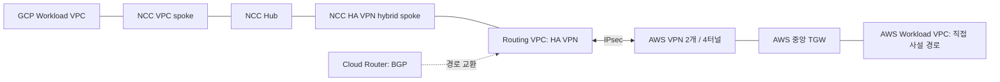

# GCP 중앙 네트워크와 AWS 로그 수집 AI-DLC

## 단계와 승인 상태

- 기준일: 2026-11-04 (Asia/Seoul).
- Ideation: 사용자 `그럼 Ideation대로 ㄱㄱ`로 승인 완료. 앞서 설명한 Cloud NGFW Enterprise의 IDS/IPS, NCC, AWS 중앙 TGW 연결과 AWS 로그 수집 방향을 따른다.
- Inception: 2026-11-04 사용자 `ANF원복은 하지말고, GCP 중앙 탐지 VPC 나눌 수 있으면 나눠 승인`으로 수정 조건을 포함해 승인 완료.
- Construction: 수정 승인된 U1~U5의 코드/문서 구현과 로컬 Test/Review를 완료했다. GCP/AWS 기반과 VPN/수집기를 실제 적용했고 양방향 통신과 GCP 자체 검사/중앙 원본 로그를 검증했다. AWS ANF 원복은 수행하지 않았다. 네 단일 BGP 경로 철회/복구, 저장 실패/재수집 및 최종 No changes 검증을 완료했다.
- 실계정 확인: 사용자 ADC 로그인 후 `term2-delta` / Number `366844544284`의 ACTIVE 상태와 조직 `354852153719` 소속, 기존 네트워크/서울 쿼터와 필요한 IAM 권한을 확인했다. Billing 조회는 API 비활성 오류였고 필수 API 6개 활성화를 완료했다. 재조회에서 Billing 활성, 18개 권한/12개 API와 실제 입력/저장 Plan을 확인했다. AWS 중앙 STS는 `482840608926`, 실제 ANF 목록은 비어 있고 중앙 state도 disabled다.
- 현재 운영: 사용자 후속 요청으로 GCP inspection_mode=disabled, endpoint/association 제거 완료. AWS ANF도 disabled를 유지한다. NCC/VPN/BGP와 기본 방화벽/로그 수집은 유지한다.
- Terraform: 로컬 mock과 실계정 Plan/Apply를 구분해 아래에 기록한다. 첫 GCP 부분 Apply를 복구했고 GCP 기반/4터널, AWS 수집기/업무 경로와 중앙 VPN을 적용했다. 초기 배포 뒤 총5개 root No changes를 확인했고, 후속 GCP 비용 중단 뒤 해당 root의 최신 실계정 Plan도 No changes/종료0이다. AWS root는 이번 중단에서 변경하지 않았다.
- Git: 사용자 2026-11-04 지시로 구현/로그 수집/회귀 테스트/운영 문서를 분할 커밋해 `feat/gcp-central-network`에서 게시한다. 앞의 세 서명 커밋 푸시와 `main` 대상 [PR #27](https://github.com/2026-sbh-delta/delta-network-gateway/pull/27) 생성을 확인했고 운영 문서도 같은 PR에 포함한다. 최종 검사/병합 상태와 squash 결과는 해당 PR을 기준으로 확인한다.

## Ideation: 승인된 범위

- 문제: 인터넷에서 GCP로 들어오는 트래픽을 GCP에서 검사하고, AWS와 GCP의 사설 네트워크를 연결하면서 검사 로그를 기존 AWS 중앙 계정에서 함께 조회해야 한다.
- 사용자: Delta 팀의 네트워크 운영자와 보안 관제 담당자.
- 성공 기준: 인터넷 요청에 대한 GCP 자체 검사, NCC를 이용한 AWS와의 양방향 사설 통신, GCP에서 생성한 검사 로그의 AWS 중앙 계정 도착을 실제 요청과 대조한다.
- Scope: 새 팀원 프로젝트 `term2-delta`의 네트워크와 시험 워크로드, Cloud NGFW Enterprise, NCC, HA VPN/Cloud Router, AWS ANF disabled를 유지하는 기존 TGW의 VPN 직접 연결, GCP 로그 전달과 AWS 수집기, 검증 및 운영 문서.
- Non-goals: 이전 GCP 프로젝트 변경, Organization 생성, Billing 계정 변경, GCP 인터넷 기본 경로의 AWS 우회, ANF Suricata 규칙의 자동 변환, 운영용 애플리케이션 이전, 전체 환경 Destroy.

## 수정 승인: 중앙 탐지 VPC와 ANF 유지

- AWS ANF 원복은 수행하지 않는다. VPN이 있어도 disabled 상태에서 직접 통신하는 경로를 구현한다.
- 중앙 탐지/연결 VPC와 Workload VPC는 분리한다. Cloud NGFW endpoint/profile은 프로젝트 범위 관리형 리소스이므로 중앙 VPC 내부에 장비처럼 배치하지 않는다. 공유 endpoint를 업무 VPC에 association해 검사하며 모든 패킷이 중앙 VPC를 라우팅으로 통과한다고 주장하지 않는다.
- 이 변경은 사용자의 조건부 승인에 포함된다. 다른 프로젝트, Organization 생성이나 프록시 장비 추가로 범위를 확대하지 않는다.

## 현재 확인값과 과거 구성의 구분

| 항목 | 현재 판단 | 근거 또는 남은 확인 |
| --- | --- | --- |
| GCP Project ID / Number | `term2-delta` / `366844544284` | 새 ADC의 실제 Project GET 성공, ACTIVE |
| Organization | `354852153719` | 실제 Project GET의 parent로 확인. 최초 사용자 전달값과 달랐으며 새 조직을 만들지 않음 |
| Billing | `billingEnabled=true` | 실제 Cloud Billing GET 확인. 연결 계정의 open 메타데이터 조회는 권한 부족으로 null이며 계정 상태는 추정하지 않음 |
| GCP Region / Zone | `asia-northeast3` / `asia-northeast3-a` | 서울 UP/실제 쿼터와 고정 Ubuntu READY 이미지 확인. 초기 enabled 검증 때 ACTIVE. 후속 disabled 요청으로 endpoint/두 association 제거 완료 |
| 초기 워크로드 | 단일 Zone의 사설 시험 VM 1대와 외부 패스스루 NLB | 신규 검증 환경 제안. 워크로드의 다중 Zone 가용성을 보장하는 구성이 아님 |
| 검사 엔드포인트 | 현재 disabled, endpoint0/association0 | 초기에 공유 endpoint1개로 검증했고 후속 비용 중단에서 제거. 프로필/그룹은 보존 |
| GCP CIDR / ASN | 중앙 `10.31.0.0/24`, 업무 `10.32.1.0/24`, ASN `65001` | 기존 업무 VPC가 `10.30.1.0/24`를 사용해 예시값 재사용을 피함. GCP 전체 Subnet과 중앙 등록 AWS `10.10/16`, `10.20/16`, 검사 `10.250/16`과 대조 |
| AWS 중앙 계정 / Region | 실조회 `482840608926` / `ap-northeast-2` | STS/실제 TGW/state를 다시 확인 |
| AWS ANF | 사용자 지시로 `disabled` 유지 | 원복 금지. VPN 직접 경로를 지원하도록 계약과 BGP 전파를 수정. 실계정 변경은 별도 |
| 이전 GCP 코드 | 현재 tracked tree에 `terraform/gcp-server` 없음 | 이전 구현과 검증은 [과거 AI-DLC](gcp-server-vpn.md)의 기록. 이번 환경의 구현이나 테스트 결과로 사용하지 않음 |

## Inception: Functional Requirements

1. GCP 실행은 `term2-delta`와 실제 조회한 Project Number에 묶는다. Billing, 실행 주체, 필요한 권한, API 상태, 기존 리소스와 쿼터를 읽기 전용으로 확인하고 실제 입력을 확정한다. 인증정보를 저장소나 문서에 넣지 않는다.
2. 같은 프로젝트에 신규 custom-mode 중앙 탐지/연결 VPC와 Workload VPC를 분리한다. 이하 Routing VPC는 이 중앙 VPC를 뜻한다. IPv4만 사용하며 CIDR은 AWS, 기존 GCP 및 터널 내부 대역과 겹치지 않아야 한다. 기존/default VPC를 변경하거나 기존 Terraform state를 자동 이전하지 않는다.
3. NCC Hub 1개에 Workload VPC spoke와 AWS 방향의 HA VPN hybrid spoke를 연결한다. Routing VPC에는 HA VPN Gateway와 Cloud Router를 둔다. 초기에는 Routing VPC 자체를 별도 VPC spoke로 추가하지 않는다. VPC spoke와 hybrid spoke 사이의 동적 경로 교환, Cloud Router의 광고와 반환 경로를 모두 구성한다.
4. 인터넷 진입점은 지역 외부 패스스루 Network Load Balancer로 제안한다. 시험 VM은 공인 IP 없이 두 시험 포트에서 응답하고, 공개 주소는 LB에만 할당한다. 초기 시험은 평문 HTTP로 수행해 인증서나 도메인을 전제하지 않는다. 이 시험을 HTTPS 본문 검사 완료로 보고하지 않는다.
5. 프로젝트 범위 Firewall Endpoint, `threat-prevention` Security Profile, Security Profile Group과 global network firewall policy를 구성한다. 검사 규칙은 `apply_security_profile_group`으로 트래픽을 보낸다. 워크로드가 있는 모든 Zone에 엔드포인트 association이 있어야 하며, 단순 L4 허용 규칙으로 검사 대상 트래픽을 먼저 통과시키지 않는다. 관리와 헬스 체크 예외는 명시한다.
6. GCP HA VPN Gateway의 인터페이스 0/1을 기존 AWS 중앙 root의 `vpn_networks` / `vpn_peers` 계약에 연결한다. AWS Customer Gateway 2개, Site-to-Site VPN 2개와 총 4터널을 구성하고 BGP로 승인된 사설 Prefix만 교환한다. 인터넷 기본 경로를 광고하거나 수신하여 업무 트래픽에 사용하지 않는다.
7. AWS ANF는 disabled로 유지한다. 기존 Spoke RT의 VPC 목적지는 해당 VPC attachment로 직접 전달하고, VPN의 BGP 경로를 Spoke RT에 전파한다. VPN 목적지에 단일 attachment를 가리키는 정적 경로를 만들지 않아 HA/ECMP와 경로 철회를 보존한다. 기존 enabled 모드의 검사 경로와 Inspected RT 전파는 회귀 보호한다.
8. GCP 방화벽 규칙 로깅과 위협 로깅을 수집 대상으로 한다. Cloud Logging의 프로젝트 Log Sink에서 Pub/Sub topic으로 전달하고 pull subscription과 재시도용 DLQ를 준비한다. VPN 운영 로그도 필요한 범위로 필터링한다. Sink의 writer identity에 해당 topic 게시 권한만 부여한다.
9. AWS 중앙 계정에 별도 로그 수집기를 둔다. 기본 구현안은 1분 간격으로 실행되는 Lambda이며, 실제 계정의 지역 동시 실행 한도가 10이므로 예약 동시성은 사용하지 않는다. 50초 timeout, 1분 주기와 비동기 호출의 재시도 0회/최대 수명 60초로 호출 적체를 제한한다. 중첩 가능성은 Pub/Sub lease와 at-least-once 처리로 다룬다. AWS 실행 역할을 GCP Workload Identity Federation으로 신뢰하고 지정된 Pub/Sub subscription만 읽게 한다. 영구 GCP 서비스 계정 키나 영구 AWS Access Key를 배포하지 않는다.
10. 수집기는 원래 LogEntry를 보존하면서 `cloud`, `project_id`, `log_name`, `insert_id`, 원본 발생 시각과 수집 시각을 보강한다. GCP 전용 CloudWatch Log Group에 기록하며 기존 ANF FLOW/ALERT 그룹의 형식과 전달 정책은 유지한다. CloudWatch에 저장한 메시지만 ack하고, 실패한 메시지는 재처리한다. 중복 가능성을 인정하고 원본 식별자로 대조한다.
11. 로그 전달은 Google API와 AWS API 사이의 TLS 연결을 사용한다. AWS 수집기는 업무 VPN과 독립적으로 동작하게 하며, VPN 장애 때문에 로그 수집까지 함께 끊기는 의존 관계를 만들지 않는다. 이 구성은 전용 사설 로그 전송망을 제공한다고 주장하지 않는다.
12. GCP 실행/state, AWS VPN/state와 AWS 로그 수집기/state의 소유권을 구분한다. 모듈 README에는 전체 입력, 출력 및 복합 속성 표를 작성하고 실제 입력, PSK, state, 저장 Plan과 원본 검증 자료는 Git에서 제외한다.

## Inception: Non-Functional Requirements

- 초기 범위는 단일 Region과 단일 Zone의 시험 워크로드다. HA VPN의 터널 이중화와 시험 VM/NGFW의 가용성은 구분한다. Zone을 추가할 때에는 같은 Zone의 검사 엔드포인트도 함께 추가한다.
- 인터넷 허용 출발지 CIDR은 명시적 입력으로 제한한다. 시험 VM 관리에는 IAP/OS Login을 사용하고 공인 SSH를 열지 않는다. 새 워크로드에 NAT나 일반 인터넷 출구를 추가하지 않는다. NLB 응답에 필요한 GCP 경로와 VPN 사설 경로를 구분한다.
- NGFW와 VPN에 사용할 서비스 지원 Region, endpoint 쿼터, API 및 프로젝트 범위 리소스의 Provider 지원을 실제 적용 전에 확인한다. 기존 AWS의 고정 Terraform/Provider 버전은 임의로 올리지 않는다. GCP Provider는 필요한 프로젝트 범위 리소스 지원을 확인한 버전으로 고정하고 lock 파일을 남긴다.
- AWS VPN PSK는 AWS Standard VPN state에 저장되는 민감정보다. 전달 파일과 Plan 출력을 제한하고 로그/일반 handoff에서 제외한다. GCP Provider의 write-only/ephemeral 지원 여부는 선택한 실제 버전으로 확인한다.
- 로그 처리는 at-least-once를 전제로 한다. Pub/Sub 보존 기간은 초기 7일, CloudWatch 보존 기간은 초기 30일을 제안한다. 원본 로그 발생 시각을 JSON에 보존하고 수집 시각과 혼동하지 않는다. 부분 저장 실패, 크기 제한, 재시도와 ack 시점은 구현 테스트 대상으로 둔다.
- 성능 보장은 초기 범위에 포함하지 않는다. 시험 로그의 AWS 도착 목표는 정상 상태에서 발생 후 5분 이내이며 실제 측정값을 기록한다. 이 목표를 운영 SLA로 표시하지 않는다.
- 비용은 실제 리소스 수와 운영 시간으로 검토한다. 무료 크레딧 잔액이나 예산 알림을 지출 상한으로 간주하지 않는다. 설계 승인과 실제 유료 리소스 생성은 구분한다.

## Inception: Architecture

### 인터넷 유입 검사

`Internet -> GCP 외부 패스스루 NLB -> Workload VPC의 사설 시험 VM`

Cloud NGFW는 정책과 endpoint association으로 VM 트래픽을 가로채 검사한다. NCC나 Routing VPC를 ANF Inspection VPC와 동일한 필수 라우팅 홉으로 취급하지 않는다. 이 인터넷 경로는 AWS VPN/TGW/ANF를 통하지 않는다.

두 시험 포트는 VM에서 모두 응답하도록 준비하고 인터넷 측 허용/거부 규칙을 대조한다. LB에 전달하지 않은 포트의 실패나 미기동 서버를 방화벽 차단 증거로 사용하지 않는다. L4 거부 로그와 별도로 IDS/IPS의 안전한 시험 패턴과 예상 Threat ID/action을 정해 실제 위협 로그를 확인한다.

### 클라우드 간 사설 통신

위 그림은 논리적 연결을 나타낸다. NCC Hub는 연결과 경로 교환을 관리하며 VM 형태의 패킷 전달 장비가 아니다. Routing VPC의 동적 라우팅 모드는 global, Cloud Router의 best path selection은 NCC hybrid spoke가 지원하는 legacy를 기준으로 검토한다. Workload subnet 광고와 AWS Prefix 수신을 양방향으로 확인한다.

### 로그 수집

`Cloud Logging -> 프로젝트 Log Sink -> Pub/Sub -> AWS Lambda pull 수집기 -> 중앙 CloudWatch Logs`

- GCP 수집 대상: 방화벽 규칙 로그, `networksecurity.googleapis.com/firewall_threat`, 필요한 VPN 운영 로그.
- AWS 목적지 제안: `/delta/lab/gcp/term2-delta/network-security`. 수집기 자체의 실행 로그는 별도 그룹에 둔다.
- AWS 역할을 GCP WIF provider의 특정 계정/역할 조건으로 제한하고 지정된 subscription 접근만 허용한다. Lambda의 임시 AWS 실행 자격 증명으로 Google 단기 토큰을 얻는 경로를 실제 검증한다.
- 저장 성공 전에 ack하지 않는다. DLQ, 오래된 미처리 메시지, 마지막 수집 성공 시각과 Lambda 오류를 관측한다. 재시도 후 동일 원본 식별자의 중복 로그가 생길 수 있다.
- S3 장기 보관과 플랫폼 관제 화면 연결은 이번 기본안에 추가하지 않는다. 기존 ANF 로그와 GCP 전용 그룹을 CloudWatch Logs Insights에서 함께 조회할 수 있도록 쿼리를 제공한다.

### 구현한 Terraform과 코드 소유권

| 경로 | 소유 범위 | state 구분 |
| --- | --- | --- |
| `terraform/network-security-gcp/` | 새 GCP VPC, NCC, HA VPN/Router, NGFW, 시험 VM/NLB, Log Sink/Pub/Sub/WIF | `term2-delta` 전용 GCS backend. 실제 bucket/Project Number는 사전 확인 후 결정 |
| `terraform/network-security/` | 기존 중앙 TGW/ANF와 AWS VPN 추가 | 기존 중앙 S3 backend 유지 |
| `terraform/gcp-log-ingest-aws/` | 중앙 계정의 Lambda, 실행 역할, 주기 실행, CloudWatch와 관측 | 기존 중앙 네트워크와 다른 S3 state key |
| `services/gcp-log-collector/` | Pub/Sub pull, 로그 변환, CloudWatch 저장/ack와 재시도 | 애플리케이션 코드. Terraform state 소유 없음 |
| `terraform/workload-client/` | 기존 Client의 GCP 목적지 Route/송신 규칙 | 기존 Client S3 state. 런타임 입력만 갱신 |
| `terraform/workload-server/` | 기존 Server의 GCP 반환 Route/시험 VM /32 수신 | 기존 Server S3 state. 런타임 입력만 갱신 |

위 경로에 코드를 작성했고 로그인 후 전용 GCS/S3 backend를 초기화했다. GCP는 부분 Apply 복구를 진행했으며 AWS 수집기는 실제 Apply를 완료했다. 새 네트워크/수집 리소스와 기존 Route/SG는 해당 소유 state에서만 변경한다. 기존 활성 API는 프로젝트의 공유 기능으로 import했고 `disable_on_destroy=false`로 보존한다.

## Inception: Unit of Work와 Construction 결과

각 Unit은 Design, Implementation Plan, Approval, Implementation, Test, Review 상태를 분리한다. 아래 계획은 2026-11-04 수정 조건을 포함한 사용자 승인으로 구현했다. 코드/로컬 검증과 실제 배포 상태는 구분한다.

| Unit | Design | Implementation Plan | Acceptance Criteria와 Test 계획 | Approval / 현재 상태 |
| --- | --- | --- | --- | --- |
| U1. 실행 대상과 상태 기반 | 새 프로젝트 검증, 별도 backend, 기존 리소스와 CIDR 보호 | 읽기 전용 preflight, Project ID/Number 계약, Provider 고정, 입력/출력 설계와 backend 준비 절차 | 다른 프로젝트와 겹치는 CIDR 거부, Billing/API/권한/쿼터 보고. backend 없는 init/validate와 계약 mock을 실제 실행 | 2026-11-04 승인 / 실제 식별/권한/API/쿼터와 backend 검증 완료 |
| U2. NCC와 사설 연결 | Routing/Workload VPC 분리, NCC VPC/hybrid spoke, 4터널 BGP | 새 GCP root 네트워크 구성, 비밀값 없는 handoff, 기존 AWS VPN 계약 연결과 ANF disabled의 직접 BGP 경로 | spoke 경로 교환, 인터페이스 0/0/1/1 대응, Prefix 제한과 양방향 반환 경로를 mock/계획으로 확인. 실배포 후 네 터널/BGP와 사설 요청 및 장애 전환 확인 | 2026-11-04 승인 / 양쪽 네 터널/BGP/NCC와 두 포트 양방향 HTTP 검증 완료. 네 단일 BGP 경로 철회/복구 통과 |
| U3. GCP 자체 검사 | 사설 시험 VM, 외부 패스스루 NLB, 같은 Zone의 프로젝트 범위 NGFW | 두 포트 리스너, 제한된 공개 진입점, profile/group/policy/association과 로깅. 안전한 위협 시험 패턴과 기대 결과 선정 | VM 공인 IP 없음, 검사 선행 우회 규칙 없음, 관리/헬스 체크 정상. 허용/거부 응답과 실제 정책 로그를 대조하고 별도 위협 로그로 IDS/IPS 확인 | 2026-11-04 승인 / 사설 VM/NLB/공유 endpoint ACTIVE. 8080 검사, 8081 거부와 별도 ALERT Threat4건 검증 완료 |
| U4. 중앙 로그 수집 | Pub/Sub와 AWS Lambda pull, WIF 단기 인증, 저장 후 ack | GCP sink/topic/subscription/DLQ/WIF와 AWS 수집기 root, 메시지 처리 코드 및 조회 쿼리 | 다른 역할/프로젝트 접근 거부, 저장 실패/부분 실패/재시도/중복/잘못된 메시지 처리 테스트. 실제 GCP 원본 로그와 AWS 로그 식별자 및 5분 이내 도착 대조 | 2026-11-04 승인 / 실제 WIF/타 역할 거부, 원본314건 일치와 최대135초 도착 확인. 저장 실패77건 ack0 및 복구 후 원본 재수집 확인 |
| U5. 통합 검증과 운영 | 세 트래픽 흐름을 독립 검증, 상태/비용/복구 증거 | 로컬 회귀, 실행 전 비용과 저장 Plan 검토, 배포/관측/중지/복구 Runbook과 검증 기록 작성 | 구현/mock/Plan/Apply/실제 통신을 구분. 인터넷 GCP 자체 검사, 사설 양방향 통신, 중앙 로그와 기존 AWS 기능 보존을 실제 확인한 범위만 완료로 기록 | 2026-11-04 승인 / 실제 통합/장애 검증 완료. GCP와 AWS4개 root 모두 No changes. 실제 검증/운영 기록 완료 |

U1~U5 구현과 로컬 검증을 완료하고 실제 대상/입력/비용/저장 Plan을 확인한 뒤 승인 범위의 배포를 진행한다. 미확정 계정이나 이전 GCP 프로젝트에 Apply하지 않는다. 현재 진행 상태는 위 표와 아래 날짜별 검증 기록을 따른다.

## Inception: Acceptance Criteria

1. 새 프로젝트의 실제 ID/Number, Billing, 실행 주체, 지원 Region/API/쿼터와 기존 CIDR을 확인하고 문서에 출처와 날짜를 남긴다.
2. 실제 실행한 fmt, init, validate, Terraform mock 및 수집기 테스트의 명령과 결과를 남긴다. 과거 GCP 테스트 수를 새 환경의 통과 기록으로 재사용하지 않는다.
3. 인터넷 요청의 허용/거부 결과를 GCP 방화벽 규칙 로그로 대조하고 IDS/IPS 시험은 별도 위협 로그로 증명한다. AWS ANF 로그가 없는 사실만으로 GCP 자체 검사를 증명하지 않는다.
4. GCP VM의 공인 IP 부재, 시험 포트 리스너, LB 상태와 유효 검사 정책/association을 확인한다. 초기 평문 시험과 HTTPS 본문 검사 범위를 구분한다.
5. NCC의 VPC/hybrid spoke 경로와 실제 GCP/AWS BGP 경로를 확인한다. 4터널의 정상 상태와 장애 전환을 별도로 시험하고, 터널 연결 상태만으로 업무 통신 성공을 기록하지 않는다.
6. AWS와 GCP 양쪽에서 승인된 사설 주소로 실제 요청을 보내고 반환 경로를 대조한다. AWS ANF와 endpoint가 재생성되지 않았고 직접 경로로 통신하는지 확인한다. 이 사설 통신을 AWS ANF 검사 증거로 보고하지 않는다.
7. GCP에서 새로 생성한 원본 검사 로그와 AWS 전용 로그 그룹의 `project_id`, `log_name`, `insert_id`, 시각 및 요청 정보를 대조한다. Lambda 자체 실행 로그나 합성 메시지 저장만으로 GCP 로그 전달 완료를 기록하지 않는다.
8. 중앙 저장 실패 후 재시도와 복구를 시험하고, 정상 저장 전 ack되지 않았음을 확인한다. WIF 인증과 AWS 역할 제한은 실제 실행 역할로 별도 검증한다.
9. 적용 후 실제 Plan과 기존 AWS 서비스 응답을 다시 확인한다. 의도하지 않은 교체/삭제, state 소유권 충돌, 평문 비밀값 출력과 Git 포함이 없어야 한다.

## 비용과 Operation 계획

### 비용 산정

- 2026-11-04 확인한 GCP 공식 가격표: Enterprise endpoint 1개당 시간당 USD 1.75, 검사량 GiB당 USD 0.0193. 엔드포인트가 배포된 동안 시간 요금이 발생한다.
- 단일 endpoint의 시간 요금만 계산하면 4시간 USD 7, 24시간 USD 42, 30일 연속 운영 USD 1,260이다. 이는 전체 구축 비용이 아니다. 두 Zone으로 늘리면 endpoint 시간 요금도 두 배다.
- HA VPN 4터널, NCC spoke와 데이터 전송, NLB/공개 IP/VM/디스크, Logging/Pub/Sub, AWS VPN 2개/TGW, Lambda/CloudWatch의 요금은 별도다. Region과 실제 수량/운영 시간에 따른 합계는 실행 준비 시 확인한다.
- 할인, 무료 크레딧, 세금과 환율은 위 계산에 반영하지 않았다. 검증 종료 시 계속 켜 둘 리소스와 정리할 리소스를 실행 계획에 명시한다.

### Deployment

1. 구현 승인 후 실제 실행 대상, Billing/권한/쿼터, CIDR과 Provider 지원을 확인한다.
2. backend 소유권과 접근을 확인하고 GCP 기반 및 빈 터널 구성의 저장 Plan을 만든다. 검토한 대상에 한해 배포한다.
3. AWS ANF disabled를 유지하는 저장 Plan에서 Firewall/endpoint 추가가 없는지 확인하고, Gateway 주소를 이용해 VPN과 Spoke RT의 BGP 직접 전파를 추가한다.
4. AWS tunnel/BGP handoff와 민감 PSK를 분리 전달하고 GCP 4터널, NCC 경로 교환과 명시적 정책을 적용한다.
5. NGFW와 제한된 시험 진입점, Pub/Sub/WIF 및 AWS 수집기를 배포하고 세 흐름을 각각 검증한다. 각 단계의 실제 Plan/Apply와 통신 결과를 기록한다.

### Observability

- GCP: Firewall Endpoint/association 상태, 규칙/위협 로그, NLB 헬스와 VM 리스너, HA VPN/BGP와 NCC 유효 경로, Pub/Sub backlog/최장 미처리 시간/DLQ.
- AWS: VPN/TGW의 실제 경로와 ANF/endpoint 부재, 수집기 오류/마지막 성공 시각, CloudWatch 도착 지연과 원본 식별자. 기존 ANF 로그는 과거 기록으로 보존한다.
- 전송 장애 동안 남은 메시지를 복구할 수 있는 기간은 설정한 Pub/Sub 보존 기간에 한정된다.

### Rollback와 Runbook

- 검사 설정이 실패하면 시험 공개 진입을 닫고 정책/association/endpoint를 진단한다. 무검사 공개 경로로 자동 전환하지 않는다.
- 로그 수집 장애는 수집기를 중지하고 Pub/Sub에 미처리 메시지를 남긴 뒤 복구한다. 기존 ANF 로그 그룹을 변경하거나 삭제하지 않는다.
- AWS 변경을 되돌릴 때는 신규 VPN에 의존하는 양쪽 경로와 허용 정책을 먼저 정리한다. ANF disabled를 유지하고 새 VPN 전파/목적지만 정리한다.
- GCP 검사 비용을 중단하려면 시험 공개 진입을 먼저 닫고 검사 규칙, endpoint association, endpoint의 의존 순서에 맞게 정리한다. VM 중지만으로 endpoint 과금이 끝났다고 기록하지 않는다.
- state와 로그는 기본 보존한다. 해체와 원복은 실제 대상/변경 목록을 검토한 범위에서 수행하고 기존 AWS 기반과 이전 GCP 프로젝트에는 확대하지 않는다.

## 이번 작업의 확인 기록

| 날짜 | 실행 또는 확인 | 결과 |
| --- | --- | --- |
| 2026-11-04 | 사용자 `그럼 Ideation대로 ㄱㄱ` | Ideation 승인. 당시 Inception과 Unit 구현 승인은 받기 전이었음 |
| 2026-11-04 | `git status --short`, `git branch --show-current`, `git log -5 --oneline --decorate` | 시작 시 작업 트리 깨끗함. 기존 브랜치 `feat/gcp-central-network`, HEAD `f8d8eb12` |
| 2026-11-04 | `docs/README.md`, 관련 AI-DLC와 `terraform/network-security`의 VPN/로그/계약 코드 읽기 | 이전 GCP 문서와 현재 코드의 차이, VPN 등록 시 ANF enabled 조건 확인. 실계정 조회 아님 |
| 2026-11-04 | `rg --files terraform`, `git ls-tree HEAD terraform/` | 현재 tracked tree에 이전 `terraform/gcp-server` 없음. 새 환경은 신규 root로 설계 |
| 2026-11-04 | GCP 공식 NGFW, NCC, HA VPN, WIF와 가격 문서 확인 | 아래 구조와 비용의 근거 확인. 실제 프로젝트의 사용 가능 상태/청구액 확인 아님 |
| 2026-11-04 | `python3 -B` 인라인 문서 검사와 `git diff --check` | 변경한 문서 3개의 로컬 링크 70개 정상. 필수 절, 코드 블록, 추가한 문자의 제한과 공백 검사 통과. 변경 범위는 문서 3개이며 제품/Terraform 구현 변경 없음 |

위 결과는 당시의 문서 검사다. 후속 로컬 검증과 실계정 Plan/Apply는 아래 별도 기록을 따른다. 커밋과 푸시는 미실행이다.

## 2026-11-04 Construction 검증과 Review

| 날짜 | 실행한 명령 또는 확인 | 결과 |
| --- | --- | --- |
| 2026-11-04 | 공식 Registry/PyPI 버전 조회, `terraform init -backend=false`, 설치한 Provider의 `providers schema -json` | Google/Google Beta 8.10.0 서명/lock 확인. 프로젝트 범위 endpoint/profile과 `shared_secret_wo` 지원 확인. 최초 로컬 sandbox의 플러그인 handshake 실패는 실행 권한 범위를 조정해 해결. 실계정 Plan 아님 |
| 2026-11-04 | ADC로 `scripts/preflight.py --output .validation/gcp-construction/preflight.json` | Project GET HTTP 403, ready=false. 토큰/credential 원문 출력과 설정 변경 없음. 사용자가 새 계정 ADC 미연결이라고 확인. Billing 비활성으로 판정하지 않음 |
| 2026-11-04 | `terraform/network-security/scripts/validate.sh` | Python helper 11개, Terraform mock 44개 통과. disabled의 VPN 전파 2개, VPN 정적 경로 부재와 ANF 생성 0개 확인. 기존 enabled 회귀 포함. 초기 mock ID/AZ fixture 오류는 보완 후 전체 재실행 |
| 2026-11-04 | `bash terraform/network-security-gcp/scripts/validate.sh` | init/validate와 mock Plan 11개 통과. 두 VPC/공유 endpoint, 4터널/BGP/Prefix 제한과 잘못된 입력 거부 확인. WIF Provider ID는 최소 길이를 충족하는 `aws-collector`로 수정. mock Plan 원문에 ephemeral 시험 PSK가 없음을 확인 |
| 2026-11-04 | GCP `python3 -B -m unittest discover` | 앱 1개, 민감 입력 전달 6개, preflight 2개 합계 9개 통과. 두 실제 로컬 HTTP 리스너 응답, 계정/Gateway/Prefix와 최신 tunnel 대조, 파일 0600/덮어쓰기/symlink 거부, 조회 거부와 불완전 inventory 처리 확인. GCP VM 실행 결과가 아님 |
| 2026-11-04 | `PYTHONPATH=services/gcp-log-collector python -B -m unittest discover -s services/gcp-log-collector/tests -v` | 11개 통과. 실제 Google SDK의 오프라인 AWS 서명 생성과 저장 후 ack, 전체/부분 저장 실패, ack 유실, 원본/중복 식별, 크기 제한, 잘못된 메시지와 프로젝트 거부 확인. fake client와 실제 SDK의 오프라인 검증이며 실제 WIF/CloudWatch 연결 성공이 아님 |
| 2026-11-04 | 고정 requirements로 `services/gcp-log-collector/build.py`, ZIP CRC/ELF/source 검사 | 최종 ZIP 22,926,714 bytes. 현재 collector 소스 일치와 native library 4개의 Linux x86_64 형식 확인. macOS 환경을 Lambda ZIP으로 복사하지 않음. ignored 산출물이며 업로드 없음 |
| 2026-11-04 | `bash terraform/gcp-log-ingest-aws/scripts/validate.sh` | 별도 backend 없는 init/validate, AWS mock 3개 통과. keyless 환경 변수, 동시 실행/timeout, 별도 로그 보존과 계정 제한 확인. AWS Apply 아님 |
| 2026-11-04 | `terraform fmt -check -recursive terraform`, `bash -n`, Python AST, 입력/출력/복합 속성 표와 로컬 링크, `git diff --check` | 형식과 문서/코드 연결 검사 통과. 소스/문서 53개와 로컬 링크 97개 확인. 중앙 모듈 입력 21/출력 18, GCP 입력 14/출력 8, AWS 수집기 입력 7/출력 5 모두 문서화. Provider/state/Plan/credential/빌드 ZIP의 Git 제외 확인 |
| 2026-11-04 | `rg -n '^inspection_mode' terraform/network-security/inspection-mode.auto.tfvars`, `git check-ignore` | 기존 로컬 모드 파일은 `disabled` 그대로다. 모드/PSK 입력, Gateway handoff와 빌드 ZIP은 Git에서 제외된다. 실제 AWS API의 ANF 상태를 재조회한 결과는 아님 |

로컬 Construction 당시 Review 결과: GCP 중앙 탐지/연결 VPC와 업무 VPC를 분리했고 managed endpoint의 공유 association을 구현했다. AWS disabled에서는 VPC 정적 직접 경로와 두 VPN의 Spoke BGP 전파를 사용하며 기존 enabled 경로를 보존한다. 비밀값 없는 handoff와 ephemeral/write-only PSK를 분리했고 원본 로그는 저장 후 ack한다. 기존 ANF 상태/실행 입력/서비스와 클라우드 리소스는 변경하지 않았다.

## 2026-11-04 로그인 후 실제 준비

| 날짜 | 명령 또는 확인 | 결과 |
| --- | --- | --- |
| 2026-11-04 | 새 ADC로 `preflight.py --output .validation/gcp-construction/preflight-after-login.json` | Project ACTIVE, ID/Number와 조직 확인. default 및 기존 `delta-customer-workloads` VPC와 전체 Subnet 조회 성공. 기존 업무 Subnet `10.30.1.0/24` 보존 |
| 2026-11-04 | Cloud Billing GET 오류 상세와 IAM `testIamPermissions` 재검사 | Billing 403은 SERVICE_DISABLED였음. 검사기의 잘못된 `compute.networkFirewallPolicies.create`를 `compute.firewallPolicies.create`로 수정하자 필요한 18개 권한 확인. HTTP 400을 모든 권한 부재로 보고하지 않도록 수정하고 회귀 테스트 추가 |
| 2026-11-04 | 검증한 프로젝트 번호에 Service Usage `services:batchEnable`, 작업 완료 조회 | networksecurity, networkconnectivity, sts, iap, privateca, cloudbilling 6개 API 활성화 완료. 실행 전 API 목록을 ignored 계획 JSON으로 저장. 결제 계정 연결과 유료 네트워크 생성은 변경하지 않음 |
| 2026-11-04 | GCS bucket 메타데이터와 object prefix GET | 기존 `delta-network-gateway-tf-366844544284`는 같은 프로젝트 소유, 서울 리전, 버전 관리/Uniform access/PAP enforced. 새 `delta/lab/network-security-gcp/` prefix 비어 있음 |
| 2026-11-04 | `aws sts get-caller-identity --profile sbh-delta-security`, VPC/ANF 목록과 중앙 Terraform 출력 | 중앙 계정 일치, ANF 목록 비어 있음. state inspection_mode=disabled, firewall_arn=null. CLI 임시 역할 자격 증명을 메모리로 전달해 Terraform SDK의 SSO refresh 오류를 우회. 키 저장/출력 없음 |
| 2026-11-04 | 실제 tfvars/backend 준비와 `stat` 권한 제한 | 실제 Project Number/고정 READY 이미지, 신규 업무 `10.32.1.0/24`, 시험 출발지 IPv4 /32와 중앙 역할 ARN을 ignored 입력에 작성. 빈 VPN 맵으로 시작. 실제 입력/backend 0600. 예시 입력과 mock fixture는 그대로 보존 |

## 2026-11-04 실제 Plan과 부분 Apply 복구

| 날짜 | 명령 또는 확인 | 결과 |
| --- | --- | --- |
| 2026-11-04 | API 활성화 후 preflight 재실행 | ready=true, Billing 활성, 18개 권한과 12개 API 확인. 계정 open 값 조회 권한은 없어 null이며 결제 비활성으로 해석하지 않음 |
| 2026-11-04 | GCS/S3 전용 backend init, 중앙 `plan` | GCP prefix와 AWS 수집기 전용 key 초기화. 중앙 기존 root는 No changes, ANF disabled/firewall_arn=null |
| 2026-11-04 | GCP `plan -out=.validation/bootstrap.tfplan` 및 JSON 검토 | 56개 추가/변경 0/삭제 0. 기존 VPC 보존, 공인 IP 없는 VM, 공유 endpoint 1개와 두 VPC 확인 |
| 2026-11-04 | GCP 저장 Plan `apply` | 실패. 주소와 헬스 체크 생성 후 API/DNS/HTTP2 연결 오류, GCS state 업로드와 lock 해제 실패. 네트워크 오류 원인은 미확정 |
| 2026-11-04 | Compute 실제 조회와 remote/recovery state 대조 | 생성된 `delta-lab-demo` 주소와 `delta-lab-server` 헬스 체크 확인. 복구 state serial4, 원격 serial1, lineage 동일. 자기 Apply 종료와 lock 소유자/생성 시각/GCS generation 대조 |
| 2026-11-04 | 자기 lock `force-unlock`, `state push errored.tfstate`, 리소스/API 순차 `import` | 원격 state 복구와 주소/헬스 체크, 12개 API import 완료. 중복 생성/삭제나 force state push 없음. 이전 Plan은 재사용하지 않고 새 Plan 생성 |
| 2026-11-04 | 공식 NLB health-check 범위 확인 | backend service 기반 외부 패스스루 NLB의 IPv4 probe `35.191.0.0/16`, `209.85.204.0/22`로 수정. 이전 ALB proxy 범위 제거 |
| 2026-11-04 | AWS Lambda `get-account-settings`, 수집기 실제 Plan 재작성 및 mock 3개 | 지역 동시성 한도/미예약10. 예약 후 최소 미예약100 제약으로 예약1을 제거하고 1분/50초, 비동기 재시도0/이벤트수명60초 적용. mock 3개 통과. 실제 Plan11개 추가/변경0/삭제0. 중첩 가능성은 남으며 Pub/Sub lease/at-least-once로 처리 |

GCP 복구 state/Plan과 실제 입력은 ignored 경로에만 보존한다. 이 복구 단계에서 기존 중앙 AWS 리소스는 변경하지 않았다. 아래 후속 AWS Apply와 구분한다.

## 2026-11-04 배포 재개

| 날짜 | 명령 또는 확인 | 결과 |
| --- | --- | --- |
| 2026-11-04 | 복구 state에서 GCP `plan -parallelism=2 -out=.validation/recovery.tfplan` | 41개 추가, 새 주소의 라벨 갱신 1개, 삭제 0. 기존 업무 VPC 변경 없음. 이 저장 Plan으로 Apply를 재개했으며 아래 후속 완료 기록을 참조 |
| 2026-11-04 | GCP `scripts/validate.sh` 재실행 | mock 11개와 Python 10개 통과. preflight 권한 실패 분류 회귀 포함 |
| 2026-11-04 | AWS 수집기 `apply .validation/initial-v2.tfplan` | 11개 추가/변경0/삭제0 완료. Lambda Active/Successful, Linux ZIP 22,926,714 bytes. 실제 WIF/로그 도착 검증은 후속 |
| 2026-11-04 | Client/Server baseline `plan`, GCP 전용 입력의 새 Plan/Apply | 기존 두 root No changes 후 각각 4개 추가/변경0/삭제0 완료. 새 GCP `10.32.1.0/24` 경로와 Client 송신, Server의 `10.32.1.10/32` 수신만 추가 |
| 2026-11-04 | 임시 EIC 키/사설 SSH에서 기존 Client -> Server 두 포트 요청 | `10.20.1.10:8080`과 `:8081` HTTP200/기존 AWS JSON 응답. ANF disabled의 기존 통신 유지 확인. 관리용 임시 키는 ignored 경로, 장기 키/state 추가 없음 |
| 2026-11-04 | GCP Gateway 실제 GET과 AWS 중앙 VPN 목록 | 두 Gateway 주소/중앙 VPC/ASN/Prefix 확인. 기존 중앙 TGW VPN 목록은 빈 배열로 Inside CIDR 비중복 확인. 비밀값 없는 handoff와 ignored 입력 작성 |
| 2026-11-04 | 중앙 `plan -out=.validation/gcp-vpn.tfplan`와 JSON Review | 12개 추가/정책2개 갱신/삭제0. 2 CGW, 2 VPN, 2 Association, Spoke/Inspected 전파4개, 기존 Inspection subnet의 신규 목적지 Route2개. 정책 갱신은 보존 HOME_NET에 GCP CIDR 추가뿐. Firewall 생성0/모드disabled 확인 후 Apply 완료 |

AWS Workload의 경로/SG 추가는 해당 `workload-client`와 `workload-server` state에서만 관리한다. GCP root가 AWS SG를 중복 소유하지 않는다.

## 2026-11-04 WIF와 사설 관리 확인

| 날짜 | 명령 또는 확인 | 결과 |
| --- | --- | --- |
| 2026-11-04 | 실제 Lambda 수동 `invoke`, 주기 실행 `ingest_summary` | Lambda 역할의 Google 단기 인증과 Pub/Sub pull 성공. pulled/stored/acked/failed 모두0이며 아직 원본 검사 로그 도착 증거는 아님. 초기 IAM member 적용 전 403은 이후 정상 실행과 구분 |
| 2026-11-04 | 허용 역할 외 중앙 SSO 관리자 임시 자격 증명으로 같은 WIF 교환 | OAuthError, attribute condition rejected. 다른 역할 거부 확인. credential/token 원문은 저장하거나 출력하지 않음 |
| 2026-11-04 | 현재 ADC의 IAP/OS Login `testIamPermissions`, gcloud 임시 token override 읽기 | 관리에 필요한 5개 권한 모두 확인. 전역 gcloud 기본 계정/프로젝트를 바꾸지 않고 task 전용 config와 메모리의 ADC token으로 새 VPC 조회 성공 |
| 2026-11-04 | AWS Server 사설 EIC SSH, systemd/ss/localhost 요청 | delta-test active, 8080/8081 LISTEN과 두 HTTP200 확인 |
| 2026-11-04 | 중앙/Client/Server/수집기 적용 후 `plan -detailed-exitcode` | 네 root 모두 No changes, 종료0. 중앙 실제 ANF 목록도 빈 배열. 신규 AWS VPN 2개 생성 완료이며 GCP 터널 연결/통신 성공과 구분 |

## 2026-11-04 GCP 배포와 실제 통합 검증

| 날짜 | 명령 또는 확인 | 결과 |
| --- | --- | --- |
| 2026-11-04 | GCP 복구 Plan `apply -parallelism=2 .validation/recovery.tfplan` | 41개 추가/주소 라벨1개 갱신/삭제0 완료. Endpoint ACTIVE까지 20분51초, 중앙/업무 association 각각 7분4초/7분15초. 기존 업무 VPC 보존 |
| 2026-11-04 | VM 실제 GET, IAP/OS Login 임시 키 SSH, systemd/ss/localhost | VM `10.32.1.10` RUNNING, 공인 IP와 서비스 계정 없음. delta-demo active와 8080/8081 리스너/HTTP200 확인. 첫 SSH 거부 후 부팅/키 반영 시간이 지난 재시도 성공. IAM 변경 없이 성공했으며 정확한 최초 거부 원인은 확정하지 않음 |
| 2026-11-04 | NLB `getHealth`, VIP/forwarding rule 및 VM local route | HEALTHY, 공개 주소 `34.64.134.28`, 두 포트 전달과 로컬 VIP 경로 확인. 헬스 체크 원본 로그/앱 응답 확인 |
| 2026-11-04 | 인터넷 첫 timeout과 GCP 원본 로그 대조 | 기본 deny1000, 실제 NAT 출발지와 사전 checkip 결과 불일치 확인. 세 정상 probe의 관측 주소가 같아 해당 /32로 시험 입력 수정. 차단 범위를 넓히지 않음 |
| 2026-11-04 | 첫 후속 GCP Plan JSON Review | API가 기본 false를 빈 endpointSettings로 반환해 endpoint 교체가 계획됨. Apply하지 않고 기본 블록을 생략했다. API의 canonical `//networksecurity.googleapis.com/...` URL로 맞춰 규칙의 반복 갱신도 제거. GCP mock11/Python10 재실행 통과 |
| 2026-11-04 | 새 `vpn-v2.tfplan` Review/Apply | 14개 터널 관련 추가와 시험 출발지 규칙2개 갱신/삭제0 완료. 기존 endpoint no-op, 비밀값은 ephemeral/write-only 입력. 4 IPsec/BGP와 양쪽 Prefix 확인 |
| 2026-11-04 | 인터넷 실제 HTTP와 원본 규칙 로그 | 8080 HTTP200/priority210 INTERCEPTED, 8081 timeout/priority220 DENIED. VM의 두 리스너가 정상인 상태에서 구분 검증 |
| 2026-11-04 | 공식 안전 시험 URI와 `firewall_threat` 로그 | Threat IDs 30844/30852/35107/55558, action ALERT, 앱 HTTP200. 같은 외부 tuple과 시각 대조. 이는 시험 문자열 탐지이며 앱의 해당 CVE 취약성 또는 공격 성공 증거가 아님 |
| 2026-11-04 | 원본 Logging과 AWS CloudWatch JSON 대조 | 05:23:50 UTC 이후 원본314건 모두 insertId/logName/원본 payload 일치. 이 대조 구간 지연 최대134.911초. Threat4건의 지연34.464~103.685초. 합성 메시지나 Lambda 실행 로그가 아닌 실제 규칙/위협 로그 |
| 2026-11-04 | 실제 Pub/Sub backlog/수집 카운터와 수집기 보완 | 한 pull이100보다 적게 반환해 backlog144/최장240초 증가 확인. 최초10초/잔여40초 이상/최대10회로 추가 pull을 제한하고 빈 배치/실패 시 중단. 테스트15개 통과, Linux ZIP22,926,937 bytes 재빌드. 코드 hash1개 갱신 Plan/Apply 후 실제282건 저장/ack, 실패0 |
| 2026-11-04 | NCC spoke/Hub 경로, Cloud Router와 AWS VPN/TGW 실제 조회 | VPC/hybrid ACTIVE, NCC AWS 동적10.10/16,10.20/16와 업무10.32.1/24 ACTIVE. 네 BGP UP/각2개 AWS Prefix 수신, AWS 네 터널 UP/각1개 GCP Prefix 수신. Spoke RT의 GCP Prefix는 정적이 아닌 propagated/active |
| 2026-11-04 | AWS EIC Client -> GCP, GCP IAP -> AWS Server 실제 요청 | AWS Client -> `10.32.1.10:8080/8081`, GCP -> `10.20.1.10:8080/8081` 모두 HTTP200과 상대 cloud/service JSON. 터널 상태만으로 성공 처리하지 않음 |

후속 장애 전환과 수집 저장 실패/재전달의 실제 결과는 아래에 기록한다. 최신 로컬 검증은 Terraform mock58개, Python36개다. 실제 시도/실패/복구와 통과 기록은 위와 같이 구분한다.

## 2026-11-04 장애 전환, 저장 실패와 복구

| 날짜 | 명령 또는 확인 | 결과 |
| --- | --- | --- |
| 2026-11-04 | `gcloud compute routers update-bgp-peer --no-enabled/--enabled`, Router 상태와 양방향 HTTP | if0t1/if0t2/if1t1/if1t2를 각각 하나씩 철회. 남은 UP3개/각 AWS 경로6개와 양방향8080 HTTP200 확인. 매 시험 뒤 UP4개 복구. 05:30:04~05:31:44 UTC의 4회 모두 통과 |
| 2026-11-04 | 첫 저장 장애 시험과 finally 복구 | 추가 공개 요청이 기본 deny1000에 걸려 실패 주입 검증까지 도달하지 못함. GCP 로그의 실제 NAT 주소가 첫 주소와 달랐음. 환경/poll 복구를 확인했고 이 시도는 PASS로 기록하지 않음 |
| 2026-11-04 | AWS Client 사설 요청을 이용한 저장 장애 재시험 | poll 중지/기존 실행 종료 대기 후 목적지 그룹만 역할에 허용되지 않은 이름으로 임시 변경. 실제77건 pull/failed77, stored0/acked0, FunctionError 확인. finally에서 원래 환경과 ENABLED poll 복구 |
| 2026-11-04 | 복구 후 `ingest_summary`, 원본/중앙 로그 대조 | 후속158건/63건 저장/ack 모두 성공. 05:36:30 UTC 이후 원본112건 모두 일치, 이 구간 최대102.953초. 사설 시험 원본 `jzq5nofawagmk`는 priority200, 05:36:33 발생/05:38:15 중앙 저장, 내용 일치 |
| 2026-11-04 | 실제 관측된 두 NAT 출발지 규칙의 저장 Plan/Apply | 두 주소만 각각 /32로 설정. 규칙2개 update/추가0/삭제0 확인 후 적용. 외부 probe의 NAT source port는 로컬 bind port와 다를 수 있어 실제 로그 tuple과 시각으로 대조 |
| 2026-11-04 | 원격 GCP state와 저장 Plan을 실제 PSK 값으로 메모리 검사 | PSK4개가 GCP state/Plan JSON 평문에 없음. AWS Standard VPN 원본 state에는 PSK가 보관되는 기존 특성을 문서와 구분. 값/토큰 출력 없음 |
| 2026-11-04 | 적용 후 기존 AWS Client -> Server, ANF API, poll 상태 | 기존8080/8081 HTTP200, 실제 Firewalls 빈 배열, poll ENABLED. GCP/중앙/수집기/Client/Server 총5개 실계정 Plan No changes, 상세 종료코드0 |
| 2026-11-04 | Terraform fmt/diff, Python AST, 입력/출력 표와 로컬 링크 | 형식 정상, 로컬 링크82개 정상. 중앙 입력21/출력18, GCP14/8, 수집기7/5 문서화. 실제 tfvars/PSK/ZIP Git 제외 확인 |

## 2026-11-04 최종 확인

| 날짜 | 명령 또는 확인 | 결과 |
| --- | --- | --- |
| 2026-11-04 | GCP `plan -parallelism=2 -detailed-exitcode -out=.validation/final-v2.tfplan`와 AWS4개 root 최종 Plan | 총5개 root 모두 실제 No changes/종료0. endpoint 교체와 잔여 drift 없음 |
| 2026-11-04 | 최종 인터넷 요청, 두 번째 관측 NAT 출발지 요청 | 8080 HTTP200,8081 timeout, 안전 패턴 HTTP200. 추가 관측 /32에서도 HTTP200. 출발지 두 /32 정책 적용 후 확인 |
| 2026-11-04 | 복구 후 Pub/Sub 실제 모니터링 | 05:40 UTC backlog13, 최장 미확인4초. 05:41 최장3초. fault 중 실패77건 이후158건/63건 stored=acked, failed0으로 복구 |
| 2026-11-04 | 중앙 CloudWatch 세 그룹 통합 Logs Insights 조회 | Complete. 기존 AWS ANF와 신규 GCP 기록이 같은 쿼리에서 각각 aws/gcp로 조회됨. 신규 ANF 로그 생성/ANF 재가동을 뜻하지 않음 |
| 2026-11-04 | task OS Login key 일치 대조 후 삭제/로컬 키 정리 | 이 작업에서 만든 공개 키1개와 두 클라우드의 임시 개인 키 제거. 다른 사용자 키/인증 변경 없음. 민감한 실행 자료 디렉터리0700 |

## 운영 상태와 검증 한계

- 현재 GCP 중앙/업무 VPC, NCC/4터널과 AWS 중앙 수집기를 운영한다. 사용자 후속 비용 중단으로 GCP endpoint/association은 제거했으며 AWS ANF도 disabled/Firewall 없음이다. 기존 GCP 업무 VPC와 AWS 서비스는 보존했다.
- 시험용 공개 주소는 실제 관측한 두 /32에서만 허용한다. 출발지/NAT가 바뀌면 통제한 요청의 GCP deny 로그와 시각/주소를 확인하고 입력의 /32를 저장 Plan으로 갱신한다. 공개 로그에 등장한 임의 출발지를 자동 허용하지 않는다.
- 평문 HTTP와 ALERT 탐지를 검증했다. TLS 복호화, IPS 위협 차단, 부하/다중 Zone 가용성 및 장시간 유지된 TCP 세션의 장애 생존은 검증하지 않았다. 장애 주입은 단일 BGP 경로 철회이며 실제 IPsec 장비/Zone 고장과 구분한다.
- 저장 실패/복구와 타 역할 거부는 실제 확인했다. 잘못된 메시지의 DLQ 최대10회 전달 과정은 로컬 테스트와 설정 확인이며 실제10회 재전달/수동 재처리까지 실행하지 않았다.
- GCP endpoint 삭제로 해당 시간 과금 리소스는 없다. VPN/NCC/NLB/VM/로그/전송 비용과 이미 발생한 검사 비용은 남는다. 향후 재개 시 endpoint 시간 요금 USD1.75/h와 검사량 요금이 다시 적용된다.
- 검증용 OS Login 키1개와 로컬 임시 SSH 개인 키는 정리했다. 기존 사용자 키와 ADC/SSO 인증은 유지했다.
- 코드/문서는 작업 트리에 있으며 이번 작업의 커밋/푸시는 하지 않았다. 실제 입력/backend/state/Plan/비밀값/빌드 ZIP과 원본 증거는 ignored 경로에 보존한다.

## 근거

- [Cloud NGFW 등급과 사용 방식](https://docs.cloud.google.com/firewall/docs/ngfw_tiers)
- [프로젝트 범위 endpoint와 VPC association](https://docs.cloud.google.com/firewall/docs/configure-firewall-endpoints)
- [IDS/IPS 구성과 보안 프로필 연결](https://docs.cloud.google.com/firewall/docs/configure-intrusion-prevention)
- [NGFW 위협 로그](https://docs.cloud.google.com/firewall/docs/threat_logs)
- [Cloud NGFW 공식 가격](https://cloud.google.com/firewall/pricing)
- [지역 외부 패스스루 NLB](https://docs.cloud.google.com/load-balancing/docs/network/networklb-backend-service)
- [LB 유형별 헬스 체크 방화벽 범위](https://docs.cloud.google.com/load-balancing/docs/firewall-rules)
- [공식 IPS 시험 트래픽 예제](https://docs.cloud.google.com/firewall/docs/tutorials/set-up-ips-tutorial)
- [NCC VPC/hybrid spoke 경로 교환](https://docs.cloud.google.com/network-connectivity/docs/network-connectivity-center/concepts/dynamic-route-exchange-with-vpc-spokes)
- [GCP와 AWS의 HA VPN 연결](https://docs.cloud.google.com/network-connectivity/docs/vpn/how-to/connect-ha-vpn-aws-peer-gateway)
- [Cloud Logging의 Pub/Sub 전달](https://docs.cloud.google.com/logging/docs/export/pubsub)
- [AWS 워크로드의 GCP Workload Identity Federation](https://docs.cloud.google.com/iam/docs/workload-identity-federation-with-other-clouds)
- [GCP 네트워크 연결 가격](https://cloud.google.com/network-connectivity/pricing)
- [기존 중앙 네트워크 계약](../../terraform/network-security/README.md)
- [기존 AWS ANF 비용 중단과 원복 기록](anf-cost-mode.md)

## 2026-11-04 U6: GCP 검사 비용 중단

### Ideation과 승인

- 문제: GCP 검사 Endpoint 시간 요금을 중단하면서 이미 검증한 NCC/VPN/TGW 사설 통신을 유지한다.
- 사용자: 현재 환경의 네트워크 운영자. 성공 기준은 Endpoint/association 부재, 두 방향 HTTP와 기본 규칙/로그 수집 유지 및 최종 No changes다.
- Scope: GCP `inspection_mode`와 endpoint 주소 이동, 검사 규칙의 allow 전환, 두 association/endpoint 제거, 검증/Runbook.
- Non-goals: AWS ANF 재가동, AWS/GCP 공통 재개 자동화, AWS 허용 정책/경로 변경, VPN/NCC/VM/NLB 제거, 새 Endpoint를 재생성하는 왕복 실배포.
- 승인: 앞서 일반 허용 전환 후 endpoint 연결/endpoint 삭제 방식을 설명했고, 사용자 `일단 지금은 그럼 꺼줘`로 현재 비용 중단 실행을 승인했다.

### Inception / Design / Implementation Plan

- `enabled`: endpoint1/association2와 기존 검사 규칙. `bypass`: endpoint/association 유지, 검사 대상 세 규칙만 일반 allow. `disabled`: bypass 정책과 라우팅/기본 deny/로그 유지, endpoint/association 없음.
- 기존 singleton endpoint를 `[0]`로 `moved`해 준비 단계에서 불필요한 교체를 방지한다. 기본값은 기존 배포를 보존하는 enabled, 실제 로컬 모드 파일은 단계마다 명시한다.
- 1단계: bypass 실제 저장 Plan에서 검사 규칙3개 update와 state 주소 이동만 허용한다. VM/VPC/NLB/NCC/VPN 변경 및 삭제0을 확인하고 Apply 후 통신 검증한다.
- 2단계: disabled 실제 저장 Plan에서 association2개/endpoint1개 삭제만 허용한다. endpoint 삭제 완료와 네 BGP/두 방향 HTTP, 규칙 로그의 중앙 도착 및 No changes를 확인한다.
- 로컬 Test: enabled 회귀, bypass의 endpoint 보존/allow/기본 deny, disabled의 4터널/VM/NCC 보존/endpoint 부재, 잘못된 모드 거부. 모드 출력과 README 입력/출력 표를 함께 갱신한다.
- Rollback: 1단계가 실패하면 기존 endpoint가 있는 enabled로 되돌린다. 삭제 후 재개는 disabled -> bypass에서 endpoint/association 준비 완료를 기다린 뒤 enabled로 전환한다. AWS ANF는 별도 승인 전 계속 disabled다.
- Implementation 승인: 위 설명에 대한 현재 실행 지시 범위로 진행한다. 로컬 테스트/실제 Plan/Apply/통신 결과는 아래에 구분해 갱신한다.

### 현재 상태

- `inspection_mode` 입력/출력, endpoint moved/count와 세 검사 규칙 전환, README/Runbook 구현 완료. GCP mock14개/Python10개 통과. 실제 bypass Plan은 세 규칙 update만 검토했고 endpoint 이동/no-op 및 나머지 리소스 보존을 확인했다. Apply는 빈 프로필 문자열에 대한 API400으로 실패했다. API 생략도 제거되지 않았고, JSON null로 같은 세 규칙을 정상 갱신했다. 우회 후 통신을 확인하고 아래 2단계로 endpoint를 제거했다.

### U6 1단계 실제 결과

| 날짜 | 명령 또는 확인 | 결과 |
| --- | --- | --- |
| 2026-11-04 | GCP 실제 Project/Endpoint/Router GET, AWS STS/ANF 조회 | 프로젝트366844544284 일치, endpoint ACTIVE/BGP4개 UP, 중앙482840608926/ANF 빈 목록 |
| 2026-11-04 | `scripts/validate.sh`, 입력/출력 표/형식 검사 | GCP mock14/Python10 통과, 입력15/출력9 문서화. 실제 Plan과 구분 |
| 2026-11-04 | `plan -out=.validation/bypass.tfplan` Review | 기존 singleton -> [0] 이동/no-op. 검사 규칙3개만 allow/update, 생성/삭제0. VM/NCC/VPN/NLB 변경 없음 |
| 2026-11-04 | 저장 Plan Apply와 직접 API 참조 생략 | 모두 API400. 빈 securityProfileGroup 문자열 거부, 생략도 기존 참조를 제거하지 못함. Endpoint 유지, 실패를 PASS로 기록하지 않음 |
| 2026-11-04 | 동일한 세 규칙의 patchRule/action=allow/securityProfileGroup=null | API200/작업DONE. priority200/210/300 모두 profile 참조 없음, 원래 match/direction/logging 보존 확인. scope는 검토한 세 규칙 그대로 |
| 2026-11-04 | 우회 후 AWS EIC와 GCP IAP에서 양방향8080/8081, 공개8080/8081 | 사설 네 요청 모두 HTTP200/상대 JSON. 공개8080 HTTP200,8081 timeout. 삭제 전 통신 보존 확인 |

실제 모드를 disabled로 기록하고, 다음 저장 Plan의 refresh로 API 갱신과 state를 동기화한다. 다음 Plan에서는 endpoint/association 세 개 삭제 외의 변경이 없는지 확인한다.

### U6 2단계 Plan / Apply

- `plan -parallelism=2 -out=.validation/disabled.tfplan`: API로 전환한 세 allow 규칙을 refresh해 확인했다. 실제 변경은 endpoint1/association2의 delete 세 개뿐이며 나머지 리소스는 모두 no-op이다.
- 저장 Plan의 프로젝트/모드/대상과 기존 match/logging을 검토한 뒤 `apply -parallelism=2 .validation/disabled.tfplan`을 시작했다. 삭제 완료/API 부재와 통신 결과는 아래 최종 기록과 같다.

### U6 최종 실제 검증과 Review

| 날짜 | 명령 또는 확인 | 결과 |
| --- | --- | --- |
| 2026-11-04 | `apply -parallelism=2 .validation/disabled.tfplan` | 추가0/갱신0/삭제3 완료. 두 association 각각12초, endpoint9분32초. AWS ANF 재생성 없음 |
| 2026-11-04 | Endpoint/association GET와 Cloud Router 상태 | 세 리소스 모두 HTTP404. BGP4개 UP/각 AWS Prefix2개 수신 유지. priority200/210/300 allow/프로필 없음,220/1000 deny 및 logging=true 확인 |
| 2026-11-04 | 삭제 후 AWS EIC Client -> GCP, GCP IAP -> AWS Server | 06:23 UTC 기준 두 방향8080/8081 네 요청 모두 HTTP200/상대 JSON. 공개8080 HTTP200,8081 timeout 유지 |
| 2026-11-04 | 삭제 후 Logging/CW 원본 대조 | 06:22:50 UTC 이후 일반 방화벽 원본99건이 중앙과 일치. 이 대조 구간 지연 최대53.616초. ALLOW/ALLOWED와 DENY/DENIED 확인. 새 L7 Threat 탐지로 해석하지 않음 |
| 2026-11-04 | `plan -parallelism=2 -detailed-exitcode -out=.validation/disabled-final.tfplan` | 실제 No changes/종료0. inspection_mode 출력disabled, endpoint null/미노출. 기존 project/VPC/NCC/Gateway 주소/서버/NLB/log handoff 출력 모두 일치 |
| 2026-11-04 | 마지막 AWS ANF API와 임시 키 정리 | 중앙 Firewall 목록 빈 배열. 이 작업의 OS Login 공개 키1개와 두 클라우드의 임시 개인 키 제거. 사용자 기존 키/ADC/SSO 유지 |

Review: 현재 목적은 완료했다. GCP Endpoint 시간 과금 대상은 제거했고 사설 라우팅과 L3/L4 규칙/중앙 로그를 유지한다. 재개용 GCP 모드는 구현했지만 실계정 재생성 왕복과 AWS/GCP 공통 자동 재개는 이번 범위에 포함하지 않았다. Provider 8.10.0의 참조 제거는 JSON null 우회가 필요하며 Runbook에 명시했다. 코드/문서는 미커밋, 실제 모드/비밀값/증거는 ignored 파일이다.

## 아키텍처 시트 갱신 (2026-11-04)

- 사용자 요청으로 [sbh-delta.drawio의 세 번째 시트](https://app.diagrams.net/#G1tfE5rvvK4l7IO959dnsFz5Km-eQ2AZv-#%7B%22pageId%22%3A%22NVW_F5C3esdCIoBv2Uto%22%7D)를 `03 GCP 아키텍처`로 작성했다. 후속 지시에 따라 공유 Endpoint와 두 VPC의 endpoint association을 포함한 구성으로 표현했다. 실제 Endpoint/연결과 AWS ANF는 disabled라는 상태 주석을 달았고 클라우드 리소스는 변경하지 않았다.
- 공개 NLB와 사설 VM, NCC VPC/Hybrid spoke, 중앙 VPC의 Cloud Router/HA VPN, AWS TGW와 업무 VPC, VPN과 독립된 Cloud Logging/Pub/Sub/WIF/Lambda/CloudWatch 경로를 구분했다. Endpoint를 중앙 VPC 내부의 라우팅 장비로 표현하지 않았다.
- [Google 공식 아이콘](https://cloud.google.com/icons)의 2026년 5월 개정 가이드에 따라 SVG 14개를 파일에 내장했다. Networking 제품은 같은 공식 카테고리 아이콘과 제품명으로 구분했다.

| 날짜 | 명령 또는 확인 | 결과 |
| --- | --- | --- |
| 2026-11-04 | `python3 .validation/gcp-diagram/build_diagram.py`, Chrome headless 렌더링과 이미지 확인 | 편집 가능한 mxGraph 요소 149개를 구성하고 글자/연결선 겹침을 조정했다. 시트 1/2의 원본 diagram 바이트 동일 확인 |
| 2026-11-04 | Drive `get_file_metadata` → `update_file` → `fetch`, Python XML/해시 대조 | 저장 직전 modifiedTime 불변 확인 후 같은 file ID에 저장. 15:49:11 KST 갱신본 251060바이트가 업로드 원본과 완전히 일치하고, 첫 두 시트 보존/세 번째 page ID와 이름/내장 아이콘 14개를 재확인. Terraform Plan/Apply와 Git 커밋/푸시는 이번 그림 갱신에서 실행하지 않음 |

### 아이콘 중심 최종 정리 (2026-11-04)

- 사용자 후속 요청 `설명을 왜 넣는거임? 아이콘만 넣어 그냥`에 따라 설명 카드, 운영 상태 배너, CIDR과 검증 설명, 범례와 출처 각주를 그림에서 제거했다. 최신 저장본에는 아이콘과 리소스 이름, 영역 경계와 연결선만 남겼다.
- 저장 전 원본을 다시 받아 세 번째 시트의 기존 AWS/온프레미스 셀 71개를 유지하고 GCP를 연결했다. GCP 공식 아이콘 13개를 내장하고 AWS와 같은 글꼴, 계정/VPC/Subnet 경계 형식과 직각 연결선으로 정리했다. 첫 두 시트는 원본 diagram 바이트 그대로 보존했다.
- 현재 Endpoint와 association이 제거된 운영 상태는 이 문서의 U6 기록을 따른다. 그림의 회색 점선 검사 구성은 보존한 구성 표현이며 클라우드 설정을 변경한 결과가 아니다. 이번 실제 GCP 재조회 시도는 로컬 Python CA 검증 오류로 완료하지 못했고, 기존 실계정 검증 기록과 Terraform 코드를 참조했다.

| 날짜 | 명령 또는 확인 | 실제 결과 |
| --- | --- | --- |
| 2026-11-04 | `python3 .validation/gcp-diagram/build_integrated.py`, Chrome headless 렌더링과 이미지 확인 | 셀 109개, GCP 공식 아이콘 13개. 설명 문구 제거와 아이콘 이름/연결선 배치 확인. XML ID/연결 참조, 첫 두 시트 보존 검사 통과 |
| 2026-11-04 16:06:13 KST | Drive `get_file_metadata` → `update_file` → `fetch`, `curl`, Python XML/해시 대조 | 저장 직전 modifiedTime 불변 확인. 같은 file ID의 304937바이트 저장본이 업로드 파일과 완전히 일치. 첫 두 시트, 세 번째 page ID/이름, 설명 문구 제거를 재확인. SHA-256 `5a2be83927ca4c2d04699575a8ec078d47bc64d7d6fdda9dd18c6787ec179ef3` |
| 2026-11-04 16:13:14 KST | `python3 .validation/gcp-diagram/compact/build_compact.py`, Chrome headless 렌더링, Drive 저장/재다운로드와 XML/해시 대조 | 사용자 후속 요청으로 GCP 간격을 축소. NLB/VM 중심 간격 290→160, Router/VPN 300→150, NGFW 430→220. 아이콘 크기/셀109개/이름/논리 연결 유지, AWS 내부 배치는 그대로 평행 이동. 첫 두 시트 바이트 동일, 실제 저장본 305269바이트가 업로드와 일치. SHA-256 `f610a83abdfc917a0b2ac33ee4376141325c87060c10c08f6625e962b01d491b` |
| 2026-11-04 16:19:49 KST | `python3 .validation/gcp-diagram/restore-aws-colors/restore.py`, Chrome headless 렌더링, Drive 저장/재다운로드와 XML/해시 대조 | 요청 범위를 넘어 바꿨던 AWS VPC/Subnet 5개 영역의 색상과 테두리 형식을 작업 전 원본으로 복구. 저장 직전 최신 원본을 기준으로 GCP 전체와 다른 셀, 첫 두 시트 바이트 동일 확인. 사용자 후속 편집도 보존. 실제 저장본 307382바이트가 업로드와 일치. SHA-256 `cebcd6174d7ebd98b4f485c177e383a43db7955de16ad3b632c267fbdaa3bbcf` |
| 2026-11-04 16:44:13 KST | `python3 .validation/gcp-diagram/vpc-connection/fix_connection.py`, Chrome headless 렌더링, Drive 저장/재다운로드와 XML/해시 대조 | 사용자 승인으로 VM/VPN 직결 표현을 제거. Workload VPC 경계와 VPC spoke를 연결하고, Hybrid spoke와 Central VPC의 Cloud VPN 사이 연결을 표현. 기존 선 1개 변경과 선 1개 추가 외 모든 셀 및 AWS 전체/첫 두 시트 동일 확인. 실제 저장본 307946바이트, 셀110개가 업로드와 일치. SHA-256 `8293b9502fafcb24a19102ea8b8eb0e5399704685c3042479c98264a9038b3ab` |

Terraform Plan/Apply, 클라우드 설정 변경, Git 커밋과 푸시는 이 그림 정리 작업에서 실행하지 않았다.

## Git 게시와 PR 검증 (2026-11-04)

사용자가 분할 커밋/푸시, `main` 대상 PR과 squash merge를 승인했다. 구현 `571e827c`, AWS 로그 수집 `26da4961`, 회귀 검증 `4228f083`을 각각 SSH 서명하고 원격 작업 브랜치에 게시했다. 운영 문서는 네 번째 단위로 같은 [PR #27](https://github.com/2026-sbh-delta/delta-network-gateway/pull/27)에 포함한다. 이 절은 PR 병합 직전 검증 기록이며 최종 merged 상태와 squash SHA는 PR의 GitHub 기록을 따른다.

| 날짜 | 명령 또는 확인 | 결과 |
| --- | --- | --- |
| 2026-11-04 | `bash terraform/network-security-gcp/scripts/validate.sh` | init/validate, mock14개와 Python10개 통과. mock Plan에 임시 PSK 노출 없음 |
| 2026-11-04 | `bash terraform/network-security/scripts/validate.sh` | init/validate, mock44개와 경로 전환 Python11개 통과. enabled와 VPN 직접 전파 회귀 포함 |
| 2026-11-04 | `bash terraform/gcp-log-ingest-aws/scripts/validate.sh` | init/validate와 mock3개 통과 |
| 2026-11-04 | `PYTHONPATH=services/gcp-log-collector /private/tmp/delta-gcp-construction-venv/bin/python -B -m unittest discover -s services/gcp-log-collector/tests -v` | Python15개 통과. 실제 Google SDK의 오프라인 서명, 저장/ACK 실패와 부분 거부 포함 |
| 2026-11-04 | 게시 후보 파일/README 속성 표/ZIP 검토 | 후보55개에서 실제 입력/backend/state/Plan/PSK/개인 키/빌드 ZIP 제외. 중앙 입력21/출력18, GCP15/9, 수집기7/5 표 확인. ignored Lambda ZIP의 현재 소스/무결성과 Linux x86_64 native 형식 확인 |
| 2026-11-04 | `git push -u origin feat/gcp-central-network`, `gh pr create --base main --head feat/gcp-central-network --draft` | 앞의 세 서명 커밋을 푸시하고 PR #27 생성. 연결 앱의 저장소404 이후 인증된 gh CLI 사용. 기존 Actions paths는 이번 변경 경로를 포함하지 않으며 해당 CI 성공을 주장하지 않음 |

이번 게시 작업에서 실계정 Plan/Apply는 재실행하지 않았고 실제 비용 모드도 변경하지 않았다. 위 로컬 검증과 앞선 실계정 배포/중단 검증, GitHub 검사/병합 상태를 구분한다. 실제 실행 입력과 원본 증거는 계속 ignored 경로에 보존한다.

### 후속 아키텍처 기록 게시 (2026-11-05)

사용자 `일단 커밋 푸시 ㄱㄱ` 지시로 위 그림 정리 기록을 `main`의 문서 커밋으로 게시한다. 최종 커밋과 푸시 결과는 Git 이력을 기준으로 확인한다.

| 날짜 | 실행한 명령 또는 확인 | 결과 |
| --- | --- | --- |
| 2026-11-05 | `git diff --check`, `python3 -B` 인라인 문서 검사 | 추가 문자의 제한, 코드 블록 짝, 로컬 링크와 공백 검사 통과. 변경 범위는 이 문서 1개이며 애플리케이션 테스트와 실계정 Plan/Apply는 재실행하지 않음 |
| 2026-11-05 | `git ls-remote --exit-code origin refs/heads/main`, `git rev-parse HEAD` | 게시 전 원격 main과 로컬 HEAD가 `5749e6780e1316ff1a9c2ccfee06824ae960ab57`로 일치 |
