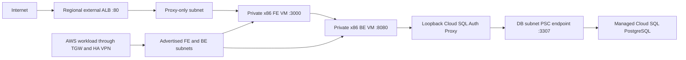

# Sample App의 GCP ALB, x86 VM과 Cloud SQL 배포

현재 운영은 사용자 후속 승인으로 [단일 x86 VM Compose](gcp-compose-consolidation.md)에 통합했다. 아래는 초기 ALB/FE/BE VM2대/Cloud SQL 교체의 역사적 승인과 검증 기록이다. 현재 VM 수량과 재시작 절차는 후속 문서를 따른다.

기준일: 2026-11-05 (Asia/Seoul).

## 승인과 진행 상태

- 사용자 요청: `term2-delta`의 기존 NLB와 시험 Compute Engine을 내리고 `2026-sbh-delta/delta-sample-app`을 ALB, FE/BE Compute Engine 각 1대, Cloud SQL PostgreSQL로 배포한다. 각 계층의 서브넷을 분리한다.
- Ideation: 공개 ALB, 사설 FE/BE VM과 DB 전용 서브넷의 Private Service Connect(PSC) 접속점, 앱의 PostgreSQL 연동을 제안했다. 사용자 `승인, instance는 사양되는 x86아키텍처로`로 승인받았다.
- 추가 확정 조건: FE/BE VM, OS와 실행 바이너리는 x86_64/AMD64를 사용한다.
- Inception 및 아래 U1~U4 Design/Implementation Plan: 2026-11-05 사용자 `ㄱㄱ`으로 승인받았다. 기존 시험 환경 삭제와 신규 구성의 구현/검증/배포를 승인된 범위에서 진행한다.
- 완료: 기존 NLB/시험 VM 제거, x86 FE/BE와 ALB/Cloud SQL PSC 생성, 공통 PostgreSQL 앱 snapshot 배포와 실제 통합 검증을 마쳤다. 공개 URL은 `http://34.64.134.28`이다.
- 최종 검증: GCP network/workload와 AWS central 전체 Plan은 No changes/종료0이다. 공개 CRUD/BE 재시작 후 보존, 양방향 TGW 사설 HTTP200과 임시 시험 자원 제거를 확인했다. 커밋/푸시는 이번 요청에 포함하지 않았으며 앱은 미커밋 변경의 hash snapshot으로 배포했다.

## Ideation

- 문제 정의: 현재 워크로드는 NLB와 단일 시험 VM이며 샘플 앱의 FE/BE 분리 실행과 PostgreSQL 저장을 제공하지 않는다.
- 사용자: Delta 팀의 앱/인프라 운영자와 공개 데모 접속자.
- 성공 기준: 공개 ALB에서 메모 생성/조회/삭제, BE 재시작 후 데이터 보존, FE/BE x86 아키텍처와 서브넷 분리, 기존 TGW 사설 경로를 실제 확인한다.
- Scope: 기존 시험 NLB/VM과 전용 부속 리소스 제거, 리전 ALB, x86 FE/BE VM 2대, 신규 Cloud SQL PostgreSQL, 분리된 서브넷/PSC/DNS/방화벽, 필요한 NCC/BGP/AWS 경로 갱신, PostgreSQL 저장 어댑터와 개별 빌드/배포, 검증/복구 문서.
- Non-goals: 로그인, 자동 확장, FE/BE/DB 고가용성, 커스텀 도메인/인증서, OTel/플랫폼/Jenkins 연동, 기존 DB 데이터 이전, 기존 `delta-lab-staging-db` 변경, AWS 앱 배포, AWS ANF/GCP 검사 endpoint 재활성화.

## 읽기 전용으로 확인한 기준

### 실제 GCP와 인증

- 대상은 `term2-delta`, Project Number `366844544284`, Region `asia-northeast3`, VM Zone `asia-northeast3-a`다.
- 활성 gcloud 사용자 자격 증명은 해당 리소스 조회에서 권한 오류였지만 ADC로는 조회에 성공했다. 이후 작업은 성공한 ADC를 기준으로 하며 gcloud 로그인 상태와 ADC를 혼용하지 않는다.
- `delta-lab-server`는 RUNNING, 사설 IP `10.32.1.10`, 공인 IP 없음이다. NLB `delta-lab-demo`는 `34.64.134.28`에서 8080/8081을 전달하고 조회 당시 백엔드는 HEALTHY였다.
- Cloud Router `delta-lab-aws`의 if0t1/if0t2/if1t1/if1t2는 모두 UP/Established다. 이번 사전 확인은 사설 HTTP 재시험 결과가 아니다.
- 현재 관련 subnet은 central `10.31.0.0/24`, workload `10.32.1.0/24`다. 프로젝트에는 별도로 customer `10.30.1.0/24`, platform sandbox `10.33.0.0/24`와 default network의 서브넷들이 있다.
- 실제 별도 Cloud SQL `delta-lab-staging-db`는 서울, POSTGRES_16, RUNNABLE이다. 이번 신규 DB와 소유권을 분리한다.
- workload VPC의 현재 인터넷 기본 경로는 시험 VM 태그 `delta-lb-backend`에만 적용된다. 새 VM의 설치/API 접근 경로로 그대로 재사용하지 않는다.
- 조회한 실제 입력에서 GCP가 받는 AWS prefix는 `10.10.0.0/16`이며, GCP/NCC/BGP와 AWS의 handoff는 현재 `10.32.1.0/24`만 포함한다. 새 BE 대역은 양쪽 소유 root에서 함께 추가해야 한다.

### 제공 사양과 권한

| 확인 | 실제 응답 | 의미와 한계 |
| --- | --- | --- |
| `e2-small`, `asia-northeast3-a` machineTypes GET | guestCpus 2, memoryMb 2048, isSharedCpu true | 공유 CPU 사양 제공 확인. 전용 코어 2개 또는 생성 시 용량 확보 보장이 아님 |
| 고정 Ubuntu 이미지 GET | `ubuntu-2404-noble-amd64-v20261024`, READY, architecture X86_64 | FE/BE의 기본 OS 제안. 구현/Apply 직전 재조회 |
| 서울 Region GET | UP, E2_CPUS quota limit 24/usage 0 | 조회 시점의 쿼터. 생성 허용과 실제 물리 용량 확보를 구분 |
| Cloud SQL tiers.list | 서울의 `db-f1-micro`, `db-g1-small` 제공 | PSC/엔진/edition 전체 조합의 생성 성공을 증명하지 않음 |
| Project testIamPermissions | 요청한 생성/네트워크/IAM/SQL/Secret/Storage/DNS/API 권한 12개 반환 | 조회한 권한에 누락 없음. 전체 배포 과정의 모든 권한을 검증한 결과는 아님 |

E2는 Intel 또는 AMD EPYC를 사용하는 x86 계열이며 물리 CPU 제조사는 지정하지 않는다. [공식 E2 설명](https://docs.cloud.google.com/compute/docs/general-purpose-machines)을 확인했다.

### Sample App

- GitHub 기본 브랜치의 `README.md`, `backend/server.mjs`, `frontend/server.mjs`, 이미지 빌드 workflow를 확인했다. 구현 시작 시 원격 SHA와 로컬 작업 트리를 다시 확인한다.
- 현재 BE는 `new Map()`을 사용하고 health의 storage는 memory다. Cloud SQL을 생성하는 것만으로 메모가 DB에 저장되지는 않는다.
- FE 기본 포트는 3000, BE는 8080이다. 브라우저의 같은 Origin `/api` 요청을 FE가 BE로 프록시한다.
- FE/BE는 각각 독립 소스와 빌드/Docker 컨텍스트를 가진다. AWS용 PostgreSQL 어댑터와 공통 앱 변경을 맞추고 같은 기능을 중복 구현하지 않는다. 문서 작성 중 별도 AWS 작업의 Inception/U1~U4 승인과 Terraform 구현 진행을 확인했다. 공통 앱의 실제 구현/검증 상태는 작업 시작 시 다시 확인한다.

## Inception

### Functional Requirements

1. 기존 시험 VM과 NLB의 전용 리소스만 Terraform으로 제거한다. VPC/기존 workload subnet/NCC/HA VPN/Cloud Router와 기존 state의 식별자는 유지한다.
2. 서울 리전 외부 Application Load Balancer를 공개 HTTP 80 진입점으로 만든다. FE 3000으로 전달하고 FE가 BE 8080에 프록시한다. 도메인/인증서는 현재 요청에 없어 기본 구성에 포함하지 않는다.
3. FE와 BE는 x86_64 Ubuntu VM 각 1대로 배포한다. 공인 IP 없이 IAP/OS Login으로 관리하고, Node.js 24와 systemd의 별도 서비스로 실행한다.
4. Cloud SQL PostgreSQL을 새 이름으로 생성하고 public IPv4를 끈다. DB 전용 subnet에서 PSC 내부 주소와 forwarding rule을 만들어 연결하며, 허용 consumer project는 term2-delta로 한정한다.
5. BE의 Cloud SQL Auth Proxy가 PSC와 인스턴스별 private DNS를 사용한다. BE 앱은 loopback의 proxy에 접속하고 proxy에서 Cloud SQL까지 IAM 인증과 암호화를 사용한다.
6. PostgreSQL 모드는 명시적으로 활성화한다. DB 설정 오류나 장애에서 메모리 저장으로 자동 전환하지 않는다. 기존 memory 실행과 API 계약, 메모 1,000개 제한은 유지한다.
7. Node.js linux-x64와 Auth Proxy linux.amd64를 정확한 버전/해시로 고정하고 FE/BE별 산출물에 포함한다. 배포 VM에서 GitHub/npm/외부 패키지 저장소로 다운로드하지 않도록 준비한다.
8. 산출물은 새 비공개 GCS 버킷으로 배포하고 VM은 Private Google Access로 수신한다. 일반 인터넷 출구나 Cloud NAT 대신 Google API 전용 route/private DNS를 준비한다.
9. FE/BE의 사설 대역을 NCC export/import, Cloud Router 각 peer 광고, AWS 중앙 TGW/VPN handoff와 workload route에 일치시킨다. proxy-only와 DB PSC subnet은 AWS 광고 대상에서 제외한다.
10. 공개 CRUD와 재시작 후 보존, ALB health, FE/BE 아키텍처, PSC 상태, 사설 연결과 접근 제한을 실제 검증하고 최종 Plan을 기록한다.

### Non-Functional Requirements

- 대상 프로젝트/번호를 코드에서 확인한다. 사전 확인과 실제 Plan에서 다른 프로젝트/DB/플랫폼 리소스가 변경되면 실행 범위를 재검토한다.
- VM 아키텍처는 배포 후 `uname -m=x86_64`, `node -p process.arch=x64`로 확인한다. 이미지 이름이나 로컬 ARM Mac의 빌드 성공만으로 x86 실행 검증을 대신하지 않는다.
- FE/BE의 VM 서비스 계정을 분리한다. FE에는 DB 연결/IAM/secret 권한을 부여하지 않는다. BE는 앱 secret과 해당 Cloud SQL 연결 권한만 갖는다.
- 앱 DB 비밀번호와 초기 관리자 비밀번호는 Terraform state, tfvars, Plan, VM metadata/startup script, 산출물과 로그에 넣지 않는다. Terraform은 Secret Manager의 metadata/IAM만 관리하고 secret 값은 승인된 초기화 도구가 런타임에 생성/저장한다.
- 관리자는 ADC와 IAP로 DB 초기화를 수행한다. BE 실행 계정은 앱 DB 계정만 사용하며 운영 중 스키마 생성이나 관리자 secret을 조회하지 않는다.
- Cloud SQL Auth Proxy는 loopback에서만 listen한다. DB망의 proxy 통신 3307과 직접 PostgreSQL 5432를 구분하고 FE에서 두 포트 모두 접근을 차단한다. DB connector/IAM과 egress 제어를 함께 적용한다.
- 기존 network firewall policy의 ingress deny 우선순위를 고려한다. 앱 root의 VPC firewall rule 추가만으로 통신이 열린다고 가정하지 않고 policy 소유 root에서 최소 허용/위임과 대상 범위를 관리한다.
- 공개 서비스는 ALB의 HTTP 80이며, FE/BE에는 외부 주소를 만들지 않는다. 첫 배포의 HTTP 데모에 기밀 데이터를 사용하거나 HTTPS 완료로 표시하지 않는다.
- DB는 암호화 저장, 자동 백업 7개와 삭제 보호를 사용한다. 단일 Zone VM/DB 구성으로 자동 장애 전환이나 운영 SLA를 제공한다고 표시하지 않는다.
- API/DNS 전용 route와 내부 subnet route를 NCC/BGP 광고에 섞지 않는다. 두 클라우드의 inspection_mode는 disabled를 유지한다.
- S3 state와 원본 증거/저장 Plan/실제 입력은 기존 ignored 경로에 보호한다. 모듈 입력/출력을 변경하면 같은 작업에서 README의 전체 표를 갱신한다.
- 별도 AWS 앱 작업이 같은 `terraform/workload` root를 수정 중이다. GCP 경로 변경을 검토할 때 해당 앱의 미적용 변경이 Plan에 함께 들어가는지 확인하고, 이 GCP 작업의 승인으로 별도 AWS 앱 생성까지 적용하지 않는다. 다른 작업의 코드/입력을 되돌리지 않는다.

### Architecture

ALB의 공개 VIP는 proxy-only subnet 주소가 아니다. 이 subnet은 리전 ALB의 Google 관리 proxy용이다. Cloud SQL 본체도 사용자 VPC subnet의 VM이 아니며, DB 전용 subnet에는 PSC 접속점을 둔다. [리전 ALB 구성](https://docs.cloud.google.com/load-balancing/docs/https/setting-up-reg-ext-https-lb), [Cloud SQL PSC 구성](https://docs.cloud.google.com/sql/docs/postgres/configure-private-service-connect)을 기준으로 한다.

#### 서브넷과 기본 사양 제안

| 용도 | CIDR / Zone | 기본 구성 |
| --- | --- | --- |
| 기존 FE용 workload subnet | `10.32.1.0/24`, asia-northeast3-a | 기존 subnet ID 유지, 새 FE IP `.20`, e2-small, Ubuntu 24.04 X86_64, pd-balanced 20 GiB |
| 신규 BE subnet | `10.32.2.0/24`, asia-northeast3-a | 새 BE IP `.20`, e2-small, 같은 x86 OS/디스크, Auth Proxy 별도 systemd 서비스 |
| 신규 DB 접속점 subnet | `10.32.3.0/24`, 서울 리전 | PSC 내부 IP `.10`, Cloud SQL service attachment로 연결 |
| 신규 ALB proxy-only subnet | `10.32.4.0/23`, 서울 리전 | REGIONAL_MANAGED_PROXY / ACTIVE. VM과 DB 접속점을 배치하지 않음 |
| 신규 Cloud SQL | 서울 / 단일 Zone | Enterprise, POSTGRES_16, db-g1-small, SSD 10 GiB, public IPv4 없음, 백업/삭제 보호 |

FE/BE의 공유 vCPU 수는 각각 2개, 메모리는 각각 2 GB다. db-g1-small은 제공 목록상 RAM 1,825,361,100 bytes의 소형 DB 사양이다. 정확한 PSC/엔진 조합은 실제 Plan과 생성 결과에서 검증하며 지원되지 않을 때 임의로 상위 사양을 생성하지 않는다.

위 CIDR은 조회한 프로젝트 subnet과 기존 입력의 AWS `10.10.0.0/16`, 온프레미스 문서의 `10.40.0.0/24`와 겹치지 않는 제안이다. 전체 실시간 연결망/예약 범위와 비교한 최종 충돌 검사는 U1 및 Apply 직전에 수행한다. 초기 제안 IP의 예약/사용 여부도 배포 직전에 다시 확인한다.

#### 통신과 배포 경로

- ALB proxy와 공식 health-check 원본에서 FE 3000을 허용한다. 기존 패스스루 NLB용 health-check 범위를 새 ALB의 기준으로 재사용하지 않는다.
- FE subnet에서 BE 8080을 허용한다. 관리 SSH는 IAP 원본과 OS Login 권한으로 제한한다.
- 승인된 AWS workload prefix에서 FE 3000/BE 8080을 사설 시험할 수 있게 한다. TGW VPN은 기존 4터널을 유지하며 새 BE prefix의 왕복 경로를 검증한다.
- BE에서 PSC 3307을 허용하고 FE에서 DB subnet의 3307/5432를 차단한다. Cloud SQL Auth Proxy의 TLS 연결과 Cloud SQL Client 권한을 사용한다. 앱과 로컬 proxy 사이 loopback 연결은 외부 TLS 검증 해제로 취급하지 않는다.
- workload VPC에 `googleapis.com` private DNS, `private.googleapis.com` A/wildcard CNAME과 Google API 전용 경로를 둔다. IPv4 VIP `199.36.153.8/30`과 공식 권장 direct-connectivity 범위를 검토하고 Cloud SQL 인스턴스별 PSC DNS도 별도로 설정한다.
- FE/BE는 metadata의 단기 서비스 계정 토큰으로 자기 산출물을 읽는다. BE만 앱 secret을 조회한다. 관리자 ADC나 사용자 refresh token을 VM에 전달하지 않는다.
- Node.js/Proxy 버전과 해시, FE/BE 소스 commit/산출물 해시를 release manifest에 기록한다. VM의 일반 apt/npm 인터넷 접근은 이 배포 경로의 전제가 아니다.

API 접근과 DB 접속의 세부 경로는 [Private Google Access](https://docs.cloud.google.com/vpc/docs/configure-private-google-access), [Cloud SQL Auth Proxy](https://docs.cloud.google.com/sql/docs/postgres/connect-auth-proxy)를 따른다. OS 업데이트가 필요하면 별도 검증한 새 이미지/산출물로 갱신하며 현재 설계에서 일반 인터넷 패키지 업데이트가 가능하다고 안내하지 않는다.

#### 코드와 state 소유권

| 경로 | 변경 범위와 소유권 |
| --- | --- |
| `terraform/network-security-gcp/` | 기존 시험 VM/NLB/전용 반환 route 제거. 기존 VPC/FE subnet/NCC/VPN/Router/API/state 유지. 추가 BE/DB/proxy subnet, 필요한 policy/API 및 광고 prefix를 관리 |
| 신규 `terraform/workload-gcp/` | 기존 VPC/subnet ID를 입력받아 ALB, FE/BE VM, Cloud SQL/PSC, private DNS/API route, GCS 산출물, 서비스 계정/secret metadata/IAM과 실행 도구를 관리. 기존 subnet을 중복 소유하지 않음 |
| `terraform/network-security/` | 새 BE prefix의 VPN/TGW 경로 계약 반영. 기존 VPN/TGW ID와 disabled 검사 모드 유지 |
| `terraform/workload/` | 새 BE prefix의 TGW 목적지 route와 필요한 송신 계약 반영. 별도 AWS 샘플 앱 설계/구현은 이번 GCP 작업과 분리 |
| `delta-sample-app`의 `backend/`, `frontend/` | PostgreSQL 저장 어댑터와 FE/BE별 독립 산출물. 클라우드 secret 조회/VM 배포 코드는 앱 본체에 넣지 않음 |

새 workload root의 backend 제안은 중앙 S3의 전용 key `delta/lab/workload-gcp/terraform.tfstate`다. 버킷과 기존 GCP 네트워크 key를 이전하지 않는다. 새 key/잠금의 부재는 초기화 전에 확인한다. Project API는 기존 network root에서 관리하고 두 root가 같은 API/IAM binding/subnet을 중복 관리하지 않도록 한다. 공유 역할에는 additive IAM member를 사용해 다른 팀원의 정책을 덮어쓰지 않는다.

기존 demo 관련 입력/출력과 파일을 제거하거나 갱신할 때 중앙 네트워크 모듈의 README와 실제 ignored 입력도 함께 정리한다. demo를 다시 생성하는 기본값이나 오래된 실행 안내를 남기지 않는다.

### Unit of Work와 Construction 계획

아래 Unit의 Design/Implementation Plan은 승인받아 구현했다. 실제 Test/Review, Plan/Apply와 배포 결과는 이 문서의 최종 검증 기록을 따른다.

| Unit | Design | Implementation Plan | Test와 Review 기준 |
| --- | --- | --- | --- |
| U1. 기존 시험 환경 제거와 네트워크 | 기존 ID/state를 유지하며 old demo만 제거하고 네 계층의 subnet과 새 prefix 계약을 준비 | 현재 state/API/삭제 보호/디스크 확인, old demo 코드와 obsolete 입력 정리, 추가 subnet, policy와 NCC/BGP/AWS route 계약, 모듈 README/Runbook 갱신 | 격리 fmt/init/validate/mock과 경로 계약 검사. 실제 Plan에서 삭제 대상 whitelist와 기존 기반 보존, 광고에 proxy/DB/API range가 없는지 Review |
| U2. 앱 PostgreSQL 저장 | AWS/GCP 공통 memory/postgres 인터페이스, 독립 FE/BE 빌드, DB 장애 시 실패 명시 | 기존 AWS 설계와 현재 앱 변경 재확인, pg 버전/lockfile, 스키마/제한된 앱 계정, 배포별 DB 설정과 secret 분리, 앱 AI-DLC와 README 갱신 | 실제 PostgreSQL CRUD/재시작 보존/동시 제한/장애, memory 회귀, FE/BE 독립 산출물 실행. 클라우드 의존성이나 소스 중복 없음 |
| U3. GCP 실행 기반과 릴리스 | 별도 workload state, x86 VM 2대와 ALB/Cloud SQL/PSC, API 전용 설치 경로 | Terraform 입력/출력/복합 속성 표, linux-x64/amd64 해시 고정, GCS/SA/Secret metadata, private DNS/route, systemd/Proxy, DB 초기화와 개별 배포/복귀 도구 | 실제 fmt/init/validate/mock, 산출물/비밀값 검사, 지원하는 환경의 x86 실행 검사. IAM/DB public IPv4/외부 VM IP/서브넷 분리/기존 리소스 보존 Review |
| U4. 실제 교체와 운영 검증 | 삭제 후 새 서비스를 생성하는 사용자 요청 순서를 실제 Plan과 보호 절차에 반영 | 최신 state/실제 리소스/동시 작업 재확인, old VM 삭제 보호 해제와 demo 제거를 단계별 Plan으로 검토/적용, 신규 기반 적용, DB 초기화, BE 후 FE 배포, 외부/사설/장애 복구 확인 | old demo 부재, 새 ALB HEALTHY, x86 VM 2대, public IPv4 없는 SQL과 PSC ACCEPTED, 실제 CRUD/재시작 보존/FE DB 차단/BGP4개와 왕복 경로, 최종 관련 root Plan 결과 기록 |

구현 승인은 기존 요청의 삭제/생성 목적을 구체화한다. 실제 Apply는 구현/검증 후 생성한 최신 저장 Plan의 대상/비용/삭제 범위를 검토한 결과와 승인 범위에 따라 수행한다. 아직 생성하지 않은 Plan을 승인됐거나 No changes라고 표시하지 않는다.

### Acceptance Criteria

1. 기존 `delta-lab-server`/NLB forwarding/backend/group/health check/주소와 전용 반환 route가 제거됐고 다른 VM/DB/네트워크를 삭제하지 않았음을 API/state로 대조한다.
2. FE와 BE의 실제 이미지 architecture, VM machine type, `uname -m`, Node `process.arch`와 실행 서비스를 대조한다.
3. proxy-only, FE, BE, DB PSC의 주소 범위와 용도가 분리되고 VM 공인 IP/SQL public IPv4가 없다.
4. 공개 ALB HTTP에서 FE 화면과 메모 CRUD가 정상이며 ALB backend health와 같은 시간대의 실제 요청을 확인한다.
5. 새 SQL/DB/앱 사용자와 Secret Manager/IAM, PSC ACCEPTED/private DNS, BE Proxy 통신을 확인한다. BE 재시작 후 메모가 보존된다.
6. FE의 DB 접근이 차단되고 BE의 정상 DB 접근은 성공한다. SQL 권한/연결 오류 때 메모리로 자동 전환하지 않는다.
7. 기존 FE prefix와 새 BE prefix를 NCC/BGP/AWS route에서 대조한다. BGP 4개 UP과 실제 승인된 AWS/GCP 사설 요청/반환 경로를 확인한다. AWS 앱 VM이 아직 없으면 그 방향의 미검증 사실과 대체 검증 범위를 기록한다.
8. 기존 staging DB/플랫폼 로그 수집과 central/workload VPC, VPN/TGW/Router 식별자를 보존한다. API route/proxy/DB prefix는 AWS로 광고하지 않는다.
9. 각 root의 fmt/validate/mock과 앱/DB 테스트는 실제 실행한 명령과 결과만 기록한다. 최종 Plan 결과와 미검증 항목, 현재 배포 version/hash를 명시한다.

## Operation 계획

- Deployment: 삭제 전 state/리소스 식별자와 원복용 이전 코드/실제 입력을 제한된 ignored 경로에 확보한다. 시험 VM 삭제 보호를 별도 갱신한 뒤 old demo를 먼저 내리므로 공개/시험 endpoint의 중단 시간이 발생한다. 새 DB/PSC/BE/FE/ALB가 준비된 순서대로 검증한다. 초기화 실패 시 DB를 임의 삭제/재생성하지 않는다.
- Observability: ALB health/request log, FE/BE/Proxy systemd와 앱 JSON 로그, DB 상태/연결 오류, PSC 상태/private DNS/API 접근, NCC/BGP 경로를 확인한다. 기존 플랫폼 수집은 별도 소유 자원으로 유지한다.
- Rollback: FE/BE는 이전 개별 산출물/manifest로 복귀한다. 앱 rollback은 DB와 데이터를 삭제하지 않는다. old demo 제거 후 인프라 원복은 이전 입력/코드의 새 Plan을 검토해 재생성하며 이전 VM/NLB IP나 즉시 복구를 보장하지 않는다.
- Runbook: 정확한 root 실행 순서, ADC/IAP 인증, state/잠금, DB 초기화와 secret rotation, 개별 배포/복귀, SQL 백업/복원과 데이터 보존 조건을 구현 시 작성한다.
- 비용: e2-small 2대/디스크, ALB/처리량/공개 IPv4, Cloud SQL/스토리지/백업, PSC, GCS/DNS/Secret과 기존 VPN/NCC의 비용을 구분한다. 무료 크레딧이나 쿼터를 지출 상한으로 보지 않으며 실제 생성 사양/수량은 저장 Plan 검토에서 확정한다.

## 승인 전 확인 기록

| 날짜 | 실행한 명령 또는 확인 | 결과 |
| --- | --- | --- |
| 2026-11-05 KST | `git status --short`, 프로젝트 docs/코드 읽기 | 기존 `docs/README.md` 수정과 untracked `docs/ai-dlc/aws-sample-app.md`를 확인. 다른 AWS 작업 내용을 유지하며 GCP 설계만 추가 |
| 2026-11-05 KST | GitHub `fetch_file`: 앱 README/server/workflow | memory 저장, FE 프록시와 독립 빌드 구성을 확인. 앱 구현/빌드/테스트는 미실행 |
| 2026-11-05 KST | `gcloud auth application-default print-access-token` 후 메모리 토큰을 사용한 Compute/SQL API GET | old VM/NLB 및 별도 SQL/subnet/주소, BGP4개 UP과 workload route를 조회. 클라우드 변경 없음, 토큰 출력 없음 |
| 2026-11-05 KST | Compute `machineTypes.get`, images.get, regions.get / SQL tiers.list | e2-small 2 vCPU/2048 MB/shared, 고정 Ubuntu X86_64 READY, Region UP/쿼터와 서울 소형 SQL 사양 확인 |
| 2026-11-05 KST | Cloud Resource Manager `projects.testIamPermissions` POST | instances/forwarding/backend/subnet/network policy/SQL/Secret/Storage/DNS/SA/project IAM/API enable 관련 요청 권한 12개 반환. 리소스 생성/변경 없음 |
| 2026-11-05 KST | 실제 ignored tfvars의 CIDR 필드만 선별 조회 | AWS10.10/16와 기존 GCP10.32.1/24 handoff 확인. VPN PSK/다른 credential 출력 없음 |
| 2026-11-05 KST | `git diff --check`와 Python 문서 검사 | 현재 문서의 필수 단계, 로컬 링크, 코드 블록 짝, 추가 내용의 금지 문자 및 공백을 확인. Terraform/앱 테스트와 구분 |
| 2026-11-05 KST | 문서 작성 후 `git status --short`, AWS AI-DLC 재조회 | 별도 작업에서 AWS 앱의 x86 조건과 구현 승인이 기록되고 workload Terraform 파일이 변경 중임을 확인. 이번 작업은 GCP 문서 3개만 수정 |

위 표는 승인 전 사전 확인 시점의 기록이다. 이후 실제 구현/Plan/Apply/배포와 검증 결과는 아래에 기록한다.

## 2026-11-05 승인 후 Construction 실행 기록

- 사용자 `ㄱㄱ`으로 Inception과 U1~U4의 구현/검증/교체 계획을 승인받았다. FE/BE는 x86_64 조건을 적용한다.
- U1 네트워크 코드와 U3 별도 workload root/배포 도구를 구현했다. 공통 PostgreSQL 저장은 별도 AWS 작업에서 수정한 실제 앱을 확인해 재사용한다. 해당 앱은 미커밋 snapshot이며 게시 완료로 보고하지 않는다.
- 실제 테스트: 네트워크 mock14개/Python10개, workload mock5개, 배포 archive/startup 검사3개 통과. 공통 앱 `npm test`는20개 통과/실제 PostgreSQL 통합1개 제외다. 실제 Cloud SQL CRUD와 재시작 후 보존은 배포 후 별도로 검증한다.
- `unlock-demo` 실제 저장 Plan은 VM의 deletion_protection 1개 update만 확인한 뒤 적용했다. 최초 apply는 Plan 상대 경로 오류로 변경 없이 실패했고 절대 경로로 재실행해 완료했다.
- `retire-demo` 실제 저장 Plan/Apply는 demo 전용10개 삭제, 포트 정책2개 update와 공유 API4개 등록이다. VM/NLB/instance-group/health-check/address/return-route 및 old demo 정책만 삭제했고 VPC/VPN/Router/TGW는 교체하지 않았다. API 재조회에서 기존 VM/NLB forwarding/공개 주소는 모두404다.
- 새 workload state는 사용 전 S3 HEAD404를 확인하고 별도 key에 초기화했다. bootstrap Plan/Apply로 FE/BE 서비스 계정2개만 먼저 생성했다.
- `app-network-v2` 실제 Plan은 subnet3개/정책5개 create와 Router/peer/NCC7개 update다. FE10.32.1/24와 BE10.32.2/24만 광고하고 delete/replace0을 확인해 Apply를 완료했다. API로 BGP4개 UP과 각 subnet CIDR/용도를 재확인했다. 첫 Plan 시도는 기존 Apply의 state 잠금 대기로 실패했으며 잠금을 우회하지 않고 최신 Plan을 다시 만들었다.
- `workload-main` 실제 Plan은 추가28개, 삭제/교체0이다. e2-small2대/VM 공인 IP 없음, POSTGRES_16/db-g1-small/SSD10GiB/public IPv4 없음, PSC와 공개 ALB, 비밀번호 미포함을 검토한 뒤 Apply를 시작했다.
- AWS 중앙의 새 BE route2개와 정책 prefix2개 update Plan을 검토해 적용했다. AWS workload는 별도 앱 Apply가 state를 잠그고 있어 GCP 경로/시험 송신 규칙만 대상으로 잠금 해제 후 Plan을 생성하도록 대기한다. 별도 앱 자원을 이 작업에서 적용하지 않는다.
- 원본 Plan/JSON/state/로그/이전 코드와 배포 snapshot은 ignored `.validation/gcp-sample-app-20261105/`에 보호한다. 실제 적용/실패/복구와 최종 검증은 계속 추가한다.

- IAP/health 응답 경로의 추가 여부를 검토하며 control route3개의 Plan을 만들었으나 적용하지 않았다. 공식 VPC Routes의 non-removable/special routing path를 확인해 불필요한 추가 정의를 제거했다. 최종 코드는 Google API 전용 route2개만 관리하며 일반 인터넷 기본 경로나 NAT를 추가하지 않는다. 해당 검토 Plan은 미적용 기록으로 보존한다.

## 최종 배포와 실제 검증 결과

기준일: 2026-11-05 (Asia/Seoul). U1~U4의 Implementation/Test/Review와 실제 교체/배포를 완료했다.

| 자원 | 실제 결과 |
| --- | --- |
| 공개 ALB | `delta-board-gcp-http`, `http://34.64.134.28`, HTTP80, FE backend HEALTHY. 새 주소 리소스에 기존과 같은 IP가 다시 할당됐으며 옛 NLB의 유지가 아님 |
| FE VM | `delta-board-gcp-frontend`, e2-small, RUNNING, `10.32.1.20`, public IP 없음, Ubuntu X86_64, 실제 uname x86_64 / Node x64 |
| BE VM | `delta-board-gcp-backend`, e2-small, RUNNING, `10.32.2.20`, public IP 없음, 같은 x86 실행 결과, 앱/SQL Proxy active |
| Cloud SQL | `delta-board-gcp-db`, POSTGRES_16, Enterprise/db-g1-small, RUNNABLE, public IPv4 false |
| DB 접속점 | 전용 `10.32.3.0/24`의 PSC `10.32.3.10`, ACCEPTED. SQL 본체는 관리 네트워크에 있음 |
| ALB proxy subnet | `10.32.4.0/23`, REGIONAL_MANAGED_PROXY. FE/BE/DB 접속점과 분리 |
| 앱 산출물 | 소스 기준 e29af5449dbccc7e6c9bff11e4cb2f0ce5812ee8 + 당시 로컬 PostgreSQL 변경 snapshot. FE sha256 `17122e3339a7ee9e002dba77aeb0dbf3c27099c15530ac218beddc74307d4dbe`, BE `b6b2104b137e1bbf4cb44dc45f0ff82c4d451daf717428c393450e68b9a81b8d` |
| 실행 버전 | Node.js24.19.0 linux-x64 / Cloud SQL Auth Proxy2.26.0 linux.amd64. 공식 해시와 ELF x86_64를 확인하고 실제 VM에서 Node x64 실행 확인 |

### 날짜별 명령과 결과

| 날짜 | 실행한 명령/확인 | 실제 결과 |
| --- | --- | --- |
| 2026-11-05 KST | `bash terraform/network-security-gcp/scripts/validate.sh` | fmt/init/validate와 mock14개, Python10개 통과. 초기 sandbox provider 소켓 오류는 제한 밖에서 재실행해 확인 |
| 2026-11-05 KST | `terraform -chdir=terraform/workload-gcp validate`, `terraform -chdir=terraform/workload-gcp test` | validate와 mock5개 통과. private x86/PSC/공개 차단 및 ARM/다른 프로젝트 거부 확인 |
| 2026-11-05 KST | `python3 -m unittest discover -s deploy/workload-gcp -p 'test_*.py' -v` | archive 경로/링크 거부, 역할/아키텍처 검증과 startup 문법3개 통과 |
| 2026-11-05 KST | `npm --prefix ../delta-sample-app test` |20개 통과, 별도 실제 PostgreSQL 통합 테스트1개 제외. 아래 실제 Cloud SQL 검증과 구분 |
| 2026-11-05 KST | protected `ops.py`의 unlock-demo/retire-demo Plan review와 Apply, 이후 Compute GET | old VM/NLB/전용 자원 제거 완료. VM/forwarding/address API404. 최초 Plan 경로 오류와 state 잠금 대기의 변경 없는 실패는 보존 |
| 2026-11-05 KST | app-network-v2와 workload-identities/workload-main 저장 Plan review/Apply | 기존 VPC/NCC/VPN/state를 유지하고 추가 subnet/정책/광고 및 새 앱 기반 생성. 신규 계정2개 bootstrap 후 전체28개 추가 |
| 2026-11-05 KST | `release.py build --allow-dirty`, FE/BE publish/install, init-db/activate | 해시 고정 산출물의 새 비공개 GCS 게시와 IAP 개별 배포 완료. DB/제한된 앱 계정 초기화 완료, 관리자 비밀번호 출력/metadata/state 저장 없음 |
| 2026-11-05 KST | protected verify_http.py before, `release.py restart --service backend`, verify_http.py after | 공개 화면200, API postgres, 메모 생성201/조회200, BE 재시작 후 같은 ID 보존, 삭제204와 검증 메모 정리 확인 |
| 2026-11-05 KST | IAP에서 uname/Node arch/systemd, FE/BE의 DB socket 대조와 Logging entries.list | 두 VM x86_64/x64/Node24.19.0. BE3307 연결 성공, FE3307/5432 실패. 실제 FE source10.32.1.20→PSC10.32.3.10의 DENIED/priority410 두 포트 로그 확인 |
| 2026-11-05 KST | BE 앱 계정으로 실제 pg_roles/schema 권한 조회 | delta_app의 superuser/createdb/createrole/replication/schema CREATE 모두 false |
| 2026-11-05 KST | Compute/SQL GET와 ALB getHealth | 두 VM RUNNING/공인 IP 없음, SQL RUNNABLE/public IPv4 없음, PSC ACCEPTED, ALB FE backend HEALTHY |
| 2026-11-05 KST | Router getRouterStatus, AWS describe-route-tables/search-transit-gateway-routes | BGP4개 UP. 기존 FE와 새 BE의 workload route2개 active, TGW의 새 BE prefix는 VPN4개 경로의 propagated/active |
| 2026-11-05 KST | protected verify_tgw.py의 IAP/EIC와 HTTP 시험 및 cleanup | AWS FE10.10.1.211→GCP BE10.32.2.20:8080 실제 앱 health200/postgres. 반대 방향은 AWS FE의 임시8080 probe에 HTTP200/원본 GCP IP 확인. /32 TCP8080 임시 ingress/egress와 probe 제거 완료 |
| 2026-11-05 KST | network-final/workload-final/aws-central-final 실제 전체 Plan | 세 root 모두 No changes/상세 종료0. app root 최종 관리 리소스는 서비스 계정 bootstrap을 포함하며 기존 staging DB의 소유권과 분리 |
| 2026-11-05 KST | AWS workload의 GCP route만 대상으로 검토한 Plan/Apply, 이후 전체 Plan | GCP BE route2개와 기존 시험 SG 송신2개 추가 완료. 전체 Plan에는 별도 AWS 앱의 DB parameter1개 update가 확인돼 이 작업에서 적용하지 않음. GCP root No changes와 혼동하지 않음 |
| 2026-11-05 KST | fmt check, `git diff --check`, Python 문서/README 범위/ignore 검사 | 공백/금지 문자/로컬 링크 및 network13입력7출력, workload10입력1출력 문서 대응 확인. 실제 tfvars/backend/증거의 Git 제외 확인 |

### 진단과 복구에서 확인한 점

- IAP SSH가 처음에는 gcloud 활성 사용자와 ADC 사용자를 혼용해 OS Login 사용자 불일치로 거부됐다. `userinfo`로 실제 ADC email을 확인해 해당 명령에만 account와 access-token-file을 지정했다. 전역 계정 설정은 변경하지 않았다.
- 방화벽 로그 조회의 최초429는 공유 OAuth 프로젝트의 조회 쿼터였다. Logging API 호출에만 term2-delta quota project를 명시해 실제 DENIED 로그를 확인했다. 같은 header를 OAuth userinfo에 적용하면 별도 권한 오류가 나므로 해당 OAuth 조회에는 붙이지 않는다. 이 오류로 중단된 첫 TGW 시험도 임시 SG 규칙을 finally에서 제거했고 재실행해 양방향 검증을 완료했다.
- IAP/health 전용 정적 route3개는 검토 Plan만 생성하고 적용하지 않았다. 공식 special routing path를 확인해 불필요한 정의를 제거했다. 최종 실제 Plan은 추가 route 없이 No changes다.
- AWS/GCP 검사 endpoint 재생성과 일반 인터넷 NAT/default route는 이번 배포에 추가하지 않았다. 현재 모드는 disabled다. 새 ALB 인터넷 트래픽의 L7 검사 재개는 별도 정책 검토 범위다.
- 앱은 위 미커밋 snapshot으로 배포했다. Git의 main 게시/CI/커밋/푸시와 실제 배포 상태를 혼동하지 않는다. 이 작업에서 공유 AWS 앱 코드를 되돌리거나 별도 AWS 릴리스를 수행하지 않았다.
- DB backup의 실제 복원, Zone 장애, 부하/고가용성, HTTPS/커스텀 도메인은 이번 검증 범위에 포함하지 않았다. 앱과 DB는 단일 Zone 구성이다.

운영/재배포/복귀는 [워크로드 README](../../terraform/workload-gcp/README.md)와 [배포 Runbook](../../deploy/workload-gcp/README.md)을 따른다. 원본 증거/Plan/이전 입력은 ignored `.validation/gcp-sample-app-20261105/`에 보존하며 민감 파일은0600이다.
