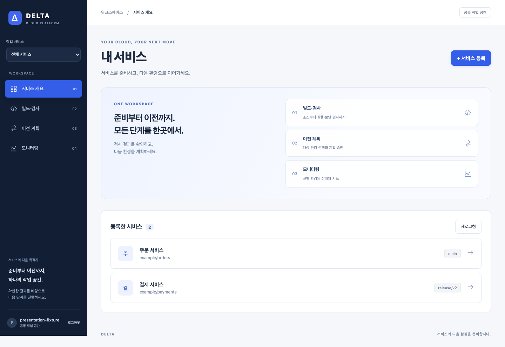
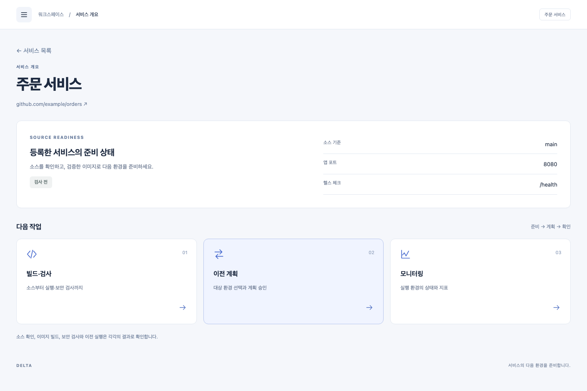
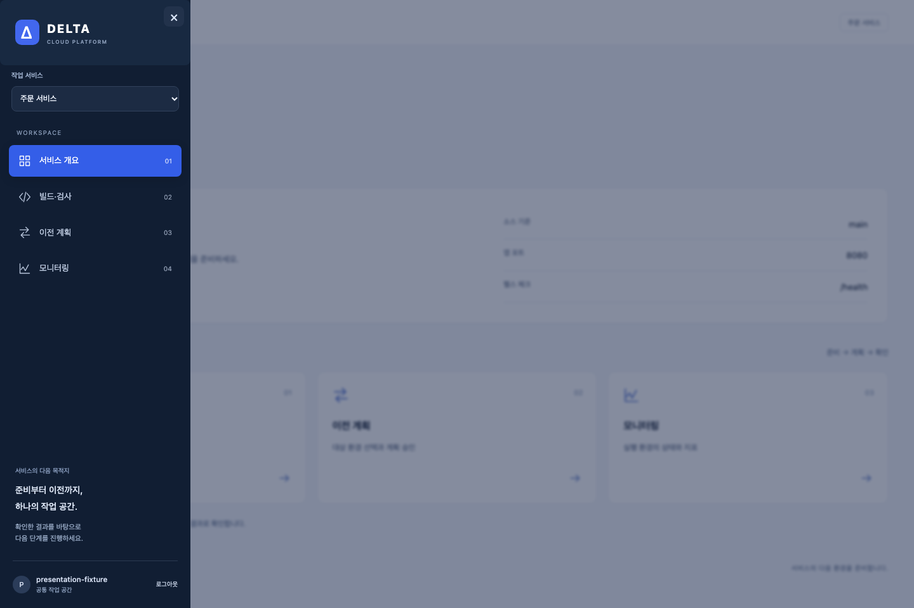
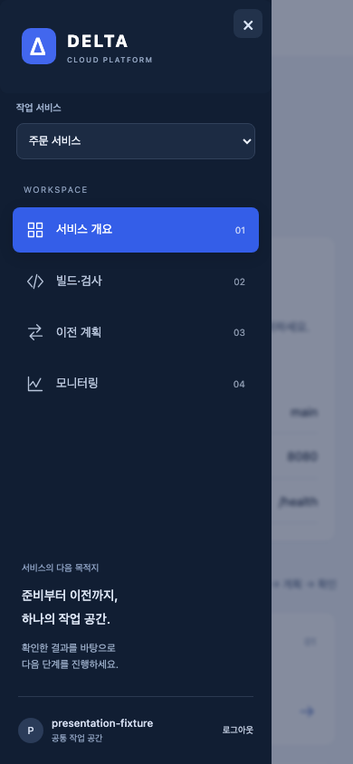

# 플랫폼 발표용 화면 개편

## 승인과 목적

- 2026-11-04: 사용자가 왼쪽 서랍 메뉴와 발표에 적합한 구조를 요청했고, 서비스 개요 / 빌드·검사 / 이전 계획 / 모니터링 설계에 `Then fix them and commit and open PR.`로 구현·검증·커밋·PR 생성을 승인했다.
- 대상: 발표자와 플랫폼을 처음 보는 청중. 긴 단일 화면을 단계별 화면으로 나누고 현재 서비스, 상태, 다음 동작을 쉽게 찾게 한다.
- 로그인 제거는 후속이다. 현재 인증·CSRF와 API 실행 계약을 유지하고 화면 틀은 인증 정보와 분리한다. 실제 배포·인프라 변경·PR 병합은 이번 요청에 포함하지 않는다.

## 설계와 구현 계획

1. 인증과 독립된 AppShell: 데스크톱 고정 사이드바, 모바일 접근 가능한 모달 서랍, 서비스 선택, 현재 화면 표시.
2. URL hash로 서비스/화면을 보존하고 뒤로가기·새로고침을 지원한다.
3. 개요는 서비스 정보와 다음 행동을 표시한다. 빌드·검사는 기존 API와 결과를 재사용하고 세부 기록은 접는다. 이전 계획과 모니터링은 별도 화면으로 연결한다.
4. 밝은 본문, 짙은 사이드바, 일관된 강조색·간격·타이포그래피를 적용한다. 모니터링의 데이터 없음·오류·오래된 상태를 유지한다.

## 성공 기준과 검증

- 서비스 선택 후 각 화면 이동, 새로고침·뒤로가기, 모바일 서랍의 키보드·닫기 동작이 정상이다.
- 기존 등록·소스 확인·빌드·SAST/DAST·계획 승인·로그인 기능이 보존된다.
- 1440px 및 390px 화면을 캡처해 확인하고 가로 넘침이 없다.
- TypeScript/Vite 빌드, Prettier, 기존 브라우저 회귀와 새 탐색 회귀를 실제 실행한다.
- 구현·검증·커밋·PR 상태는 아래에 기록한다.

## 구현과 검증 결과

- 화면 틀 `AppShell`과 인증 코드를 분리하고 사이드바·모바일 모달 서랍을 추가했다. Escape, 닫기, 포커스 순환, 배경 스크롤 잠금과 메뉴 선택 후 본문 포커스를 지원한다.
- 서비스/화면을 hash에 유지한다. 잘못된 경로는 목록으로 복구하고 서비스 ID에 경로 구분자·쿼리를 허용하지 않는다.
- 서비스 개요에 등록 정보와 다음 작업 카드를 배치했다. 빌드 화면은 이미지/실행/보안으로 나누고 소스 세부 정보와 이력을 접었다. 이전 계획·모니터링은 선택한 서비스 기준으로 연결한다.
- 기존 API·인증·CSRF·실행 승인 의미는 유지했다. API나 실제 이전 실행 기능은 추가하지 않았다.
- 검증일: 2026-11-04. Node 24.22.2로 실행했다. 기본 셸의 Node20 대신 `npx --package=node@24 -c '…'`를 사용했다.
- `npm run format:check`: 통과.
- `npm run build`: TypeScript·Vite 빌드 통과.
- `npm run test:e2e`: 실제 로컬 시험 DB·API·Worker를 사용하는 기존 기능과 브라우저 fixture 기반 탐색·관측·계획 시험을 함께 실행해 **20 passed**. 실제 클라우드 실행을 검증한 수치는 아니다.
- `npx playwright test --config=playwright.fixture.config.ts --output=../../.validation/presentation-browser`: **7 passed**. 탐색·키보드·새로고침·뒤로가기·잘못된 경로·모니터링·계획 승인 동작을 검증했다.
- 데스크톱 1440×960과 모바일 390×844 캡처를 시각 확인했다. 아래 이미지는 API fixture를 사용한 화면 검증이며 운영 서비스 데이터가 아니다.

### 화면 미리보기

## 자체 검토

선택한 서비스가 화면 전환·새로고침·뒤로가기·모니터링에서 유지되는지, 읽기 전용 탐색이 실행 API를 호출하지 않는지, 로그인·CSRF·계획 승인 경계가 보존되는지 확인했다. 모바일 포커스 순환을 보완했고 빌드 버튼이 상세 정보에 밀리지 않도록 등록 정보와 커밋 기록을 접었다. 최종 `git diff --check`가 통과했다.

## 운영과 복구

화면 개편 PR #31, 웹 서랍 PR #37, 프로젝트 대시보드 PR #41은 병합·운영 배포를 완료했다. 아래 날짜별 배포 기록을 따른다. 이번 변경은 웹 번들이다. 기존 플랫폼 릴리스 절차로 배포하고 문제가 있으면 이전 웹 번들로 복귀한다. DB 스키마·인프라·로그인 정책 변경은 없다.

## 웹 서랍 후속 수정 (2026-11-04)

- 사용자 `I need drawer for the web platform.` 요청으로 데스크톱 고정 사이드바를 모든 화면 크기에서 메뉴 버튼으로 여는 왼쪽 서랍으로 변경한다. 기존 화면 개편 승인 범위의 수정이다.
- 설계·구현: 기본은 닫힌 상태이고 본문은 전체 너비를 사용한다. 단일 native dialog로 메뉴를 제공하며, 메뉴 버튼에 펼침 상태와 연결 대상을 표시한다. 열릴 때 짧은 슬라이드 효과를 적용하고 동작 줄이기 설정에서는 애니메이션을 생략한다.
- 닫기 버튼·Escape·배경 클릭·메뉴 선택을 지원한다. 열린 동안 배경 조작과 스크롤을 막고 키보드 포커스를 유지한다. 화면 크기를 바꿔도 열린 메뉴를 유지한다. 로그인과 API 계약은 유지한다.
- 테스트: 데스크톱 1440×960·모바일 390×844에서 기본 닫힘, 전체 너비, 열림 상태, 포커스 유지·복귀, 스크롤 잠금·복구, 닫기 방법, 화면 크기 변경, 메뉴 탐색·로그아웃을 검증한다. 기존 탐색 테스트는 메뉴를 먼저 여는 동작으로 갱신했다.
- `npm run build`: TypeScript/Vite 통과. `npm run format:check`: 통과.
- `node node_modules/@playwright/test/cli.js test --config=playwright.fixture.config.ts --output=../../.validation/web-drawer-final`: **8 passed**. 최초 실행의 메뉴 활성 상태 확인 테스트는 닫힌 서랍을 조회해 실패했으며, 메뉴를 열고 확인하도록 수정한 뒤 재검증했다.
- 위 미리보기는 후속 구현의 API fixture 화면이다. 애니메이션을 완료한 상태로 캡처해 데스크톱·모바일을 시각 확인했다. 실제 운영 배포를 검증한 이미지는 아니다.
- `npm run test:e2e`: 실제 로컬 시험 DB·API·Worker와 브라우저 fixture를 포함해 **21 passed (2.1m)**. 클라우드 배포 검증과 구분한다. 최종 `git diff --check`도 통과했다.

## 프로젝트 대시보드 개편 (2026-11-04 KST)

### 요청과 설계

- 사용자가 발표에 맞지 않는 정보 구성·디자인을 지적하고, 프로젝트 내부에서 진입하므로 중복 프로젝트 드롭다운이 필요 없으며 개발자들이 흔히 사용하는 대시보드를 원한다고 명확히 했다. 기존 프론트엔드 수정·검증·커밋·PR/검사 후 병합·배포 요청의 후속 수정이다.
- 초기 운영 확인에서는 서비스 2개에 연결된 환경이 없었다. 사용자 확인으로 기능 장애 추측 대신 디자인·프로젝트 문맥 요구사항에 집중했다. 진단의 오류 원인 가설 단계는 생략하고 원하는 사용자 흐름을 브라우저 회귀 검사로 고정했다.
- URL의 프로젝트를 기준으로 개별 서비스 정보를 읽는다. 대시보드에서 프로젝트 드롭다운과 자동 첫 서비스 선택을 없앤다. 전체 작업 공간에서 모니터링을 누르면 먼저 서비스 목록에서 대상을 선택한다.
- 구조: 프로젝트 링크·대시보드 제목·새로고침 → 실행 환경 탭·조회 기간 버튼 → 요청/오류율/p95 지표와 실제 시계열 → 앱·DB / 서버 상태 → 경고·오류 / 요청 경로.
- 환경 미연결·조회 실패·데이터 없음은 0 또는 정상으로 보이지 않게 한다. 환경이 없어도 동일 카드 구조와 연결 안내를 제공한다. 그래프는 실제 수집 시각으로 간격을 계산하고 데이터가 2점 미만이면 그리지 않는다.

### 구현과 확인

- `ObservabilityPanel`은 필수 `serviceId`를 받으며 프로젝트 재선택 UI를 제거했다. 환경과 기간은 버튼으로 전환한다. 미연결 상태에서도 새로고침으로 환경 목록을 다시 조회한다.
- 오류·지연·미지원·DB 이전 상태의 의미를 유지했다. 환경/기간이 바뀌는 동안 이전 스냅샷을 새 선택의 데이터로 표시하지 않는다. API·인증·실제 데이터는 변경하지 않는다.
- 수정 전 `playwright test --config=playwright.fixture.config.ts --grep "프로젝트 대시보드는"` 실행에서 본문의 드롭다운이 기대 0개/실제 3개로 실패하는 것을 확인했다. 구현 후 프로젝트 문맥·드롭다운 제거·환경 탭·새로고침 검증이 통과했다.
- `npm run build`, `npm run format:check`: 통과. 최초 fixture 검사 **10 passed**. 데스크톱 1360px·모바일 390px의 실제 브라우저 캡처를 시각 확인했다. 캡처의 지표는 테스트 fixture이며 운영 데이터가 아니다.
- 최종 `npm run test:e2e`: **24 passed (2.2m)**. 실제 로컬 시험 DB·API·Worker와 fixture 회귀를 포함하며 운영 데이터 검사와 구분한다. 원격 CI·운영 배포는 후속이다.
- [데스크톱 미리보기](../images/project-dashboard/desktop.png) · [환경 미연결](../images/project-dashboard/empty.png) · [모바일](../images/project-dashboard/mobile.png). 모두 API fixture를 사용한 화면이다.

## 운영 배포 완료 (2026-11-04 23:45 KST)

- 사용자가 `배포해`로 운영 반영을 요청했다. 서랍 수정 PR #37은 검사 10개 통과 후 main에 병합했다(`669f414`).
- main `5f3236c88bd3b632e4b7456e9c1978ce8be43a79`로 `gh workflow run platform-release.yml --ref main`을 실행했다. [Release 41849097814](https://github.com/2026-sbh-delta/delta-network-gateway/actions/runs/41849097814)의 검사·ARM64 이미지 빌드·게시·기존 설정을 사용한 VM 배포·HTTPS readiness가 모두 성공했다. 이번 실행은 인프라 Apply를 수행하지 않는다.
- [운영 주소](https://d3udcz0zch0on.cloudfront.net)는 유지했다. `curl --fail .../health/ready`로 `{"status":"ready"}` 응답을 확인했다.
- Playwright로 실제 운영 로그인, 데스크톱 1440×960 서랍 열기·Escape 닫기, 모바일 390×844 메뉴 열기·모니터링 이동·닫기, 로그아웃을 검증했다. 브라우저 pageerror는 0건이고 모바일 가로 넘침이 없었다. 데스크톱·모바일 캡처를 시각 확인했다.
- 배포 전후 서비스 ID 목록을 비교해 기존 서비스 2개의 보존을 확인했다. 고객 서비스 등록·빌드·SAST/DAST 실행은 이 배포 확인에서 수행하지 않았다.
- 실행 증거·운영 화면은 작업 트리의 ignored `.validation/drawer-release/`에 보관한다. 로그인 비밀값과 세션은 기록에 포함하지 않는다.
- 워크플로는 여전히 수동 실행 방식이다. main 병합 자체가 자동 배포를 의미하지 않는다.

## 프로젝트 대시보드 운영 반영 (2026-11-05 00:16 KST)

- 구현 커밋 `97d32e0`, [PR #41](https://github.com/2026-sbh-delta/delta-network-gateway/pull/41)의 원격 검사 11개가 모두 통과했다. 확인한 head로 병합해 main `7989f6d4cc19885ab3a82bc7af21ac415238d785`에 반영했다.
- `gh workflow run platform-release.yml --ref main`의 [Release 41854211786](https://github.com/2026-sbh-delta/delta-network-gateway/actions/runs/41854211786)가 검사·ARM64 이미지 빌드·기존 설정 기반 배포·HTTPS 검사까지 성공했다. 인프라 Apply나 고객 앱 실행은 하지 않았다.
- 운영에서 Playwright로 서비스 개요 → 서랍의 모니터링 → 해당 서비스 ID의 대시보드 진입을 확인했다. 본문 select 0개, 프로젝트 이름·URL 유지, 새로고침 후 같은 프로젝트, 모바일 가로 넘침 없음, 서비스 개요 복귀, 로그인·로그아웃을 검증했다. pageerror는 0건이다.
- 운영 서비스 2개를 배포 전후 ID로 비교해 보존을 확인했다. 실제 실행 환경은 미연결 상태였으며, 연결 안내·3개 지표 카드의 `—`·재조회 동작을 확인했다. 실측 그래프 표시를 운영에서 확인한 것은 아니며 해당 경로는 브라우저 fixture로 검사했다.
- `curl --fail https://d3udcz0zch0on.cloudfront.net/health/ready`는 `{"status":"ready"}`였다. 주소는 그대로다. 운영 캡처·비밀값 없는 검증 JSON은 ignored `.validation/dashboard/`에 보관하고 데스크톱·모바일 캡처를 시각 확인했다.

## 서랍 드롭다운 테마 (2026-11-05)

- 사용자 요청: 왼쪽 서랍의 드롭다운이 다른 테마로 보여 서랍과 통일한다. 운영에서 선택 요소의 `color-scheme`이 `normal`인 것을 확인했다.
- 서랍의 서비스 선택에 `color-scheme: dark`와 옵션 배경·글자색을 지정했다. 지원 브라우저에서는 native `base-select`와 `::picker(select)`로 펼친 목록·테두리·선택·호버 색을 남색/파란 서랍 테마에 맞춘다. 미지원 브라우저는 기존 native select와 어두운 색상 설정을 사용한다. 다른 폼에는 적용하지 않는다.
- JavaScript·선택·라우팅 계약 변경은 없다. 키보드와 native 선택 의미를 유지한다.
- `npm run build`, `npm run format:check` 통과. 기존 fixture 브라우저 검사 **11 passed**. 단순 스타일 변경이므로 새 영구 테스트는 추가하지 않았다.
- 별도 로컬 Playwright 확인에서 light/dark 두 설정의 계산된 dark 테마, 방향키·Enter 선택, 모바일 옵션 클릭·프로젝트 이동, 가로 넘침 없음을 확인했다. 데스크톱·모바일의 펼친 목록 캡처를 시각 확인했다. [미리보기](../images/platform-presentation/drawer-select.png)는 테스트 데이터다.
- 원격 CI·병합·운영 반영은 후속이다.

### 드롭다운 운영 반영 (2026-11-05 00:46 KST)

- 구현 `83d19ad`, [PR #43](https://github.com/2026-sbh-delta/delta-network-gateway/pull/43)의 원격 검사 11개 통과 후 병합했다. main `4a1924be769074f7278cc4a52643e016e2cd7cc7`의 [Release 41859205247](https://github.com/2026-sbh-delta/delta-network-gateway/actions/runs/41859205247)가 검사·이미지 빌드·배포·HTTPS readiness까지 성공했다.
- 운영 Playwright로 선택 요소의 `color-scheme: dark`, 펼친 목록의 `rgb(28, 43, 67)` 배경, 서비스 선택 후 해당 서비스 화면 이동, 모바일 가로 넘침 없음, 로그인·로그아웃을 확인했다. 페이지 스크립트 오류는 0건이고 기존 서비스 2개를 보존했다.
- 데스크톱·모바일에서 펼친 드롭다운 색상을 확인했다. 운영 확인은 Chromium 기준이며, 다른 브라우저의 native popup 모양이 픽셀 단위로 동일함을 보장하지 않는다. 로컬 light/dark 설정과 native 키보드 선택은 앞선 확인을 따른다.
- 공개 주소는 유지했고 `/health/ready`는 `{"status":"ready"}`였다. 검증 JSON과 운영 캡처는 ignored `.validation/dropdown/`에 보관한다.

## 발표 계획·프로젝트 삭제 릴리스 (2026-11-05)

- 사용자 제공 `PLATFORM_FRONTEND_PLAN.md`를 반영한 프론트엔드 PR #45와, 별도 최소 백엔드 변경 승인을 받은 프로젝트 삭제 PR #46을 main에 병합했다. 초기 구현/선택적 조회 계약은 `platform/web/IMPLEMENTATION.md`, 삭제 경계는 [프로젝트 삭제 기록](platform-project-delete.md)을 따른다.
- 사용자 `Release it.` 요청으로 main `445c32f`의 [Release 41929791403](https://github.com/2026-sbh-delta/delta-network-gateway/actions/runs/41929791403)를 실행해 성공했다. 배포 검사·ARM64 이미지 게시·기존 VM 릴리스·HTTPS 준비 상태 확인을 완료했다. 인프라 Apply는 없었다.
- 공개 웹에서 새 개요·구성 요소/환경 카드, 서랍의 어두운 선택 테마, 프로젝트별 대시보드 문맥·새로고침, 1440px/390px 삭제 확인창·취소, 로그인/로그아웃을 확인했다. 기존 프로젝트 4개의 등록 정보를 보존했고 브라우저 오류는 0개였다.
- 기존 프로젝트를 삭제하지 않았다. 새 삭제 API는 존재하지 않는 UUID와 필수 이름 누락 요청의 422 응답으로 연결·입력 검증을 확인했다. 실제 삭제 동작은 테스트 DB에서 검증한 결과와 구분한다.
- FE·BE 묶음/공개 AI 차분/구성 요소별 관측 데이터는 이번 배포가 새로 생성하거나 연결하지 않는다. 기존 API 응답에 없는 데이터는 계속 미연결/확인 필요로 표시한다.
- 운영 확인 시각: 2026-11-05 08:10 KST. [플랫폼 주소](https://d3udcz0zch0on.cloudfront.net)는 변경되지 않았다.
