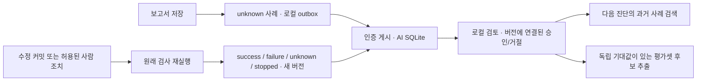

# 검증된 장애 사례와 진단 피드백

## 승인·범위

2026-11-06 사용자가 제안한 1차 범위(사례 저장, 조치 결과 검증, 검토 후 검색, 평가셋 후보 추출)를 승인하고 구현을 요청했다. Ideation/Inception/Construction 설계는 이 실행 요청 범위로 진행한다. 별도 `codex/verified-case-learning`, 기준 `3ddf601`. 팀 SAST/DAST/platform 변경, 공용 배포, Git 게시, Slack/Notion 쓰기는 범위 밖이다.

## 로컬 ADR 초안 — 팀 번호 미할당

- 문제: 보고서 확인/재시도 접수를 해결 성공으로 볼 수 없고, 과거 보고서가 다음 진단/평가에 연결되지 않는다.
- 기존 보고서는 불변으로 유지한다. 별도 버전 사례에 입력/보고서 해시, 환경/코드/이미지, 조치, 재검사 범위/근거와 success/failure/unknown/stopped를 연결한다. 성공은 해당 단계의 확인에 한정하며 원인 가설 확정과 구분한다.
- AI 서비스의 별도 SQLite 저장소에 버전을 보관한다. 그래프는 기존 인증으로 게시만 가능하고, 승격/거절은 서버 로컬 CLI와 OS 접근권한으로 분리한다. 검토는 정확한 버전 해시에 묶인다. 새 결과는 재검토가 필요하다.
- 진단은 같은 서비스/환경/단계의 승인된 사례만 제한 검색한다. 오류 코드/규칙을 추가 비교한다. 현재 실행과 동일 관측은 제외한다. 과거 사례를 이번 관측으로 취급하거나 자동 실행/승인하지 않는다.
- 기존 진단 API에 호환 가능한 context/사례 참조를 추가한다. 검색된 스냅샷을 보고서에 묶고 LLM 요청 해시에도 반영한다.
- 그래프 보고서 저장 후 unknown 사례를 자동 생성한다. 사람 조치 후 원래 단계의 재검사 결과를 연결한다. 로컬 outbox가 AI 장애 시 기록을 보존하며 재전송은 멱등이다. 이전 사건/성공한 재시도를 소급 추측하지 않는다.
- 평가셋은 사람이 별도로 작성한 기대 확인 항목/금지 단정으로 생성한다. LLM 가설을 정답으로 자동 승격하지 않는다. 평가에 포함한 모든 원본/동일 관측 사례를 검색에서 제외한다.
- 단일 AI 저장소의 현 서비스 범위이다. 다중 테넌트 권한체계/전용 UI/의미 검색/자동 규칙 활성화/파인튜닝은 후속이다.

## 작업 단위·검증 기준

1. 사례 스키마/SQLite 버전·승격·검색·CLI. 재시작/동시 쓰기/중복/역순 게시, 비밀값 마스킹, 서비스 경계 검사.
2. 진단 검색·출처 검증·실제 프롬프트 해시 및 보고서 표시. 과거 사례를 현재 증거로 인용하면 거부.
3. 그래프 보고서/재검사 연결·outbox. 확인/접수만으로 success 금지, 학습 저장 실패가 게이트를 바꾸지 않음.
4. 평가셋 추출/고정 검색 스냅샷/기준 대비 비교. 동일 사례 정답 누출 차단.

## 현재 상태

설계·로컬 구현 완료. 실제 AWS/Claude 검증, 배포, 커밋, 푸시, PR/main 반영 없음. 테스트 최종 결과는 아래에 기록한다.

## 제공되는 경로와 범위



- 사례 생성: 진단 보고서 저장 시 시작한다. 확인/중단은 unknown/stopped다. 보고서 생성 전에 자동 복구로 끝난 장애와 과거 실행을 소급 추측해 라벨링하지 않는다.
- 결과 연결: 기존 GCP DAST 수정→새 커밋/빌드→DAST 재검사, 온프레미스 사람 조치→원래 실행 재검사에 연결했다. 온프레미스 pass는 runtime UID/이미지/HTTP/정리 검사 범위이며 DAST/전체 이전 통과와 구분한다. 범위·해시·실제 확인한 바인딩 상세를 사례에 보존한다.
- 게시: 그래프 보고서와 체크포인트를 보존하고 별도 `case-outbox`를 사용한다. AI 장애 시 pending, 다음 실행/재개 시작에 최대100개 재전송한다. 개별 사례 저장 시에도 게시를 시도한다. 새 모델 호출/클라우드 실행/승격은 재전송에 포함되지 않는다. 첫 미전송 건에서 서비스 오류가 나면 나머지는 보존된다.
- 검토: API 게시자는 승인할 수 없다. AI 서버 로컬 CLI/OS 접근 권한을 가진 운영자가 원본 보고서와 재검사 상세를 확인한다. 새 결과 버전은 승인 상태를 상속하지 않는다. 같은 버전의 승인을 거절로 바꾸면 검색에서 즉시 제외되며 이전 검토 이벤트는 남는다. 현재 실행 중 진단은 이미 선택한 사례 스냅샷을 사용한다.
- 검색: 동일 서비스/환경/노드 + 같은 오류 코드 또는 규칙 교집합. 최대200개 최신 승인 후보 중 최대3개를 결정적으로 선택한다. 텍스트 의미 검색이 아니며 문장만 비슷한 사례를 찾지는 않는다. 모델 입력에서 검토 기대값은 제외하고, 현재 관측과 과거 증거를 구분한다. 사례 ID/원본 실행/버전/결과 범위를 보고서 JSON/Markdown·기존 화면에 표시한다.
- 영속성: 기본 사례 DB는 기존 `DELTA_RULE_STORE`와 같은 디렉터리이므로 기존 AI 볼륨에 남는다. 다른 경로의 `DELTA_CASE_STORE`를 지정할 때는 해당 경로를 영속 볼륨으로 연결해야 한다. SQLite 파일0600, outbox0600, 사례 디렉터리0700. 기존 보고서/룰 후보 DB는 수정하지 않는다.

## 운영자 사용법

AI 서버에서 해당 서비스의 Python 환경으로 실행한다. 아래 경로는 예시이며 실제 `DELTA_RULE_STORE`/`DELTA_CASE_STORE`를 따른다. 생산자 토큰을 CLI 인수로 넘길 필요가 없다.

```bash
python -m delta_ai.case_cli --store /state/verified-cases.sqlite list
python -m delta_ai.case_cli --store /state/verified-cases.sqlite list --offset 50
```

목록의 최신 `case_id`/`revision`, `case.resolution.checks`의 상세와 원본 보고서를 확인한 뒤 검토 파일을 작성한다. 다음은 형식 예시이며 실제 결과를 확인한 운영자의 이름/근거/기대값으로 작성한다.

```json
{
  "decision": "approved",
  "reviewer": "operator",
  "reason": "동일 작업 ID와 이미지 바인딩, HTTP 재검사 근거를 확인했다. 원인 가설은 미확정이다.",
  "required_terms": ["HTTP", "작업"],
  "forbidden_terms": ["전체 이전 완료"]
}
```

```bash
python -m delta_ai.case_cli --store /state/verified-cases.sqlite review CASE_ID REVISION --file review.json
python -m delta_ai.case_cli --store /state/verified-cases.sqlite export CASE_ID --output candidates.json
python -m delta_ai.case_cli --store /state/verified-cases.sqlite evaluate candidates.json --llm fake --output fake-evaluation.json
```

`required_terms`는 모델 가설에서 자동 생성하지 않는다. 독립 기대 확인 항목이 없는 사례도 검색용 승인할 수 있지만 평가셋으로 추출할 수는 없다. `decision: rejected` 검토 파일로 같은 명령을 실행하면 승인 취소 이력을 추가한다. export/evaluate 출력은0600, 기존 파일 덮어쓰기 금지다.

실제 모델 비교는 승인된 비용 범위에서 `--llm claude`로 실행한다. 키는 기존 비밀 파일에서 해당 명령에만 제공하고 출력하지 않는다. baseline/with_cases 각1회이므로 사례 수의2배 모델 호출이다. fake/none 결과를 실제 모델 성능으로 설명하지 않는다.

## 평가 해석

추출한 평가 후보는 request/report/검증 결과와 정확한 버전, 독립 기대 문자열·금지 단정을 포함한다. 평가기는 먼저 승인 검색 후보를 고정하고 모든 평가 원본 ID/동일 관측 signature를 제외한다. 실행 ID/커밋 해시가 달라졌어도 같은 관측 본문은 동일 signature로 정규화한다. 기대값과 저장된 원래 AI 보고서는 모델에게 주지 않는다.

출력 지표는 baseline/with_cases의 통과 수, 누락 확인 항목, 금지 단정, 모델 분석 상태, 검색한 사례/스냅샷이다. 문자열 검사는 의미적 원인 정확도 전체를 측정하지 않는다. 판단 품질 개선은 실제 모델·독립 평가셋으로 후속 실측해야 한다.

## 통합·복구 주의

이 소스는 onprem 검증 브랜치 기준이며 공용 런타임 최신본으로 자동 배포하지 않았다. 기존 공유 오케스트레이터 변경을 보존해 통합해야 한다. AI/그래프 계약을 함께 갱신하며 기존 인증/TLS/볼륨을 보존한다. 사례 쓰기/검색 장애는 원래 실행 게이트를 바꾸지 않는다. 기능을 되돌릴 때 기존 보고서/체크포인트/사례 DB/outbox를 삭제하지 않는다. 이전 버전 AI는 새 context/사례 게시 API를 지원하지 않으므로 두 서비스 동시 호환 검증이 필요하다.

## 검증 기록

2026-11-06, 준비된 Python3.12 venv와 이 worktree의 소스 경로를 명시해 실행했다. 서로 같은 테스트 모듈 이름이 있어 AI와 pipeline/orchestrator는 분리 실행한다.

```bash
PYTHONPATH=services/delta-ai ../delta-network-gateway-diagnostics-handoff/.venv/bin/python -m pytest -q services/delta-ai/tests --tb=short --junitxml=../notes/verified-case-learning-20261106/ai-tests.xml
PYTHONPATH=services/delta-ai:services/delta-pipeline:services/delta-orchestrator:platform/backend ../delta-network-gateway-diagnostics-handoff/.venv/bin/python -m pytest -q services/delta-pipeline/tests services/delta-orchestrator/tests --tb=short --junitxml=../notes/verified-case-learning-20261106/pipeline-tests.xml
node --check services/delta-orchestrator/delta_orchestrator/static/app.js
git diff --check
PYTHONPATH=services/delta-ai ../delta-network-gateway-diagnostics-handoff/.venv/bin/python -m delta_ai.case_cli --help
```

- AI **333 passed / 1.93秒**, pipeline/orchestrator **187 passed / 24.27秒**, 합계 **520 passed**. 새 사례 전용 시험은 AI14개 + pipeline11개로 기존 회귀를 포함한다. pytest-asyncio의 기존 fixture-loop 기본값 경고는 남아 있으며 실패는 없다.
- 실제 그래프를 로컬 가짜 실행 도구로 구동하여 수정→새 커밋/빌드→DAST 재검사 성공/다시 재현된 실패/사람 승인으로 미해결 유지/중단을 확인했다.
- 실제 DiagnosticClient 직렬화·Bearer·크기 제한을 FastAPI TestClient에 연결하여 그래프→인증 게시→검토→다음 진단의 과거 사례→평가셋 추출까지 검증했다. 외부 HTTP 서버나 실제 클라우드 스캐너 호출 시험은 아니다.
- 별도 프로세스를 사람 확인 대기/재배포 접수 뒤/조회 뒤에 강제 종료하고 재개했다. 각 시험은 기존3회 실패 후 사람 재배포1회, 총 native작업4개를 유지하며 완료 사례1개를 기록했다. 실제 k3s 장애 시험이 아니라 영속 fake provider fixture다.
- DB 재시작/동시 게시8건/중복·역순 재전송, 새 버전 재검토, 승인 취소 감사, 현재 실행/같은 관측/다른 서비스·환경·오류 제외, 비밀값 마스킹, 미인증401·검증오류422 비밀값 비반사·과대입력413을 확인했다.
- 기대값 독립 작성, 평가 원본·중복 제외, 모델 호출 중 승인 추가에도 평가 검색 스냅샷 유지, 현재 근거/과거 사례 인용 검증 및 조회 실패 한계를 확인했다. 품질 평가 시험은 가짜 모델이며 실제 진단 품질 향상 수치가 아니다.
- JS 구문/CLI 도움말/공백 검사 통과. 보안 검토는 인증·생산자/검토 분리·서비스 범위·SQL 매개변수·영속 파일 권한·비밀값·출력 HTML escaping을 확인했다. 변경 범위에서 미해결 critical/high 발견 없음. 실제 클라우드·실제 Claude·브라우저 시각 검증·공용 최신본 재통합은 실행하지 않았다.

증거는 작업 루트 `notes/verified-case-learning-20261106/{ai-tests.xml,pipeline-tests.xml,summary.json}`에 있다. Git 소스는 미커밋/미푸시, PR/main 반영·원격 CI·AWS 변경·팀 Slack/Notion 쓰기 없음.
