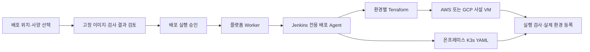

# 사용자 선택에 따른 앱 배포

서비스 등록 시 AWS/GCP VM 사양 또는 온프레미스 호스트·앱 자원 한도를 저장한다. 이미지 빌드와 대상별 샌드박스 검사 후 계획을 검토하고 **대상 앱 배포**를 실행한다. 이전에서는 GCP와 온프레미스를 함께 선택할 수 있다. 대상마다 실행 ID·성공·실패를 따로 보관하며 원본을 수정하거나 삭제하지 않는다.



## 현재 범위

- AWS: AL2023 x86_64 VM, `t3.micro` 또는 `t3.small`, Docker, SSM 배포.
- GCP: Debian 12 x86_64 VM, `e2-micro` 또는 `e2-small`, Docker, OS Login/IAP 배포. ECR 이미지를 같은 digest로 Artifact Registry에 복사한다.
- 온프레미스: 기존 K3s 서버의 새 `delta-apps` namespace. VM 생성 없이 앱 전체 500m/512Mi 또는 1000m/1024Mi 한도를 적용한다. FE·BE는 각각 Deployment·Service로 만들고 합산 한도를 나눠 쓴다. 기존 demo·delta-notes는 수정하지 않는다.
- 최초 배포 한 곳, 이전 한 곳 또는 두 곳. 작은 배포 Agent는 한 번에 한 작업씩 처리한다. 두 곳을 함께 요청해도 실제 생성 시작 시각이 같다는 의미는 아니다.
- 성공하면 실제 VM ID 또는 Kubernetes UID를 플랫폼 환경에 자동 등록한다. 온프레미스 삭제용 Worker의 namespace 접근 권한도 준비해야 앱 삭제가 가능하다.

**앱 준비 완료와 서비스 이전 완료는 다르다.** 현재 실행기는 추가 DB 비밀 값이 필요 없는 이미지를 사설 환경에 준비한다. 실행 검사는 앱의 시작/응답을 확인하며 SAST·DAST 보안 승인 전체를 뜻하지 않는다. 고객 트래픽을 받는 LB·도메인 연결, DB 연결 비밀 값 전달·데이터 복제·쓰기 전환, 로그인 세션 유지, 보안 승인 후 트래픽 전환은 후속 연결 대상이다. 메모리 안에만 저장한 데이터는 이미지 배포로 복사되지 않는다. 대상 준비만으로 원본을 내리지 않는다.

## 실행기 연결

기존 이미지 빌드 Agent에 Terraform 권한을 추가하지 않는다. 별도 VM/격리 Agent를 `delta-deployer` 전용 라벨·실행기 1개로 등록한다. 고객 Dockerfile이나 Jenkinsfile을 이 Agent에서 실행하지 않는다. Job의 파이프라인은 저장소의 고정된 `Jenkinsfile`을 사용하고 일반 개발자가 바꿀 수 없게 한다.

Agent에 필요한 도구: Python 3.12와 `platform/backend`의 잠금된 의존성, Terraform 1.16.x, gcloud CLI, kubectl. `/opt/delta/workloads`에 이 디렉터리를 읽기 전용 배치하고 `/opt/delta/venv`에 Python 환경을 준비한다. Jenkins controller에는 `Jenkinsfile`과 `job.groovy`를 읽기 전용으로 배치하고 Job DSL로 배포 Job을 등록한다. 전용 API 사용자는 이 Job의 조회·실행·취소만 허용한다. 기존 이미지 Job과 전용 배포 Job의 권한이 섞이지 않게 한다.

`config.example.json`의 `REPLACE_*`를 실제 연결값으로 바꿔 Agent의 `/etc/delta/deployment.json`에 0600으로 저장한다. 이 파일이나 kubeconfig를 Git·빌드 artifact에 넣지 않는다. AWS는 인스턴스 역할, GCP는 WIF/ADC 등 단기 자격 증명을 사용한다. 예제는 실제 연결 완료 설정이 아니다.

플랫폼 API·Worker 설정(기존 SSM runtime의 `app_env`)에는 아래 값만 추가한다. 기존 로그인·Jenkins·DB 설정을 보존한다.

| 설정 | 값 |
|---|---|
| `PLATFORM_DEPLOYMENT_JENKINS_JOB` | `delta-platform-deploy` |
| `PLATFORM_DEPLOYMENT_JENKINS_USER` | 전용 배포 API 사용자 ID |
| `PLATFORM_DEPLOYMENT_JENKINS_TOKEN` | 해당 사용자의 API 토큰, SecureString에 저장 |
| `PLATFORM_DEPLOYMENT_CONNECTIONS` | 아래 JSON을 한 줄 문자열로 저장 |

```json
{"aws":{"revision":"v1","account_id":"616723161368"},"gcp":{"revision":"v1","gcp_project":"term2-delta"},"onprem":{"revision":"v1","host_id":"delta-onprem"}}
```

연결 준비가 끝난 대상만 위 JSON에 포함한다. 네트워크·IAM·SA·Agent 설정을 바꾸면 해당 `revision`을 올리고 새 계획을 만든다. API 설정과 Agent 설정의 `identity`가 일치하지 않으면 실행을 거부한다. 공유 Jenkins URL·CA·빌드 ECR 설정은 기존 값을 사용한다. 설정이 없으면 화면에서 사양 선택·계획 검토는 가능하지만 실행은 차단한다.

## 환경 담당자에게 받을 것

| 환경 | 필요한 연결 정보·조건 |
|---|---|
| AWS | 고객용 사설 subnet·SG, AL2023 x86_64 고정 AMI, SSM/ECR 읽기 VM 역할. Agent에는 이 subnet에서 EC2 생성·조회·태그와 해당 역할만 PassRole, 해당 앱 VM에 SSM 명령 권한. NAT/Endpoint와 Agent→8088 경로. |
| GCP | 서울 subnet·zone·고정 Debian 이미지, Artifact Registry 저장소, 읽기 전용 VM SA, 네트워크 태그. Agent에는 지정 프로젝트 VM 생성/조회·SA 사용·OS Admin Login·IAP·이미지 복사 권한. NAT/Private Google Access와 Agent→8088 경로. |
| 온프레미스 | `onprem-baseline.yaml` 적용 후 namespace UID·kube-system UID, 제한된 kubeconfig, 사설 IP, Agent/LB 허용 CIDR. 기존 ECR pull 인증 갱신을 `ecr-pull` Secret에 연결. Agent→6443·앱 NodePort 경로. |

공용 TGW/VPN·방화벽은 이 실행기가 변경하지 않는다. 사설 경로가 연결되지 않으면 실제 실행 검사에서 실패한다. 표시되는 앱 주소도 해당 네트워크에서만 접근할 수 있다. GCP Cloud Run 샌드박스 성공은 최종 VM 네트워크 검증을 대신하지 않으므로 VM 배포 후 다시 검사한다.

온프레미스 baseline의 총 예산은 1.5 CPU/1.5GiB, 최대 앱 진입점 3개다. 남은 용량이 부족하면 quota/실행 검사에서 실패하며 다른 앱을 밀어내지 않는다. UID 10001로 실행할 수 있는 이미지를 사용한다. DB·볼륨을 자동 만들지 않는다. 전용 pull Secret 갱신과 kubeconfig 단기 토큰 갱신은 운영 설정에 포함한다.

## 실패·복구·되돌리기

배포 계획의 해시·이미지·대상·검사 결과는 고정한다. Worker 재시작 시 기존 Jenkins 실행을 찾아 이어 간다. 접수 여부가 불확실하면 자동 재접수하지 않는다. 두 대상 중 실패한 곳을 재요청할 때는 성공한 곳을 제외한 새 계획을 검토한다.

Terraform state는 Agent의 영속 암호화 디스크 `/var/lib/delta-deploy/state/<환경 UUID>`에 보관한다. **기존 S3 bucket/state는 사용하거나 수정하지 않는다.** 이 저비용 구성은 단일 배포 Agent를 전제로 한다. Agent 교체 전 state를 보존해야 하며 다중 Agent 운영은 별도 공유 state/잠금 설계가 필요하다. Jenkins workspace 정리로 state가 지워지지 않게 한다.

실패 시 생성된 VM은 조사·정리를 위해 남을 수 있다. 플랫폼 계획의 환경 UUID와 해당 state를 확인하고, 연결 정보를 유지한 채 해당 디렉터리에서 `terraform plan -destroy`를 검토한 후 명시적으로 정리한다. 다른 state를 가져오거나 임의의 이름으로 VM을 삭제하지 않는다. 온프레미스 실패 자원도 같은 서비스·환경 라벨과 UID를 확인한다. 성공한 앱의 삭제는 기존 삭제 경로를 사용하고 DB·namespace·네트워크 정책은 보존한다.

DB schema `0009`가 필요하다. 기존 데이터는 유지하며 등록 선택값만 nullable로 추가한다. 배포 이력이 생긴 뒤에는 자동 downgrade를 막는다. 앱 이미지만 되돌리는 방식으로 schema를 낮추지 않는다.

## 사양·접속 기준

T3 사양은 [AWS 공식 사양](https://aws.amazon.com/ec2/instance-types/t3/), E2의 공유 코어 특성은 [GCP 공식 사양](https://docs.cloud.google.com/compute/docs/general-purpose-machines)을 기준으로 표시한다. IAP 관리 접속은 [GCP 공식 연결 문서](https://docs.cloud.google.com/iap/docs/using-tcp-forwarding)에 따라 TCP 22에 IAP 대역 `35.235.240.0/20` 접근과 OS Login 권한이 필요하다. 이 경로는 관리용이며 고객 트래픽 경로는 별도다.
