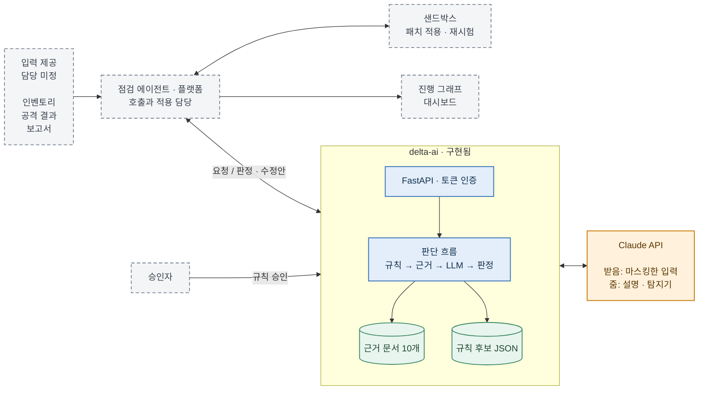
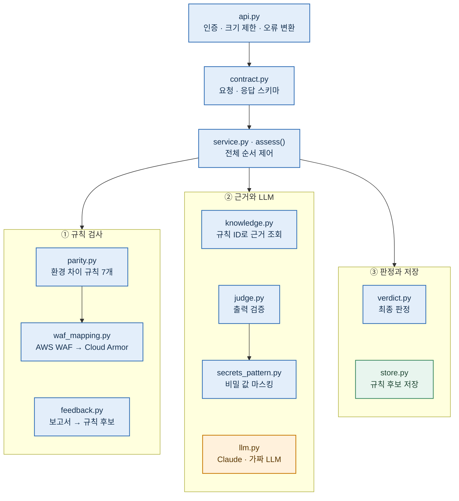
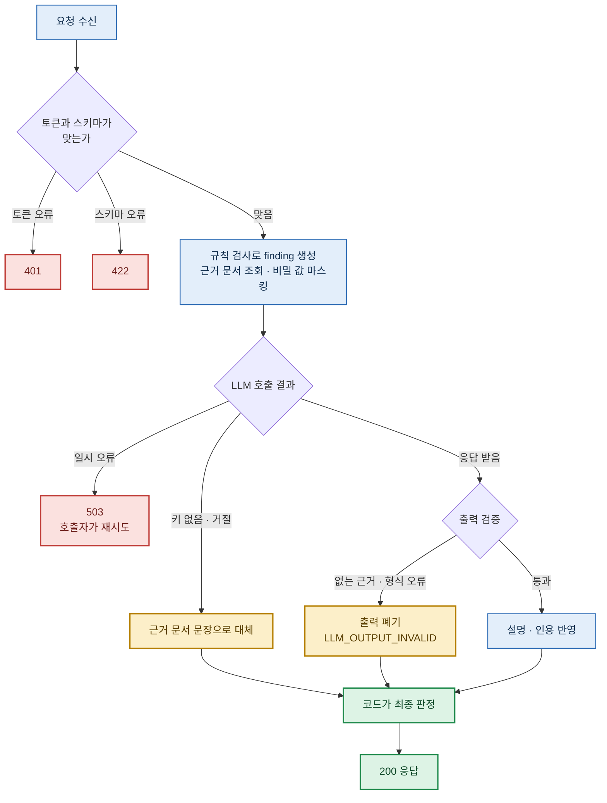
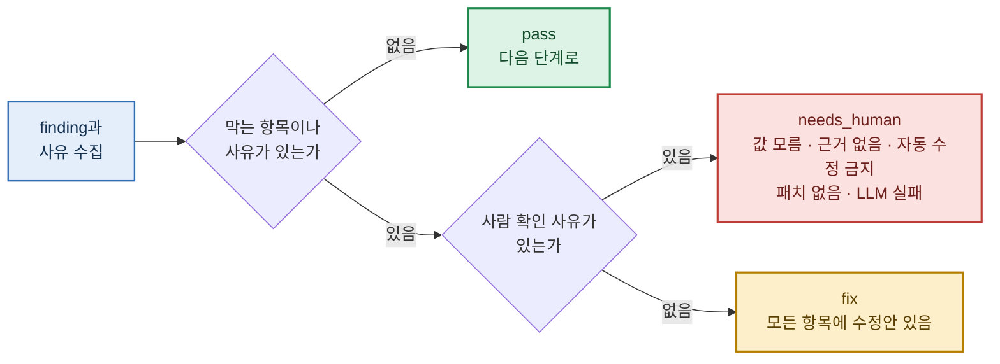
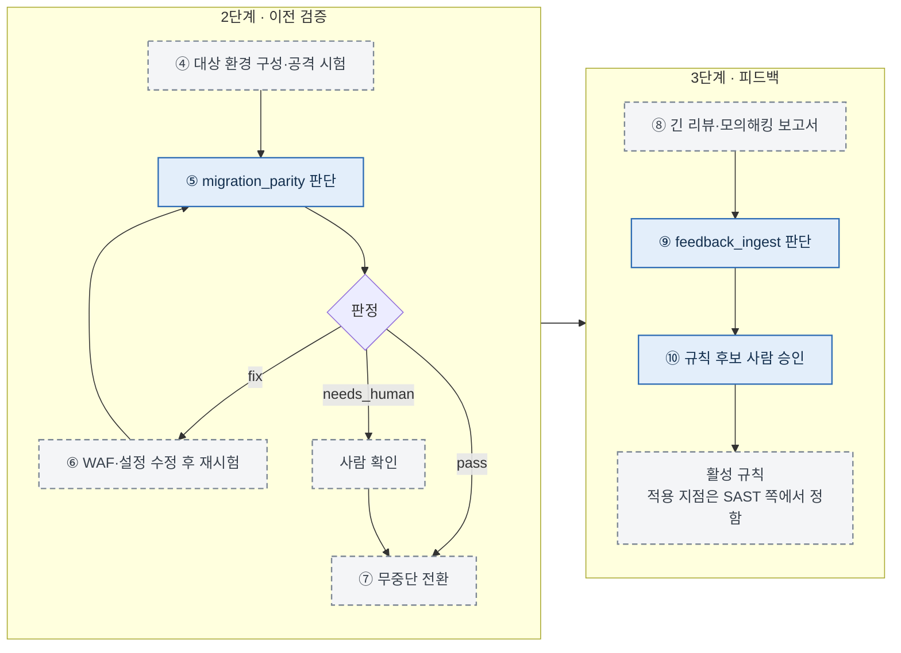
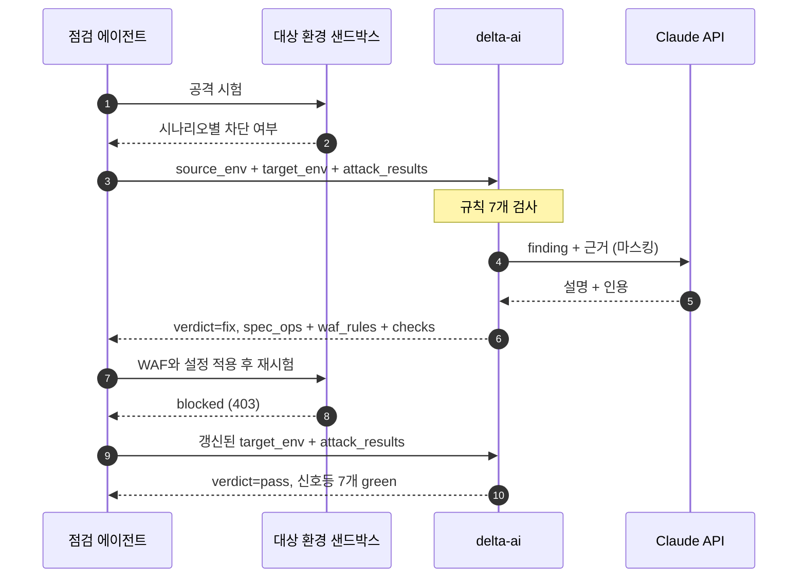
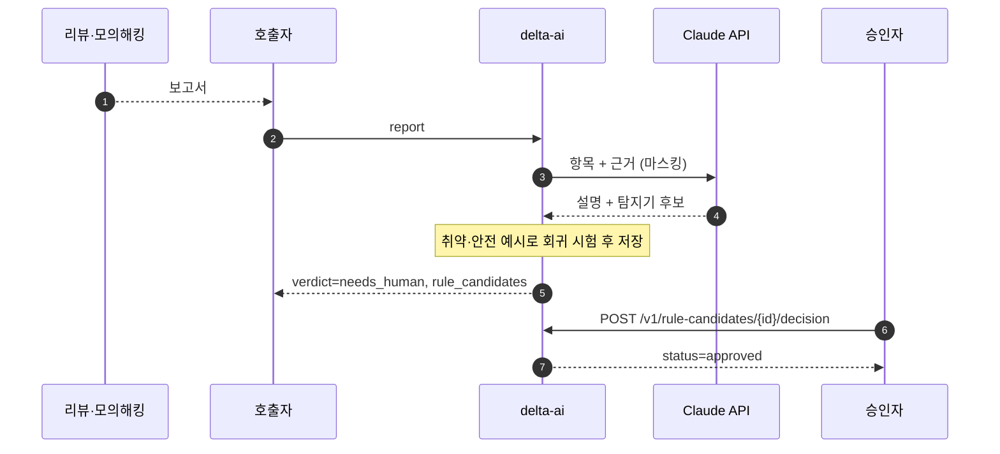

# delta-ai 구조와 데이터 흐름

> 상태: 제안 · 오너: 김연재 · 작성: 2026-11-01. 팀 합의 전 초안이다.
> 점선은 아직 없는 구성요소다. 호출 주체와 담당은 회의에서 정한다.

## 현재 상태

| 구분 | 내용 |
|---|---|
| 동작함 | 판단 API 2종, 규칙 후보 승인 API, 환경 차이 규칙 7개 |
| 검증함 | 테스트 66개 통과(2026-11-02, 코드 보안 경로 제거 후) |
| 아직 없음 | 샌드박스 적용 주체, 컨테이너 이미지, 진행 그래프 화면, 승인 규칙을 적용할 코드 검사 |
| 예시로만 있음 | 인벤토리, 공격 결과, 보고서 입력. 손으로 쓴 값이고 팀 실제 형식이 아니다 |

코드 보안 판단(`code_security`, SARIF 입력, 코드 패치)은 2026-11-02에 뺐다. SAST는 별도 서비스가 SARIF와 코드 흐름으로 다시 설계한다.

## 1. 전체 구조

판단 서비스는 입력을 받아 판정과 수정안을 돌려준다. 클라우드와 저장소를 직접 바꾸지 않는다. 호출자는 [ADR-AI-05](adr/ADR-AI-05-execution-authority.md)의 권고대로 점검 에이전트로 그렸고, 아직 합의 전이다.



## 2. 서비스 내부 구조



## 3. 판단 한 번의 처리 순서

두 `kind`가 같은 순서를 따른다. LLM은 판정을 정하지 않으며, 출력이 틀리면 전체를 버린다.



키가 없거나 모델이 거절하면 규칙만으로 판정을 계속한다. 설명은 근거 문서 문장으로 대신한다.

## 4. 판정 규칙

`verdict.py`의 `decide()`가 정한다. `severity: low` 항목은 막지 않는다.



| 판정 | 호출자가 할 일 |
|---|---|
| `pass` | 다음 단계로 간다 |
| `fix` | `remediation`을 샌드박스에 적용하고 재시험한 뒤 다시 호출한다 |
| `needs_human` | `reasons`를 보여 주고 사람이 정한다 |

## 5. 시연 워크플로(제안)

10/31 회의의 "이전 후 WAF 비교"와 피드백 수집을 한 흐름으로 묶었다. 정적 검사 단계는 SAST 서비스로 옮겼다. 각 단계의 담당은 미정이다. 예시 데이터로 판단 부분만 확인했고, 샌드박스·이전·공격 시험과 이어서 돌린 적은 없다.



재시도 횟수와 `needs_human` 뒤의 진행 방식은 정하지 않았다. 이 그래프는 발표용 진행 화면의 뼈대로 쓸 수 있다([ADR-AI-24](adr/ADR-AI-24-progress-graph.md)).

## 6. 호출별 주고받기

### 환경 차이 `migration_parity`



### 피드백 `feedback_ingest`



회귀 시험을 통과하지 못한 후보를 승인하면 409로 막는다. 현재는 호출자와 승인자가 같은 토큰을 쓴다([ADR-AI-20](adr/ADR-AI-20-service-auth.md)).

## 7. 데이터 계약

스키마 원본은 [schema/](../schema/)에 있다. 정의되지 않은 필드는 거부한다. 값이 `null`이면 "모른다"는 뜻이고 통과로 보지 않는다.

### 무엇을 누가 주는가

| `kind` | 필수 입력 | 내용 | 제공자 |
|---|---|---|---|
| `migration_parity` | `source_env`, `target_env` | 출발·대상 환경의 WAF, 권한, 시크릿, 로그, TLS, 네트워크 | 미정 |
| | `evidence.attack_results` | 필수는 아니다. 없으면 차단 여부를 모르는 것으로 판정한다 | 미정 |
| `feedback_ingest` | `evidence.report` | 항목별 CWE, 위치, 설명, 취약·안전 예시 | 미정 |

### 요청 예시

`fixtures/parity-waf-missing.json`을 줄인 것이다.

```json
{
  "assessment_id": "as-parity-waf-missing",
  "kind": "migration_parity",
  "service": { "service_id": "demo-app", "commit": "abc123" },
  "source_env": {
    "provider": "aws",
    "waf": { "enabled": true, "product": "aws_waf", "mode": "block",
             "rule_groups": ["AWSManagedRulesSQLiRuleSet", "AWSManagedRulesCommonRuleSet"] }
  },
  "target_env": {
    "provider": "gcp",
    "waf": { "enabled": false }
  },
  "evidence": {
    "attack_results": [
      { "scenario": "sqli-login-bypass", "environment": "gcp", "observed": "allowed", "http_status": 200 }
    ]
  }
}
```

### 응답 예시

위 요청을 실제 API로 호출한 결과를 줄인 것이다. 연동 확인용 가짜 LLM을 써서 `why`가 고정 문장이다.

```json
{
  "assessment_id": "as-parity-waf-missing",
  "kind": "migration_parity",
  "verdict": "fix",
  "reasons": [],
  "findings": [
    {
      "finding_id": "PAR-WAF-001:4d500227ef",
      "rule_id": "PAR-WAF-001",
      "severity": "high",
      "status": "fail",
      "autofix": "allowed",
      "evidence": "출발 환경은 aws_waf 를 쓰는데 대상 환경에는 WAF 가 없다",
      "why": "[가짜 LLM] 대상 환경 WAF 동등성: ...",
      "citations": ["rules/parity/PAR-WAF-001.md"]
    }
  ],
  "checks": [
    { "rule_id": "PAR-WAF-001", "name": "대상 환경 WAF 동등성", "state": "red" },
    { "rule_id": "PAR-WAF-002", "name": "대상 환경 공격 차단 시험", "state": "red" },
    { "rule_id": "PAR-IAM-001", "name": "워크로드 권한 이식", "state": "green" }
  ],
  "remediation": {
    "spec_ops": [
      { "op": "replace", "path": "/waf/enabled", "value": true },
      { "op": "replace", "path": "/waf/product", "value": "cloud_armor" }
    ],
    "waf_rules": [
      { "priority": 1020, "action": "deny(403)", "capability": "sqli",
        "expression": "evaluatePreconfiguredWaf('sqli-v422-stable', {'sensitivity': 1})" }
    ]
  },
  "rule_candidates": [],
  "meta": { "llm_used": true, "model": "fake-llm", "prompt_version": "delta-judge-v4", "duration_ms": 5 }
}
```

### 호출자가 쓰는 응답 필드

| 필드 | 용도 |
|---|---|
| `verdict`, `reasons` | 다음 단계 분기와 사람에게 보여 줄 사유 |
| `findings` | 항목별 근거, 설명, 인용 |
| `checks` | 대시보드 신호등. `green`·`red`·`unknown` |
| `remediation.spec_ops` | `target_env` 기준 JSON Patch. 호출자가 실제 설정으로 번역한다 |
| `remediation.waf_rules` | Cloud Armor 규칙. 지금은 AWS → GCP 방향만 만든다 |
| `rule_candidates` | 승인 대기 규칙과 회귀 시험 결과 |
| `meta` | LLM 사용 여부, 모델, 입력 해시, 토큰 사용량, 처리 시간 |

### LLM과 주고받는 데이터

외부로 나가는 데이터는 이 호출뿐이다.

| 방향 | 내용 |
|---|---|
| 보내는 것 | `kind`, finding의 ID·규칙·심각도·제목·위치·근거·코드 조각, 근거 문서 |
| 보내기 전 처리 | 비밀 값 패턴 마스킹, 전체를 `<untrusted_data>`로 감싸기 |
| 보내지 않는 것 | 인벤토리 원본, API 토큰. `feedback_ingest`를 뺀 호출의 `severity: low` 항목 |
| 받는 것 | 항목별 설명, 인용한 규칙, 탐지기 문자열 |
| 받은 뒤 처리 | 스키마 검증, 인용 검증 |

마스킹은 패턴 기반이라 형식이 다른 비밀 값은 놓칠 수 있다([ADR-AI-11](adr/ADR-AI-11-llm-data-protection.md)).

### HTTP 응답

| 코드 | 뜻 | 호출자 대응 |
|---|---|---|
| 200 | 판단 완료. `verdict`를 본다 | 판정에 따라 분기 |
| 401 | 토큰 없음 또는 불일치 | 설정 확인 |
| 404 | 없는 규칙 후보 | ID 확인 |
| 409 | 승인할 수 없는 후보 | 탐지기와 회귀 시험 확인 |
| 413 | `Content-Length`가 10MB 초과 | 입력 축소 |
| 422 | 스키마 위반 | 요청 수정 |
| 500 | 처리하지 못한 LLM 요청 오류 등 | 로그 확인 |
| 503 | LLM 일시 오류 | 재시도 |

## 8. 알려진 문제

| 문제 | 영향 | ADR |
|---|---|---|
| LLM 시간 제한을 설정하지 않음 | SDK 기본값이면 최악의 경우 응답까지 약 30분이 걸린다 | [03](adr/ADR-AI-03-sync-vs-async.md) |
| 크기 제한이 `Content-Length`만 확인 | 헤더 없는 11MB 요청이 검증 단계까지 도달했다 | [20](adr/ADR-AI-20-service-auth.md) |
| 판단과 승인 토큰이 같음 | 호출자가 자기 규칙을 승인할 수 있다 | [20](adr/ADR-AI-20-service-auth.md) |
| 큰 실제 보고서를 시험하지 않음 | 거절이나 잘림이 나면 사람 확인으로 넘어간다 | [08](adr/ADR-AI-08-llm-model.md) |
